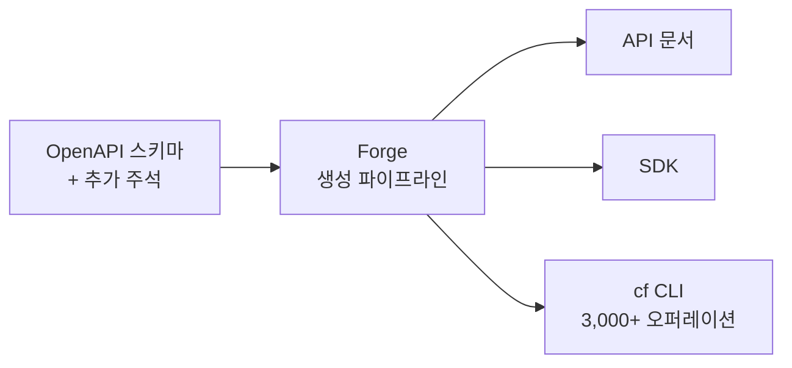

2026년 9월 28일 Cloudflare는 전체 API 표면을 다루는 새 명령줄 도구 `cf`를 오픈 베타로 공개했다. 신제품 CLI 자체는 특별한 뉴스가 아니지만, 이 글을 쓰게 만든 것은 출시 근거다. Cloudflare는 지난주 Wrangler 실행량의 48%가 사람이 아니라 코딩 에이전트에서 나왔다고 밝히며, 그래서 에이전트를 기본 사용자로 놓고 CLI를 다시 설계했다고 설명한다. 이 글은 공식 발표(Cloudflare Blog)에서 확인되는 사실과 설계 선택을 정리하고, 우리 도구에 적용할 때 무엇을 가져갈 만한지 판단 기준을 덧붙인다.

## 출시 배경: 에이전트가 CLI의 주 사용자가 된 숫자

Cloudflare 블로그가 제시한 수치는 세 가지다. 2026년 3월에는 Wrangler 사용의 4분의 1이 에이전트였고 1년 전에는 한 자릿수 비율이었으며, 발표 직전 주에는 48%에 도달했다. 또 에이전트는 사람보다 하루에 거의 두 배 많은 종류의 명령을 쓰고, 여섯 개 이상의 명령을 연쇄 실행할 확률이 거의 네 배 높다고 한다. 이 수치는 Cloudflare 자체 텔레메트리이며 외부에서 재현할 수 없다는 점은 감안해야 한다. 다만 방향성, 즉 CLI의 다수 호출자가 사람에서 에이전트로 이동하고 있다는 점은 다른 개발자 도구에서도 체감되는 흐름이다.

문제는 Wrangler가 약 280개 작업만 명령으로 제공하는 반면 Cloudflare 제품은 수천 개의 API 작업을 가진다는 격차였다. 에이전트가 CLI를 좋아하는데 CLI가 제품의 일부만 덮고 있으니, 나머지는 REST 호출을 직접 만들어야 했다.

## Forge: 스키마에서 CLI를 생성한다

Wrangler는 제품 팀마다 직접 손으로 만든 명령 모음이었고, 팀 간 일관성을 강제하기 어려웠다. 블로그는 `d1 info`, `hyperdrive get`, `workflows describe`처럼 같은 개념(조회)에 다른 동사가 쓰인 사례와, 수천 줄을 들였지만 거의 쓰이지 않는 맞춤 경험을 문제로 꼽는다.

해결책은 내부 API 생성 파이프라인 **Forge**다. 이미 API 문서와 SDK 생성에 쓰는 OpenAPI 스키마에 약간의 주석을 더해 CLI 명령을 생성한다. 그 결과 명령 범위가 약 280개에서 3,000개가 넘는 API 오퍼레이션 전체로 확장됐다. 설계 관점에서 중요한 것은 규모보다 <strong>단일 원천(single source of truth)</strong>이다. 문서, SDK, CLI가 같은 스키마에서 나오면 용어 불일치가 구조적으로 줄고, 에이전트가 학습하거나 검색해야 할 어휘도 하나가 된다.



## 에이전트를 위한 네 가지 설계 결정

### JSON이 기본 출력이다

에이전트는 Wrangler에서 거의 모든 명령에 `--json`을 붙이고 `jq`로 필요한 필드만 추렸다. 그런데 일부 명령은 `--json`을 지원하지 않고 사람용 유니코드 표를 내보냈다. 에이전트는 표를 해석할 수 있지만 시간과 토큰이 더 든다. `cf`는 반대로 기본값을 JSON으로 두고, 에이전트에게는 컨텍스트 절약을 위해 압축된 형태로 출력한다. 사람이 직접 입력을 줘야 하는 흐름(예: 도메인 구매)은 요구사항을 검증된 입력 항목으로 분해한 폼 형태로 제공한다고 한다.

### cf cli search로 명령을 찾는다

3,000개 명령을 `--help` 트리로 훑게 하면 컨텍스트가 터진다. `cf cli search`는 자연어로 하려는 일을 묻고, API 설명과 파라미터를 색인한 작은 검색 인덱스에서 후보 명령을 돌려준다. 에이전트가 처음 `--help`를 실행할 때 이 명령의 존재를 자동으로 알려준다는 점이 눈에 띈다. 도구가 스스로 사용법을 에이전트에게 주입하는 셈이다.

### cloudflare.config.ts로 설정을 타입 검사한다

설정 형식은 TOML/JSONC 대신 TypeScript다. 블로그의 논리는 이렇다. TOML에는 접근 가능한 스키마가 없고, JSONC는 스키마 링크가 있어도 에이전트가 거의 참조하지 않는다. 반면 TypeScript 설정은 Claude Code나 Codex처럼 LSP 플러그인을 쓰는 에이전트가 타입 정보를 읽고 더 정확하게 편집하게 해 준다. 공개된 예시는 다음 구조다.

```typescript
import { bindings, defineConfig, triggers } from "cf/config";

export default defineConfig(({ mode }) => ({
  worker: {
    name: "example-worker",
    env: {
      API_TOKEN: bindings.secret(),
      DATABASE: bindings.d1({ name: `example-${mode}-database` }),
    },
    triggers: [
      triggers.scheduled({ schedule: "0 * * * *" }),
    ],
  },
}));
```

`bindings`는 환경 변수·KV·D1·R2·큐 같은 바인딩을 에디터 자동 완성으로 발견하게 하고, `triggers`는 라우트·스케줄·큐·이메일처럼 Worker를 실행시키는 원인을 한 블록에 모은다. 환경별로 `env` 블록을 복사하던 방식 대신 `mode`로 하나의 기반 설정을 변형하므로, Cloudflare 내부에서는 5,000줄이 넘던 일부 Wrangler 설정이 40% 줄었다고 한다. 설정이 코드이므로 반복이 함수로 사라진다는 점은 이점이지만, 설정 파일이 실행 가능한 코드가 되면 정적 분석과 도구 연동이 단순 데이터 형식만큼 쉽지 않다는 비용도 따른다.

### Vite를 기본 개발 환경으로 둔다

Wrangler는 Vite가 없던 시절 esbuild와 자체 개발 서버(8787 포트)로 만들어졌다. `cf`는 Cloudflare Vite 플러그인을 기본으로 삼아 HMR과 Rolldown 기반 빌드를 활용한다. esbuild에 의존하는 JavaScript Worker와 Rust·Python Worker는 개발과 배포를 계속 Wrangler에 위임한다.

## 마이그레이션과 호환 전략

`cf migrate`는 이미 Vite로 빌드하는 Worker를 `cloudflare.config.ts`로 변환한다. esbuild에 의존하는 Worker는 빌드를 Wrangler에 위임하므로 당장 모든 프로젝트가 옮겨야 하는 것은 아니다. 공식 일정은 다음과 같다.

| 항목 | 내용 |
|---|---|
| 현재 상태 | 오픈 베타, `npm i -g cf`로 설치 |
| 신규 프로젝트 | `cf init`, 정적 사이트는 설정 파일 없이 `cf deploy` |
| 베타 종료 후 | Wrangler 최종 메이저 버전이 `cf`로 안내 |
| Wrangler 지원 | 베타 종료 후 18개월간 유지보수 |

흥미로운 부분은 "에이전트가 한 번도 본 적 없는 새 CLI"를 오히려 더 깨끗한 선택으로 본다는 점이다. 에이전트는 학습 데이터 속 옛 Wrangler 습관을 갖고 있어서, 같은 이름의 도구가 다르게 동작하면 오히려 혼란이 크다. 그래서 새 이름과 AGENTS.md 같은 컨텍스트 주입으로 구분을 명확히 한다는 논리다. 이 주장은 합리적이지만 Cloudflare의 설계 판단이지 검증된 결과는 아니다. 블로그에도 실험 수치는 없다.

## 우리 도구에 가져갈 수 있는 판단 기준

`cf`를 쓰지 않더라도 자기 CLI나 내부 도구를 만들 때 점검할 만한 항목이 있다.

- **기본 출력 형식**: 호출자의 다수가 에이전트라면 사람용 표가 아니라 구조화된 출력이 기본이어야 하는가. 사람용 출력은 TTY 감지로 분기할 수 있다.
- **명령 발견 경로**: 명령이 수백 개를 넘으면 `--help` 트리 탐색 대신 검색 인덱스가 필요하다. 도구가 첫 실행에서 검색 방법을 알려 주는 것까지 포함한다.
- **단일 스키마 원천**: 문서·SDK·CLI를 같은 스키마에서 생성하면 용어 일관성이 구조적으로 확보된다. 반대로 생성기 품질이 곧 CLI 품질이 되고, 수작업 UX가 필요한 흐름(폼 입력 등)은 별도 설계가 필요하다.
- **설정의 타입화**: LSP를 쓰는 에이전트가 많다면 타입 있는 설정이 편집 정확도를 높인다. 그러나 선언형 데이터의 단순함과 맞바꾸는 선택이다.
- **마이그레이션 비용**: 새 이름으로 갈아타는 전략은 에이전트 혼동을 줄이지만 사람 사용자의 학습 비용과 이중 유지보수 기간(여기서는 18개월)을 만든다.

반대로 아직 알려지지 않은 것도 있다. 3,000개 오퍼레이션 전체가 같은 품질로 다듬어졌는지, `cf cli search`의 검색 정확도가 어느 정도인지, 압축 JSON이 실제로 토큰을 얼마나 줄이는지는 발표문에 수치가 없다. 베타 단계이므로 운영 환경 자동화에 바로 넣기보다 읽기 전용 작업부터 에이전트에 맡겨 보는 쪽이 안전하다.

## 정리

`cf`의 핵심은 기능 추가가 아니라 가정의 전환이다. 사람이 쓰는 도구에 에이전트를 맞추던 방식에서, 에이전트가 기본 소비자라는 전제로 출력·탐색·설정을 다시 설계한 것이다. 같은 방향의 요구는 앞으로 다른 벤더의 CLI와 사내 도구에도 번질 가능성이 높다. 다만 현재 근거는 벤더 자체 발표 한 건이므로, 수치는 참고하되 자기 환경에서 호출 로그를 먼저 확인해 에이전트 비율을 측정해 보는 것이 순서다.

## 참고 및 출처

- [Introducing cf: the agentic CLI for the entire Cloudflare API (Cloudflare Blog, 2026-09-28)](https://blog.cloudflare.com/cloudflare-cf-cli-launch/)
- [Wrangler 문서 (Cloudflare Developers)](https://developers.cloudflare.com/workers/wrangler/)
- [Vite](https://vite.dev/)
