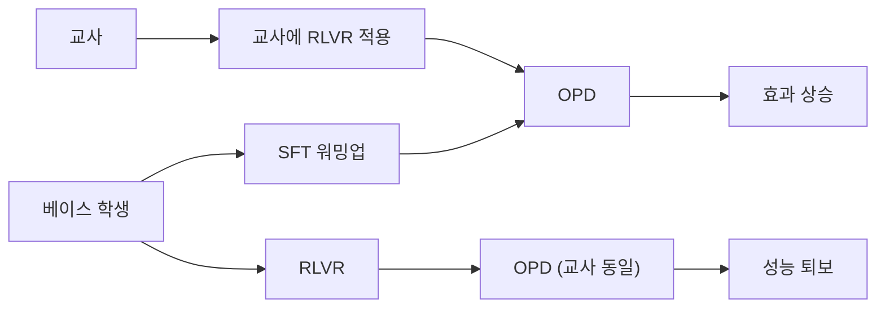

LLM 사후학습은 보통 지도 파인튜닝(SFT)으로 시작해 강화학습(RLVR)을 거치고, 필요하면 더 큰 모델에게서 증류(OPD)를 받는 식으로 단계를 쌓는다. 각 단계는 따로따로는 잘 연구되어 있지만, "이 순서로 쌓아도 되는가"는 상대적으로 덜 다뤄졌다. 2026-09-25에 arXiv에 올라온 "Understanding the Synergy between SFT, RLVR, and OPD in LLM Post-Training"(arXiv:2609.31900)은 바로 이 질문에 실험으로 답한다. 결론부터 말하면, 앞 단계가 뒤 단계를 오히려 방해할 수 있고, 순서와 조합을 바꾸는 것만으로 평균 정확도가 29.2%에서 43.8%로 올랐다.

## 세 단계가 각각 하는 일

**SFT(Supervised Fine-Tuning, 지도 파인튜닝)** 는 정답 예시를 모방하도록 모델을 학습시킨다. 형식과 기본 추론 패턴을 빠르게 익히게 하지만, 예시에 없는 문제에서의 탐색 능력은 제한적이다.

**RLVR(Reinforcement Learning with Verifiable Rewards, 검증 가능한 보상 강화학습)** 은 수학 정답이나 코드 실행 결과처럼 자동으로 채점할 수 있는 보상을 써서 모델이 스스로 추론 경로를 탐색하게 한다. 모델 자신의 출력 분포가 보상 방향으로 이동한다.

**OPD(On-Policy Distillation, 온폴리시 증류)** 는 학생 모델이 직접 생성한 응답에 대해 교사 모델이 토큰 단위로 피드백을 주는 방식이다. 교사의 정답 문장을 그대로 따라 쓰는 일반 증류와 달리, 학생이 실제로 가는 경로 위에서 지도를 받기 때문에 분포 불일치가 줄어든다.

세 방법 모두 "모델을 좋게 만든다"는 점은 같지만, 다음 단계가 받아들이는 입력(모델의 출력 분포)을 서로 다르게 바꾼다. 이 논문의 핵심 관점은 여기에 있다.

## 실험 설계

저자들(Acikgoz, Li, Liu, Bansal, Hakkani-Tür, Joty, Yavuz)은 Qwen3 계열 모델로 수학·과학 추론 과제를 다뤘다. 학생과 교사의 파라미터 비율이 2배부터 53배까지 걸치는 학생–교사 쌍 9개를 구성해, 단계 조합을 바꿔 가며 OPD 이후의 정확도를 비교했다.

## 주요 결과

논문이 보고한 발견은 다섯 가지로 요약된다.

| 발견 | 내용 |
|---|---|
| 호환성 > 규모 | OPD의 성공은 교사의 크기보다 학생–교사 호환성에 더 좌우된다 (2×~53× 범위) |
| SFT 워밍업 | 짧은 SFT 워밍업을 거치면 이후 OPD가 좋아진다 |
| RLVR 학생의 퇴보 | RLVR로 강화된 학생은 같은 교사로부터 OPD를 받으면 오히려 성능이 떨어진다 |
| 교사 적응 | 교사를 RLVR로 적응시키면, 교사가 얻은 능력에 비례해 OPD 정확도가 오른다 |
| 조합 효과 | 교사 적응 + 학생 워밍업으로 OPD 평균 정확도가 29.2% → 43.8% (상대 약 50% 향상), 증류 스텝 수는 동일 |

또 하나의 결과는 반대 방향의 순서다. 비슷한 정확도 수준에서 비교하면, OPD를 거친 모델이 SFT를 거친 모델보다 이후 RLVR의 더 나은 출발점이 되며, RL 연산량이 늘수록 그 격차가 커진다.

## 왜 이런 일이 생기는가: 해석

아래는 논문 결과에 대한 필자의 해석이며, 논문이 이 메커니즘을 증명했다는 뜻은 아니다. 논문이 직접 말하는 것은 마지막 문장에 있다. 각 단계는 "그 단계가 더하는 능력"뿐 아니라 "다음 단계에 어떤 학습 인터페이스를 남기는가"로 평가해야 한다는 것이다.

RLVR을 거친 학생은 자기 출력 분포가 보상 방향으로 이미 날카롭게 바뀌어 있다. 이 상태에서 교사의 토큰 단위 신호를 받으면, 교사가 선호하는 분포와 학생이 굳힌 분포가 충돌할 수 있다. 반대로 짧은 SFT 워밍업은 학생이 교사와 비슷한 형식·어휘 영역에서 응답을 생성하게 만들어, 교사의 피드백이 의미 있는 위치에 닿게 해 줄 가능성이 있다. 교사를 RLVR로 먼저 강화하는 쪽은 "더 좋은 신호원"을 만드는 것이라 직관적이다.

## 실무에서 어떻게 쓸 것인가

이 결과를 자기 파이프라인에 적용할 때는 다음 정도를 판단 기준으로 삼을 수 있다.

- 단계를 추가하기 전에, 직전 단계 이후 모델에서 다음 단계를 돌렸을 때 기준선보다 나빠지지 않는지 먼저 확인한다. 단계별 성능이 아니라 단계 쌍의 상호작용을 측정해야 한다.
- 증류용 교사는 크기만으로 고르지 말고, 학생과의 호환성을 작은 규모 실험으로 확인한다.
- 증류를 쓸 계획이라면 학생을 RLVR로 먼저 밀기보다 짧은 SFT 워밍업을 앞에 두는 구성을 후보에 넣는다.

한계도 분명하다. 실험은 Qwen3 계열과 수학·과학 추론에 한정되어 있다. 코드, 장문 에이전트 과제, 다른 모델 계열에서 같은 순서 효과가 재현되는지는 이 논문만으로 알 수 없다. 또 위 수치는 논문 초록과 요약 기준이며, 개별 학생–교사 쌍별 편차는 원문 표를 확인해야 한다.

## 정리

- 사후학습 단계는 독립적이지 않다. 앞 단계가 뒤 단계의 효과를 줄일 수 있다.
- OPD에서는 교사 크기보다 학생–교사 호환성이 중요하다.
- 교사 적응(RLVR) + 학생 워밍업(SFT)으로 같은 증류 스텝에서 평균 정확도 29.2% → 43.8%를 얻었다.
- 단계는 "얼마나 능력을 더하는가"뿐 아니라 "다음 단계에 어떤 출발점을 남기는가"로 선택한다.

## 참고 자료

- Acikgoz et al., "Understanding the Synergy between SFT, RLVR, and OPD in LLM Post-Training", arXiv:2609.31900 (2026-09-25): <https://arxiv.org/abs/2609.31900>
