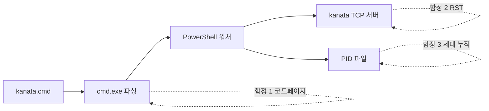
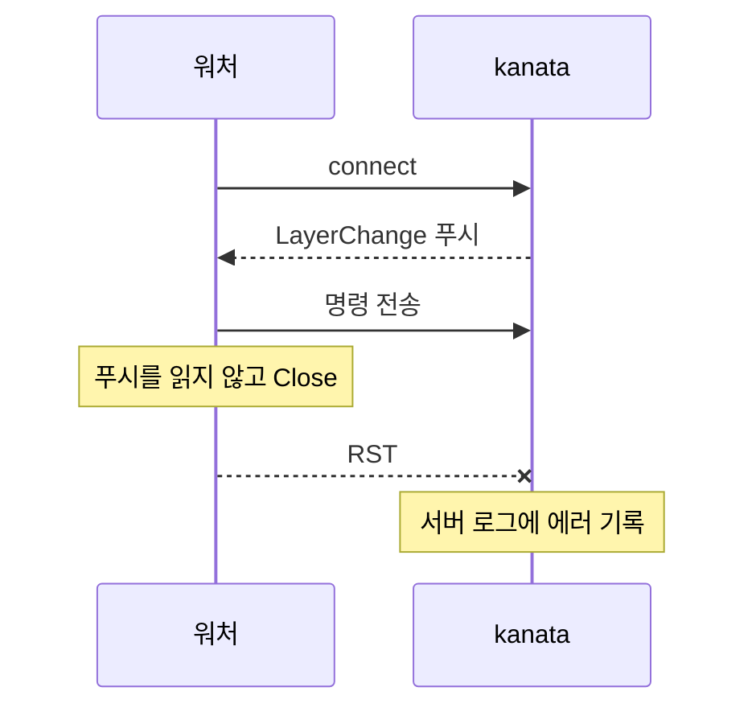

Windows에서 상주 프로세스를 하나 관리하려고 서비스나 별도 `.ps1`을 만들기는 번거로울 때가 있다. 그럴 때 흔히 `.cmd` 파일 하나에 `start "" /min powershell ...`로 백그라운드 워처를 인라인으로 심어 두는 방식을 쓴다. 배포가 파일 하나 복사로 끝난다는 장점이 크다. 하지만 이 방식은 눈에 잘 띄지 않는 실패 모드를 세 가지 가지고 있다.

이 글은 키보드 리매퍼 [kanata](https://github.com/jtroo/kanata)를 감싼 `bin/kanata.cmd`에 원격 데스크톱(mstsc) 포커스 전환 감지 워처를 추가하면서 순서대로 만난 세 함정을 정리한 것이다. 원인 확인과 수정은 [42jerrykim/hotkey PR #2](https://github.com/42jerrykim/hotkey/pull/2)의 작업에서 직접 재현하고 재검증한 내용이다. 이 글을 읽고 나면 "스크립트가 이유 없이 토막 나서 실행된다", "서버 로그에 정체 모를 연결 에러가 쌓인다", "같은 이벤트가 두 번씩 처리된다"라는 세 증상을 각각 어디서부터 의심해야 하는지 판단할 수 있다.

---

## 세 함정의 위치

세 문제는 서로 다른 계층에서 일어난다. 하나는 cmd.exe가 파일을 읽는 단계, 하나는 TCP 연결을 닫는 단계, 하나는 프로세스 생명주기를 추적하는 단계다.



## 함정 1 — cmd.exe는 배치 파일을 시스템 코드페이지로 읽는다

**증상**: 한 줄짜리 긴 PowerShell 인라인 명령 안에 한글 로그 메시지를 넣었더니 스크립트가 통째로 실행되지 않았다. 출력은 `'_DIR:~0' is not recognized...`, `'watcher.pid"' is not recognized...`처럼 명령이 토막 난 채로 해석된 모습이었다. 문법 오류처럼 보이지만 실제 원인은 인코딩 불일치였다.

**원인**: cmd.exe는 배치 파일 내용을 콘솔의 활성 코드페이지로 해석한다. 한국어 Windows의 기본은 CP949인데, 파일을 UTF-8로 저장하고 한글을 직접 넣으면 UTF-8 멀티바이트 시퀀스가 CP949 바이트로 잘못 읽힌다. 이 어긋남이 따옴표나 구분 문자를 먹어 버리면 긴 줄의 파싱 경계가 무너진다. 비슷한 계열의 현상은 Microsoft의 Raymond Chen도 "배치 파일이 쓰레기 문자를 출력하는 이유"로 설명한 바 있다. 그 글의 사례는 UTF-16LE의 BOM이 ANSI 코드페이지로 해석된 경우로, 원인은 다르지만 "cmd는 파일 인코딩을 스스로 알아내지 않고 활성 코드페이지를 따른다"는 점은 같다 ([The Old New Thing](https://devblogs.microsoft.com/oldnewthing/20210726-00/?p=105483)).

**해법은 두 가지**다.

1. 배치 파일 안의 문자열을 순수 ASCII로만 쓴다. 가장 안전하며, 이 사례에서는 한글 로그 메시지를 영어로 바꿨다.
2. 파일을 UTF-8로 유지하려면 맨 앞에 `chcp 65001`을 둔다. 다만 `chcp`는 콘솔 전체의 코드페이지를 바꾸므로 같은 콘솔에서 실행되는 다른 도구에 영향을 줄 수 있다는 점을 감안해야 한다.

```bat
@echo off
rem 옵션 2: UTF-8로 해석하도록 명시 (콘솔 전체에 영향)
chcp 65001 >nul
```

범위를 정확히 해 두자. 문제는 cmd.exe가 직접 렉싱하는 `.bat`/`.cmd` 본문에만 있다. `.kbd`나 `.md`처럼 cmd가 파싱하지 않는 파일에서는 한글을 써도 상관없다.

## 함정 2 — 응답을 읽지 않고 소켓을 닫으면 RST가 나간다

**증상**: 포커스 전환마다 kanata 서버 로그에 `client sent an invalid message... (os error 10053/10054)`가 쌓였다. 프로토콜 메시지를 잘못 보낸 적은 없었다.

**원인**: kanata의 TCP 서버는 클라이언트가 연결되면 현재 레이어 상태를 알리는 `{"LayerChange":{"new":"base"}}` 같은 메시지를 먼저 푸시한다 (프로토콜은 [kanata config.adoc](https://github.com/jtroo/kanata/blob/main/docs/config.adoc) 참고). 워처는 명령만 쏘고 곧장 `$client.Close()`를 불렀는데, 이때 수신 버퍼에 읽지 않은 서버 푸시가 남아 있었다. 수신 버퍼에 읽지 않은 데이터가 남은 채로 소켓을 닫으면 정상적인 FIN 종료 대신 RST가 나가는 동작은 Microsoft 지원 문서에서도 확인된다 ([Microsoft Support](https://support.microsoft.com/en-us/topic/fix-an-rst-packet-is-sent-unexpectedly-from-a-tcp-server-that-runs-on-a-windows-embedded-compact-7-based-device-after-a-socket-connection-is-closed-0285ecd8-f663-3ecc-876a-4cd227f41d7d)). 서버는 이 RST를 에러로 기록했다.

두 에러 코드는 Winsock 정의상 다르다. 10053은 WSAECONNABORTED(로컬에서 연결 중단), 10054는 WSAECONNRESET(상대가 강제로 닫음)다 ([Microsoft Learn](https://learn.microsoft.com/en-us/windows/win32/winsock/windows-sockets-error-codes-2)). 이 사례에서는 두 코드가 모두 "응답을 안 읽고 닫았다"는 같은 원인의 다른 얼굴이었다.



**해법**은 `Write`/`Flush` 뒤에 남은 데이터를 읽어 비운 다음 닫는 것이다. 서버가 응답 크기를 예측할 수 없다면 루프에 상한을 둔다.

```powershell
$client = New-Object System.Net.Sockets.TcpClient('127.0.0.1', $port)
$stream = $client.GetStream()
$bytes  = [Text.Encoding]::UTF8.GetBytes($payload)
$stream.Write($bytes, 0, $bytes.Length)
$stream.Flush()

# 서버가 먼저 푸시한 데이터를 비운 뒤에 닫는다
$buf = New-Object byte[] 4096
$drainGuard = 0
Start-Sleep -Milliseconds 50
while ($stream.DataAvailable -and $drainGuard -lt 16) {
    [void]$stream.Read($buf, 0, $buf.Length)
    $drainGuard++
}
$client.Close()
```

fire-and-forget처럼 보이는 TCP 클라이언트라도, 서버가 먼저 무언가를 밀어 주는 프로토콜이라면 그 푸시를 소비하고 닫아야 한다. 응답 수신을 아예 건너뛰는 단순화는 소용이 없다. 읽지 않은 데이터가 남는 한 RST는 피할 수 없기 때문이다. 한계도 있다. 상한(`drainGuard`)을 넘는 대량 응답은 여전히 불완전하게 비워질 수 있다.

## 함정 3 — PID 파일은 최신 세대만 기억한다

**증상**: 같은 mstsc 포커스 전환 하나에 TCP 연결이 약 60ms 간격으로 두 번씩 거의 동시에 발생했다. 워처의 폴링 주기는 250ms라서, 한 워처가 같은 이벤트를 두 번 처리했을 가능성은 낮았다. 여러 세대의 워처가 동시에 살아 있다는 뜻이었다.

**원인**: 흔한 정리 방식은 워처가 자기 PID를 파일 하나에 적어 두고, 종료 시 그 파일을 읽어 `taskkill`하는 것이다. 이 파일에는 항상 가장 최근에 기록된 PID 하나만 있다. 상위 프로세스가 끝까지 도달하지 못하고 죽으면(작업 관리자 강제 종료, 콘솔 창 닫기 등) 끝부분의 정리 코드가 실행되지 않아 워처가 고아로 남는다. 스크립트를 다시 실행하면 새 워처가 PID 파일을 덮어쓰고, 이전 세대는 어디에도 PID가 남지 않은 채 계속 산다. 비정상 종료가 반복될수록 세대가 누적된다.

**해법**은 PID 대신 **명령줄 내용을 마커로 삼는 것**이다. 시작 시점에 마커가 들어간 프로세스를 전부 찾아 종료하면 몇 세대가 쌓여 있어도 한 번에 정리된다.

```powershell
# 마커는 이 스크립트에만 쓰이는 고유한 타입/API 이름으로 잡는다
$marker = '*Win32Focus*'
Get-CimInstance Win32_Process |
    Where-Object { $_.CommandLine -like $marker -and $_.ProcessId -ne $PID } |
    ForEach-Object { Stop-Process -Id $_.ProcessId -Force }
```

이 사례에서는 더미 마커 프로세스 두 개를 띄워 둘 다 잡히는지까지 확인했다. 위 코드의 `$_.ProcessId -ne $PID` 조건은 이 글을 쓰며 덧붙인 방어 코드다. 정리를 수행하는 PowerShell 프로세스의 명령줄에도 마커 문자열이 들어 있을 수 있기 때문에 자기 자신을 제외해 두는 편이 안전하다.

트레이드오프는 분명하다. 명령줄 매칭은 PID보다 약한 식별자라, 우연히 같은 문자열을 포함한 무관한 프로세스를 오탐으로 종료할 이론적 가능성이 있다. 마커를 흔한 단어가 아니라 이 스크립트 고유의 타입 이름으로 잡는 것이 완화책의 전부다.

## 정리

| 함정 | 증상 | 원인 | 해법 | 남는 한계 |
|------|------|------|------|-----------|
| 코드페이지 | 긴 줄이 토막 나 실행 실패 | cmd가 활성 코드페이지(CP949)로 파싱 | ASCII 전용 또는 `chcp 65001` | `chcp`는 콘솔 전체에 영향 |
| TCP RST | 서버 로그에 10053/10054 | 읽지 않은 푸시가 남은 채 Close | Close 전 드레인 | 대량 응답은 상한 때문에 불완전 |
| PID 파일 | 같은 이벤트가 중복 처리 | 최신 PID 하나만 기억 | 명령줄 마커로 일괄 종료 | 오탐 종료 가능성 |

세 문제의 공통점은 "빠르게 짜서 잘 도는 것처럼 보이는 스크립트"와 "여러 번 재시작되고 프로세스가 얽히는 실제 운영 환경" 사이의 간극이다. 각각의 수정은 국소적이었지만, 인라인 구성을 유지하는 한 이 간극을 메우는 것은 작성자의 몫이다. 별도 `.ps1`로 분리하면 cmd의 이스케이프와 코드페이지 문제 상당수는 피할 수 있지만, 이 사례에서는 파일 하나로 배포한다는 요구가 우선이어서 인라인을 유지했다. 따라서 인라인을 쓸지 분리할지는 배포 단순성과 디버깅 비용 중 무엇이 더 중요한지로 판단하면 된다.

## 참고 및 출처

- [Diagnosing why your batch file prints a garbage character — The Old New Thing](https://devblogs.microsoft.com/oldnewthing/20210726-00/?p=105483)
- [Windows code page — Wikipedia](https://en.wikipedia.org/wiki/Windows_code_page)
- [RST packet sent unexpectedly after a socket connection is closed — Microsoft Support](https://support.microsoft.com/en-us/topic/fix-an-rst-packet-is-sent-unexpectedly-from-a-tcp-server-that-runs-on-a-windows-embedded-compact-7-based-device-after-a-socket-connection-is-closed-0285ecd8-f663-3ecc-876a-4cd227f41d7d)
- [Windows Sockets Error Codes — Microsoft Learn](https://learn.microsoft.com/en-us/windows/win32/winsock/windows-sockets-error-codes-2)
- [kanata config.adoc](https://github.com/jtroo/kanata/blob/main/docs/config.adoc)
- [42jerrykim/hotkey PR #2](https://github.com/42jerrykim/hotkey/pull/2)
