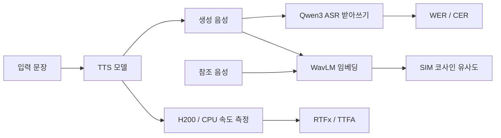

음성합성(TTS) 모델은 Hugging Face Hub에만 8,000개가 넘게 올라와 있는데, 어떤 모델이 좋은지 비교하는 기준은 여전히 흩어져 있습니다. 2026년 9월 30일 Hugging Face가 공개한 [Open TTS Leaderboard](https://huggingface.co/spaces/hf-audio/open_tts_leaderboard)는 사람 투표 대신 자동 측정 지표로 모델을 평가하겠다는 접근입니다. 이 글은 무엇을 어떻게 재는지, 그 수치가 무엇을 말해 주고 무엇을 말해 주지 않는지 정리합니다.

## 아레나 방식의 병목

TTS 평가의 기준은 사람의 선호입니다. MOS나 MUSHRA 같은 청취 점수가 대표적이고, [TTS Arena V2](https://huggingface.co/spaces/TTS-AGI/TTS-Arena-V2) 같은 아레나는 두 모델의 출력을 나란히 들려주고 고르게 한 뒤 Bradley–Terry 모델로 **Elo(엘로 점수)** 를 계산합니다. 정확하지만 투표가 충분히 쌓여야 순위가 나오므로 새 모델 하나를 평가하는 데 몇 주가 걸립니다.

HF 블로그는 구조적 편향도 지적합니다. 2026-09-30 기준 Artificial Analysis에 오른 92개 모델 중 오픈 웨이트는 16개뿐입니다. API 모델은 키 하나면 추가되지만, 오픈 모델은 운영자가 직접 호스팅해야 하고 상용 업체는 노출될 동기가 더 크기 때문이라는 설명입니다. 또 투표자 집단과 "더 낫다"의 기준이 시간에 따라 일정하다는 보장이 없다는 점도 한계로 듭니다.

## 세 가지 객관 지표

Open TTS Leaderboard는 서로 보완적인 세 축을 자동으로 측정합니다.

| 축 | 지표 | 측정 방법 |
|---|---|---|
| 명료도 | WER / CER | 입력 문장과, 생성된 음성을 Qwen3 ASR로 받아쓴 결과의 오류율 |
| 속도 | RTFx, TTFA | H200 GPU에서 배치 오프라인 추론 RTFx, 배치 크기 1의 첫 오디오까지 시간 TTFA(GPU·CPU) |
| 화자 유사도 | SIM | 생성 음성과 참조 음성의 WavLM 화자 임베딩 코사인 유사도 |

명료도는 **ASR을 심판으로 쓰는** 방식입니다. 합성음을 음성인식기가 정확히 받아쓰면 발음이 또렷하다고 보는 것이고, 심판으로는 Open ASR Leaderboard 상위 오픈소스 모델인 Qwen3 ASR을 씁니다. 중국어·일본어·한국어처럼 글자 단위로 평가하는 언어는 WER 대신 CER을 보고하며, 언어 평균은 언어 간 매크로 평균입니다.

속도는 두 얼굴입니다. RTFx는 실시간보다 몇 배 빠르게 합성하는지(처리량)이고, TTFA는 사용자가 요청한 뒤 재생 가능한 소리가 나오기까지의 대기 시간(지연)입니다. 음성 에이전트처럼 대화형 앱에는 TTFA가 결정적입니다. 스트리밍을 지원하지 않는 모델은 발화 전체가 끝나야 재생할 수 있으므로 전체 생성 시간이 TTFA가 됩니다. 스트리밍 탭은 CV3-Eval의 영어 프롬프트 50개를 기본 음성·배치 1로 돌리고, 처음 3회를 워밍업으로 버린 뒤 중앙값을 보고합니다.

## 리더보드 읽는 법

기본 화면은 영어 Seed TTS Eval과 CV3 Eval(zero-shot) 두 분할의 매크로 평균 WER 순입니다. 블로그 기준으로 영어 WER 상위는 hexgrad/[Kokoro-82M](https://huggingface.co/hexgrad/Kokoro-82M), Supertone/supertonic-3, fishaudio/s2-pro입니다. 82M 규모의 작은 모델이 맨 앞에 있다는 점이 눈에 띄는데, 그래서 WER·RTFx·모델 크기를 함께 놓은 파레토(Pareto) 그림이 의미가 있습니다. 한 지표의 1등보다 균형이 좋은 모델을 고르는 데 쓰라는 뜻입니다.

다국어 순위는 영어와 다릅니다. Seed TTS Eval은 영어와 중국어 음성만 있어서 그 밖의 언어는 CV3 Eval 점수만으로 매깁니다. 블로그는 k2-fsa/OmniVoice, fishaudio/s2-pro, Fun-CosyVoice3-0.5B를 강한 다국어 모델로 꼽고, 영어 성능이 다른 언어 성능의 대리 지표가 되지 못한다고 명시합니다. 한국어 서비스를 고르는 입장이라면 영어 기본 화면 순위를 그대로 믿지 말고 언어 토글을 바꿔 확인해야 합니다. 보이스 클로닝 토글을 켜면 해당 기능을 지원하는 모델만 남고 SIM 열이 생기며, higgs-tts-3-4b나 VoxCPM2처럼 참조 음성이 주어지면 평균 WER이 개선되는 모델도 있습니다. 스트리밍 쪽에서는 kyutai/pocket-tts가 GPU와 CPU 모두에서 좋은 결과로 소개됩니다.

## 이 수치가 말하지 못하는 것

HF 팀 스스로 이 리더보드가 사람 선호 평가를 대체하지 않는다고 못 박습니다. WER은 명료도의 대리 지표일 뿐이고 SIM은 목소리 정체성 보존의 추정치입니다. 둘 다 **자연스러움, 감정 표현, 청취 선호**를 직접 재지 않습니다. 몇 가지 구조적 주의점도 있습니다.

- ASR 심판의 편향: 같은 ASR이 모든 모델을 채점하므로 상대 비교는 일관되지만, ASR이 잘 받아쓰는 또박또박한 발화에 유리하고 억양이 풍부한 발화를 손해 볼 수 있습니다. 이는 방법의 구조에서 오는 추론이며 블로그가 수치로 검증한 내용은 아닙니다.
- 속도는 H200 기준: 개인 GPU나 엣지 기기에서 순위가 같다고 가정하면 안 됩니다. CPU 결과는 일부 모델에만 있습니다.
- 데이터셋 범위: 평가 문장이 Seed TTS Eval·CV3 Eval에 한정되므로 도메인 특화 문장(전문 용어, 숫자 읽기)의 품질은 별도 확인이 필요합니다.

그래서 이 리더보드는 후보를 빠르게 좁히는 1차 필터로 쓰고, 최종 선택은 직접 듣는 것으로 마무리하는 편이 안전합니다. 이를 위해 Listen 탭이 지표 뒤에 있는 실제 출력을 들어 보고 피드백을 남기게 해 줍니다. 로컬에서 직접 벤치마크를 돌리고 싶다면 TTS 55종을 속도·청취·UTMOS/WER/SIM으로 비교하는 독립 도구 [tts-bench](https://github.com/5uck1ess/tts-bench)가 상호보완적입니다.

## 정리

| 질문 | 어디를 볼까 |
|---|---|
| 또박또박 읽는 모델은? | 영어/언어별 WER·CER 순위 |
| 내 목소리를 닮게 복제하나? | 보이스 클로닝 토글의 SIM |
| 대화형 앱에 쓸 만큼 빠른가? | Streaming 탭의 TTFA (GPU/CPU) |
| 크기 대비 효율은? | WER–RTFx–크기 파레토 그림 |
| 실제로 듣기 좋은가? | Listen 탭에서 직접 청취 |

핵심은 "자동 지표로 후보를 몇 시간 만에 걸러 내고, 사람의 귀로 마무리한다"는 분업입니다. HF는 평가 스크립트를 곧 오픈소스로 공개해 데이터셋·모델·지표 제안을 GitHub 이슈와 PR로 받겠다고 밝혔으니, 한국어 평가 데이터가 부족하다고 느낀다면 그곳이 의견을 낼 자리입니다.

## 참고 및 출처

- [Hugging Face Blog, "Open TTS Leaderboard: Scalable Evaluation for Multilingual Text-to-Speech and Voice Cloning" (2026-09-30)](https://huggingface.co/blog/open-tts-leaderboard)
- [Open TTS Leaderboard 스페이스](https://huggingface.co/spaces/hf-audio/open_tts_leaderboard)
- [Open ASR Leaderboard](https://huggingface.co/spaces/hf-audio/open_asr_leaderboard)
- [Seed-TTS-Eval](https://github.com/BytedanceSpeech/seed-tts-eval)
- [TTS Arena V2](https://huggingface.co/spaces/TTS-AGI/TTS-Arena-V2)
- [kyutai/pocket-tts](https://huggingface.co/kyutai/pocket-tts)
- [5uck1ess/tts-bench](https://github.com/5uck1ess/tts-bench)
