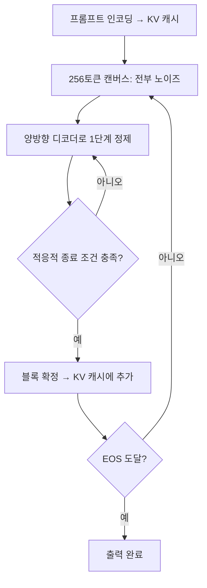

LLM 응답 속도의 상한은 오래도록 "토큰 하나를 만들려면 순전파(forward pass)를 한 번 돌려야 한다"는 구조가 결정해 왔습니다. Google DeepMind가 2026년 7월 31일 arXiv에 올린 **DiffusionGemma**(arXiv:2608.00146)는 이 전제를 정면으로 건드립니다. 텍스트를 왼쪽에서 오른쪽으로 한 토큰씩 쓰는 대신, 256토큰짜리 블록을 통째로 놓고 여러 번 고쳐 쓰는 방식입니다. 이 글은 기술 보고서가 밝힌 원리와 수치, 그리고 보고서 스스로 인정한 한계를 정리해, "빠르다"는 주장을 어떤 조건에서 믿어야 하는지 판단할 근거를 제공합니다.

---

## 배경: 자기회귀 디코딩의 병목

**자기회귀(Autoregressive, AR)** 모델은 이전 토큰들에 조건을 걸어 다음 토큰의 분포를 예측합니다. 출력 N토큰에는 순전파 N회가 필요하고, 각 순전파는 매번 모델 가중치를 메모리에서 읽어야 하므로 배치가 작을 때는 연산이 아니라 메모리 대역폭이 병목이 됩니다. 이 순차성을 줄이려는 기존 접근이 **추측적 디코딩(Speculative Decoding)** 과 **다중 토큰 예측(MTP)** 입니다. 작은 초안 모델이나 추가 헤드가 여러 토큰을 미리 제안하고 큰 모델이 한 번에 검증하는 방식인데, 보고서는 최신 추측적 디코딩이 순전파당 대략 3–6토큰 수준이라고 소개합니다.

**이산 확산(Discrete Diffusion)** 언어모델은 다른 길을 택합니다. 일부 위치를 마스크하거나 노이즈로 오염시킨 토큰 열을 만들고, 모델이 그 전체를 양방향 문맥으로 복원하도록 학습합니다. 생성 시에는 노이즈가 낀 블록에서 시작해 여러 단계에 걸쳐 확신이 높은 위치부터 확정해 나갑니다. 한 단계에서 여러 위치가 동시에 확정되므로 토큰 수 대비 순전파 횟수가 줄어듭니다.

## DiffusionGemma의 구성

모델은 처음부터 확산 모델로 사전학습한 것이 아닙니다. 후학습된 **Gemma 4 26B A4B**(총 25.2B, 토큰당 활성 약 3.85B인 MoE)를 출발점으로 삼아, 원래 AR 모델 총 학습 토큰의 10% 미만으로 확산 방식에 맞게 바꿨습니다. 그래서 "기존 AR 모델을 확산 디코더로 개조"하는 레시피 자체가 이 보고서의 핵심 기여 중 하나입니다.

학습은 두 단계입니다.

1. **SFT**: 256토큰 캔버스를 양방향으로 디노이징하도록 크로스 엔트로피 손실로 학습합니다. 블록 대각 어텐션 마스크를 써서 프롬프트는 캐시로 두고 현재 블록 안에서만 양방향 어텐션이 일어납니다.
2. **SD·RL(Sampler Distillation + RL)**: 보상 최대화와 샘플러 증류를 하나의 온라인 목적으로 묶습니다. SFT 모델이 교사가 되어, 적은 디노이징 단계로도 같은 품질에 도달하도록 가르칩니다.

샘플러 설정도 보고서에 구체적으로 나옵니다. 캔버스 길이 256, 최대 48 디노이징 단계, 온도는 0.8에서 0.4로 선형 감쇠, 적응적 종료 임계값 0.005이며, 실제로는 평균 약 12 단계에서 끝나 지연시간이 약 4배 줄어든다고 합니다. 단계당 비용은 캔버스 순전파가 약 12.6ms로 단일 토큰 AR 순전파(약 4.0ms)보다 크지만, 단계 수가 적고 한 번에 확정하는 토큰이 많아 전체로는 이득이라는 논리입니다.

## 수치: 속도와 정확도의 교환

보고서는 H100 1장, FP8, 배치 크기 1 조건의 수치를 제시합니다.

| 모델 | 출력 속도(tok/s) | 비고 |
|---|---|---|
| Gemma 4 AR | 204 | 기준선 |
| Gemma 4 + MTP | 303 | 다중 토큰 예측 |
| Mercury 2 | 600 (high) / 547 (medium) | 폐쇄 API 확산 모델 |
| DiffusionGemma | 약 1,479 | 순전파당 약 19.7토큰 |

AR 대비 약 7.1배, MTP 대비 약 4.8배, Mercury 2 대비 약 2.5배입니다. 위키 등에서 흔히 "초당 약 1,500토큰"으로 반올림해 인용되지만 정확한 평균은 1,479 tok/s입니다.

정확도는 이야기가 다릅니다. 사고(thinking) 모드의 Table 3을 보면 DiffusionGemma가 대부분 열세입니다.

| 벤치마크 | DiffusionGemma | Gemma 4 AR | Gemma 4 AR + MTP |
|---|---|---|---|
| AIME 2026 | 69.1 | 84.2 | 88.3 |
| GPQA Diamond | 73.2 | 79.8 | 82.3 |
| LiveCodeBench-v6 | 69.1 | 71.4 | 77.1 |
| GSM8K | 96.3 | 96.6 | 96.7 |
| HumanEval | 94.5 | 98.2 | 98.8 |
| Tau2 Retail | 71.5 | 75.4 | 85.5 |

GSM8K처럼 쉬운 과제는 거의 차이가 없지만 AIME 2026은 15점 안팎 떨어집니다. 추론 난도가 올라갈수록 병렬 확정의 대가가 커지는 경향으로 읽을 수 있습니다. 다만 이는 표의 숫자에서 읽은 해석이며, 원인을 보고서가 이렇게 단정한 것은 아닙니다. 공개 확산 모델과의 비교도 있습니다. GPQA Diamond 기준 DiffusionGemma 73.2%는 LLaDA 2.1 Flash 100B(68.7%, 375 tok/s)와 Nemotron Diffusion 14B(47.0%, 49 tok/s)보다 높고, 폐쇄 API인 Mercury 2(75.2%, 600 tok/s)보다는 약간 낮으면서 더 빠릅니다. 이 비교는 보고서 본문이 아닌 2차 요약(arXiv 해설 뉴스레터)에서 확인한 수치이므로 원문 표로 재확인하는 편이 안전합니다.

## SD·RL이 한 일

SFT만 거친 체크포인트는 48단계를 쓰는데도 순전파당 확정 토큰이 약 5개에 그쳤습니다. 샘플러 증류와 RL을 결합하자 이 값이 거의 20으로 올랐고, GPQA-Diamond와 LiveCodeBench-v6 평균도 약 10점 개선됐다고 합니다. 속도 목적의 증류가 품질까지 올린 셈인데, 부작용도 있습니다. 응답 길이가 SFT 체크포인트 대비 약 절반으로 줄었습니다. 긴 사고 사슬(chain-of-thought)이 필요한 과제에서는 이 짧아진 출력이 성능 한계로 작용할 수 있습니다.

## 한계와 읽을 때의 주의점

- **배치 의존성**: 속도 이점은 동시 요청이 약 32개 이하인 저·중 동시성 구간에 집중됩니다. 배치가 커지면 GPU가 연산 바운드가 되어 AR 모델이 따라잡습니다. 즉 이 수치는 "개인용 로컬 추론, 낮은 동시성 에이전트 루프"에 가장 잘 맞고, 대규모 서빙의 처리량 비용을 낮춘다는 보장은 아닙니다. 보고서도 대배치 서빙 최적화는 아직이라고 밝힙니다.
- **정확도 열세**: 위 표처럼 AR 기준선보다 낮습니다. 원인으로는 AR 가중치에서의 웜 스타트, 제한된 SFT 연산, 지연 중심 SD·RL 목적이 거론됩니다.
- **생성 아티팩트**: 단계 예산이 빡빡하면 국소적인 토큰 반복이 나타날 수 있고, 멀티모달 설정에서 생각 종료 태그를 빠뜨려 자동 파싱이 깨지는 경우가 보고됩니다.
- **자체 보고**: 수치는 DiffusionGemma Team의 기술 보고서에서 나온 것이며, 독립 재현은 제가 확인한 범위에서는 없었습니다. 모델은 스스로 실험적이라고 규정합니다.
- **AR 모드 폴백**: 같은 가중치로 AR 모드 실행도 가능하며 성능 손실은 작다고 하는데, 보고서 일부 표에서 구체 수치를 확인하지 못했습니다. 저자들은 이를 확산·AR 혼합 디코딩의 가능성으로 해석합니다.

## 어떤 상황에서 눈여겨볼 만한가

| 상황 | 판단 |
|---|---|
| 단일 GPU, 동시 요청 적음, 응답 지연이 중요 | 후보로 검토할 가치 있음 |
| 수학·코드 추론 정확도가 최우선 | AR 기준선(또는 MTP 적용)이 여전히 유리 |
| 대규모 다중 사용자 서빙 | 배치가 커지면 이점 소멸, 현시점 비권장 |
| 확산 LM 연구·파인튜닝 실험 | 오픈웨이트이므로 출발점으로 적합 |

공개 가중치는 Hugging Face, Kaggle, Vertex AI Model Garden을 통해 Apache 2.0으로 배포된다고 2차 보도들이 전합니다. 라이선스와 배포처는 사용 전에 모델 카드에서 직접 확인하세요.

## 마무리

DiffusionGemma가 보여 주는 것은 "확산이 AR을 대체했다"가 아니라, **AR 사전학습 자산을 10% 미만의 추가 학습으로 확산 디코더로 바꿔 속도–능력 곡선의 다른 지점을 얻을 수 있다**는 증명입니다. 순전파당 약 20토큰이라는 숫자는 추측적 디코딩의 3–6토큰과 질적으로 다른 영역이지만, 그 대가가 어려운 추론 과제의 점수 하락과 배치 의존성이라는 점까지 함께 읽어야 합니다. 후속 연구에서 확산·AR 혼합 디코딩이 이 격차를 줄이는지가 다음 관전 포인트입니다.

## 참고 및 출처

- [DiffusionGemma Technical Report (arXiv:2608.00146)](https://arxiv.org/abs/2608.00146)
- [DiffusionGemma Technical Report — HTML 버전](https://arxiv.org/html/2608.00146)
- [ArXiv·IQ: DiffusionGemma Technical Report 요약](https://arxiviq.substack.com/p/diffusiongemma-technical-report)
- [DataNorth: Google releases DiffusionGemma 26B-A4B](https://datanorth.ai/news/google-releases-diffusiongemma)
