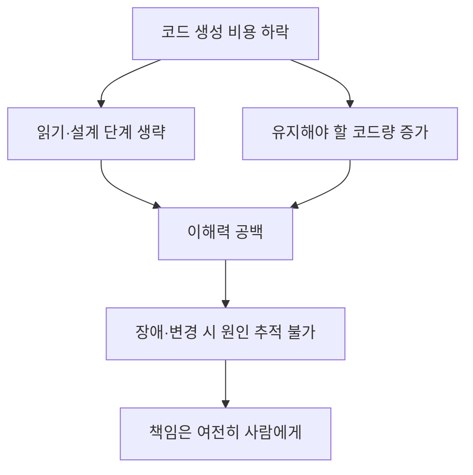

"코딩은 해결됐다"는 말이 업계의 기본 전제처럼 쓰이기 시작했다. 2026년 9월 26일 전후로 서로 독립적으로 발행된 두 글은 이 전제에 같은 방향에서 반론을 편다. 하나는 현장 엔지니어의 증언을 모은 Simon Späti(ssp.sh)의 노트이고, 다른 하나는 신뢰성 엔지니어 Alex Ewerlöf의 에세이 "Coding is NOT Solved"다. 두 글이 공통으로 가리키는 문제는 AI가 코드를 못 쓴다는 것이 아니라, 코드를 쓴 뒤 **사람이 그 코드를 이해하지 못한다**는 것이다. 이 글은 두 글의 주장을 구분해서 정리하고, 어떤 소프트웨어에서 이 문제가 실제로 비용이 되는지 판단하는 기준을 뽑아 본다.

---

## 두 글이 말하는 것

### ssp.sh: "아무도 아무것도 모른다"

ssp.sh의 노트는 Hacker News 토론의 댓글 하나에서 출발한다. AI가 쓰는 코드는 대체로 평균 수준이라서, 평균 이하였던 코드베이스는 AI가 평균까지 끌어올릴 수 있다는 관찰이다. 그러고 나서 요점을 옮긴다. 문제는 AI 코드가 아니라 아무도 아무것도 모르고 모두가 Claude에게 묻는다는 것이고, 그 결과 "계획이 아예 없는 상태"가 된다는 것이다.

노트가 인용하는 현장 증언은 구체적이다. 대기업으로 이직한 지 보름 된 엔지니어가 쓴 글에는 명세, 코드, 테스트, PRD, 티켓, 티켓 해결 보고서까지 전부 Claude Code가 만들고, 경영진은 "코드를 밀어 넣는 건 병목이 아니다"라고 말하며 속도를 재촉한다고 적혀 있다. "L1부터 L7까지 말 그대로 모두가 똑같이 한다. Claude에게 말을 건다"는 문장은 직급과 무관하게 이해의 출처가 하나로 수렴했다는 뜻이다. 다른 인용은 COBOL 프로그래머가 은퇴하며 생긴 지식 단절이 이제 모든 언어로 퍼질 것이라는 경고다.

노트의 결론은 단호하다. 코드를 직접 쓰는 일은 죽었을지 몰라도 설계·의도·취향은 더 중요해졌고, 최종 보스는 언제나 유지보수성이라는 것이다. 만들기 쉬워질수록 유지해야 할 것이 늘어나는데, 아무도 모르는 시스템은 유지하기 어렵다. 또 신입을 뽑지 않아 설계 원리를 배울 경로가 사라지는 문제도 함께 언급한다. 이 노트는 "growing" 상태의 개인 노트이고 본문 일부가 트윗 인용이라, 증언 하나하나를 통계로 읽어서는 안 된다는 점은 염두에 둘 필요가 있다.

### Ewerlöf: 만드는 비용과 소유하는 비용

Ewerlöf의 글은 같은 문제를 비용 구조로 설명한다. 생성 비용은 크게 낮아졌지만, 프로덕션 규모에서 소프트웨어를 운영해 본 사람은 유지보수·신뢰성·보안·확장성 같은 <strong>비기능 요구사항(Non-Functional Requirements)</strong>이 비용의 대부분이라는 것을 안다. 그는 기능 요구사항조차 해결된 문제가 아니라고 보고, 출력을 읽지 않는 사람일수록 결과를 더 확신하는 경향이 있다고 말한다.

글의 가장 쓸모 있는 부분은 "코드를 읽지 않아도 되는 소프트웨어"를 네 가지로 한정한 대목이다.

| 유형 | 코드를 안 읽어도 되는 이유 |
|---|---|
| 개인용 소프트웨어 | 실패해도 본인만 영향받음 |
| 개념 증명(POC) | 기술·제품 타당성만 보이면 됨 |
| 일회성 자동화 | 결과를 직접 검증할 수 있는 예산 범위 |
| 무기화된 AI | 위험을 인지하고 의도적으로 겨냥함 (그래도 통제 필요) |

앞의 세 유형은 위험 허용도가 높고, 개발자를 고용해 돈을 주는 대부분의 소프트웨어는 반대로 허용도가 낮다. 의료·금융·자동차·국방·발전소·항공·제조처럼 실수가 돈이나 생명, 법적 책임으로 돌아오는 영역이다. 이해와 점검에 쓰는 시간은 이분법이 아니라 위험 허용도의 함수이고, 그 허용도는 영향 규모, 결합도에 따른 연쇄 장애 가능성, 격리·분리 같은 봉쇄 장치, 관측성(Observability)에 따라 달라진다고 그는 정리한다.

그의 책임 논증은 이렇다. AI는 처벌받을 수 없고 결과를 감당할 수 없으므로 법적으로는 **도구**이며, 책임(responsible)을 질 수 있을 뿐 문책(accountable)의 대상은 인간이다. 따라서 "이해하지 못하는 것에 대해 책임질 수는 없다". 이해는 시스템 동작을 추론하고 AI가 실패했을 때 고치기 위한 전제 조건이다.

### 기술적 논거: 루프가 논리를 대신한다

Ewerlöf는 코딩이 오히려 LLM이 정복하기 어려운 영역이라고 주장한다. 코드는 논리이고 논리가 틀리면 컴파일되지 않거나 런타임에서 깨진다. LLM이 코드에서 성공하는 이유는 오류를 모델에게 되먹여 대부분의 오류가 해결되거나 가려질 때까지 반복하는 피드백 루프를 만들었기 때문이며, 그 과정에서 모델은 편법(cheat)도 쓴다. 확률적 모델을 논리적으로 만드는 방법은 결국 전통적 코드로 감싼 하네스, 테스트, CoT 같은 기법이고, 입력이 길어질수록 정확도가 떨어지는 문제는 남는다. 이 부분은 저자의 경험에 기반한 의견이며, 모델 성능의 S-커브가 어디까지 이어질지는 이 글만으로 판정할 수 없다.

---

## 두 글을 어떻게 겹쳐 읽을까

두 글은 같은 인과 사슬의 다른 구간을 본다. ssp.sh는 "생성 비용 하락 → 읽기 생략 → 이해력 공백"을 현장 서사로 보여 주고, Ewerlöf는 "공백 → 장애 → 책임"을 비용과 책임의 논리로 풀어 쓴다. 그래서 두 글을 합치면 한 가지 점검 질문이 나온다. **이 시스템이 새벽에 깨졌을 때, 원인을 설명할 수 있는 사람이 팀에 있는가?**

이 관점은 낙관론과도 충돌한다. 예컨대 Pragmatic Engineer 인터뷰에서 Charity Majors는 2026년에는 AI 회의론이 더는 방어되지 않으며 코드 리뷰는 인간 기여 중 가장 가치가 낮은 부분이라고 주장했다. 다만 해당 인터뷰에서 리뷰를 대체할 검증 수단이 효과적이라는 근거가 구체적으로 제시된 것은 아니다. 반면 위 두 글은 이해·리뷰·책임을 핵심으로 본다. 두 입장은 "검증을 누가 맡는가"라는 같은 질문에 다른 답을 내놓고 있고, 업계가 아직 합의에 이르지 못한 상태로 보는 편이 정확하다.

---

## 실전 판단 기준

두 글의 논리를 팀 의사결정에 옮기면 다음과 같은 기준이 된다. 아래는 글의 주장을 바탕으로 한 필자의 정리다.

| 상황 | 권장 태도 |
|---|---|
| 개인 도구·POC·일회성 스크립트 | 읽지 않고 쓰되, 운영 환경에 올리지 않는다는 선을 명시 |
| 다수 사용자가 쓰는 서비스 | 변경마다 최소 한 명이 의도와 영향 범위를 설명할 수 있어야 함 |
| 위험 허용도 낮은 영역 | 생성 속도보다 리뷰·테스트·관측성에 예산 배정 |
| 신입 교육 | 코드를 직접 읽고 설계 이유를 설명하는 과정을 업무에 포함 |

특히 "속도 압박 때문에 읽을 시간이 없다"는 증언은 위험 신호로 볼 만하다. 읽는 시간을 줄인 만큼 이해 부채가 쌓이고, 그 부채는 장애 대응이나 변경 요청 때 한꺼번에 청구된다.

---

## 한계와 주의

- ssp.sh의 핵심 증언은 출처가 익명 트윗이어서 일반화 근거로는 약하다. 현장의 한 사례로 읽어야 한다.
- Ewerlöf의 글은 의견 에세이이며, 본인도 서두에 인지 편향을 경고한다. 특정 회사 제품의 버그 사례를 들어 "코딩 해결" 주장 전체를 비판하는 부분은 논증이라기보다 수사에 가깝다.
- 두 글 모두 "AI 코드의 결함 빈도"를 측정한 데이터를 제시하지 않는다. 주장은 이해와 책임의 구조에 대한 것이지, 코드 품질 벤치마크가 아니다.
- AI를 쓰지 말라는 글이 아니다. Ewerlöf 스스로 초기 도입자이며 자체 하네스까지 만들었다고 밝힌다.

---

## 마무리

| 핵심 | 내용 |
|---|---|
| 문제의 위치 | AI 코드의 품질이 아니라 사람의 이해력 공백 |
| 비용 구조 | 생성은 싸졌지만 유지보수·신뢰성·보안이 비용 대부분 |
| 읽지 않아도 되는 영역 | 개인용·POC·일회성 자동화에 한정 |
| 책임 | AI는 도구이고 문책 대상은 인간 |
| 점검 질문 | 장애 시 원인을 설명할 사람이 있는가 |

## 참고 및 출처

- [Simon Späti, "The Problem is not the AI Code, but Nobody Knows Anything Anymore" (ssp.sh)](https://www.ssp.sh/brain/the-problem-is-not-the-ai-code-but-nobody-knows-anything-anymore/), 2026-09-26 작성
- [Alex Ewerlöf, "Coding is NOT Solved"](https://blog.alexewerlof.com/p/coding-is-not-solved), 2026-09-26
- [Stop being skeptical about AI for development — Charity Majors, The Pragmatic Engineer](https://newsletter.pragmaticengineer.com/p/stop-being-skeptical-about-ai-for), 2026-08-12
