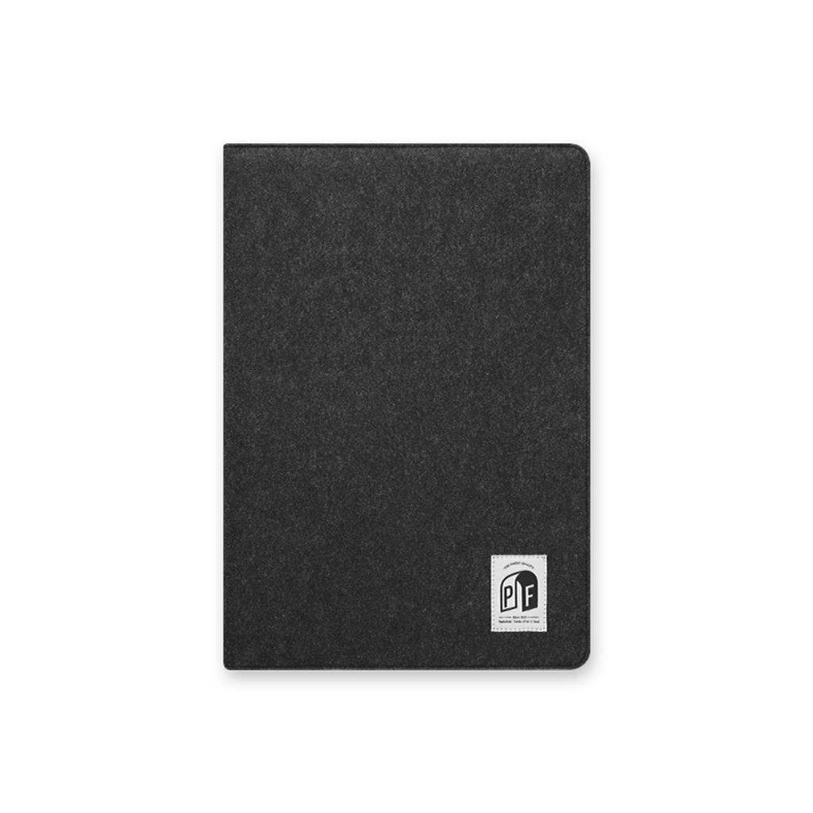
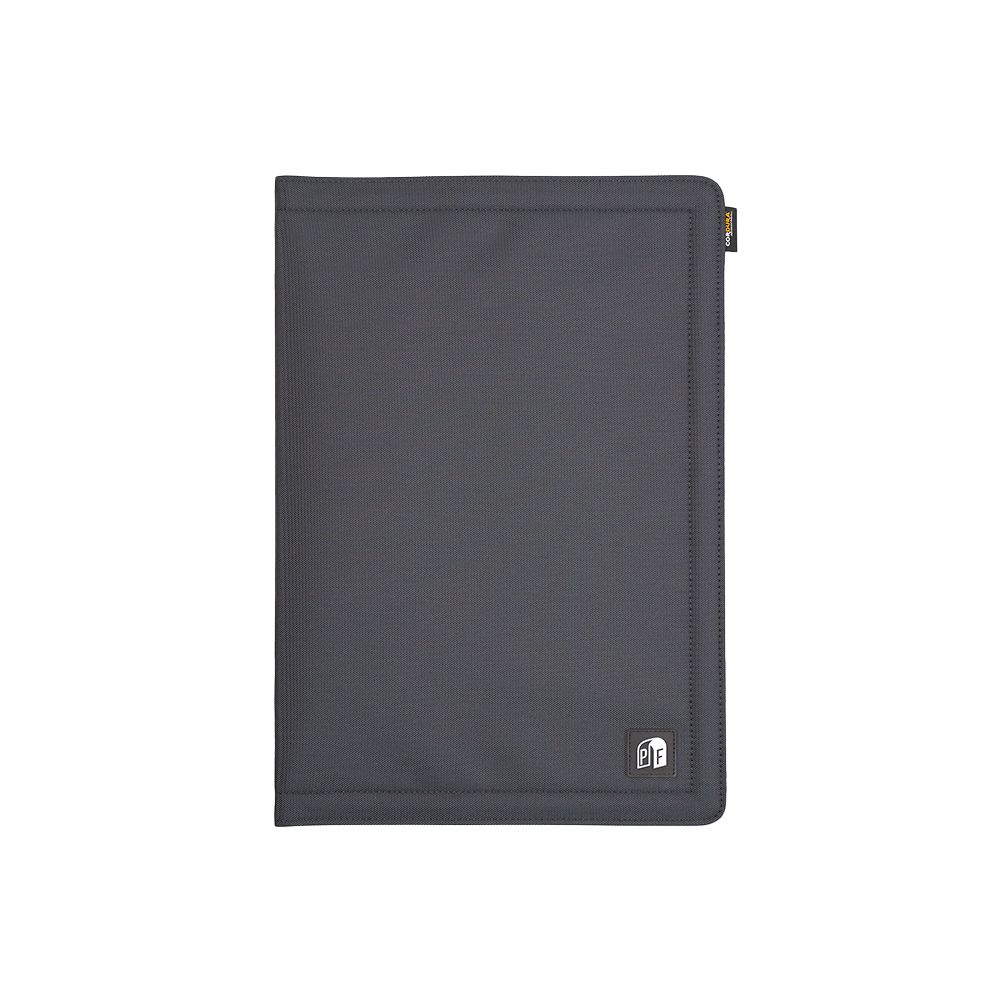
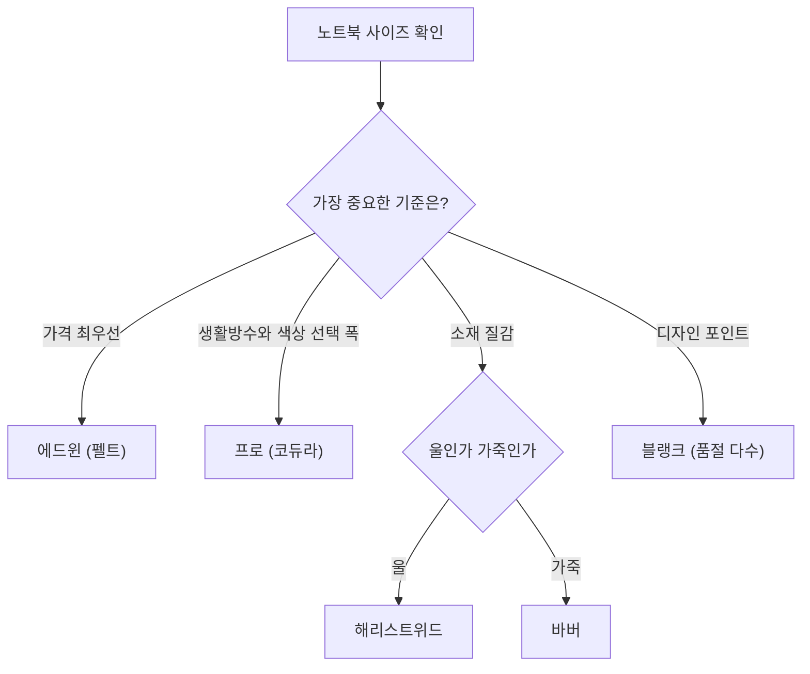

노트북을 가방에 넣을 때는 파우치가 필요하고, 카페 테이블에 올릴 때는 책상 위가 지저분해지지 않도록 매트가 필요하다. 팩앤폴드(Packnfold)의 <strong>슬리브매트(Sleevemat)</strong>는 이 둘을 한 장으로 합친 제품이다. 자석으로 닫으면 파우치가 되고, 펼치면 데스크매트가 된다.

이 글은 쇼핑몰의 노트북 케이스 카테고리(총 37개 상품, 2페이지)를 소재·가격·사이즈·후기 기준으로 정리한 글이다. **직접 써 본 리뷰가 아니라, 2026-10-27 시점에 공개된 상품 페이지 정보를 읽고 비교한 분석**이다. 그래서 상품 페이지에 없는 정보(두께, 무게, 정확한 치수, 충격 흡수 수준)는 추측하지 않고 "확인되지 않음"으로 남겼다.

---

## 슬리브매트가 무엇인가

쇼핑몰 메인 페이지는 이 제품을 "접으면 케이스, 펼치면 매트", "지퍼마저 삭제한 마그네틱 일체형"이라고 소개한다. 상품 페이지의 한 줄 설명도 같은 구조다. 겉감만 시리즈마다 다르다.

- 파우치 상태: 자석으로 닫아 노트북을 감싸 가방에 넣는다.
- 매트 상태: 펼쳐서 책상 위에 깔고 그 위에 노트북과 마우스 등을 둔다.

지퍼가 없으므로 파우치로 쓸 때 열고 닫는 동작이 단순하고, 매트로 쓸 때 지퍼가 책상에 닿을 일이 없다. 반대로 자석 하나에 닫힘을 의존하므로 가방 안에서 얼마나 단단히 닫혀 있는지는 상품 정보만으로는 알 수 없다.

## 라인업 한눈에 보기

카테고리 1페이지에 20개, 2페이지에 17개가 있다. 시리즈 단위로 묶으면 다섯 갈래다. 가격은 카테고리 목록에 노출되는 값(노트북 13–14인치용)이다.

| 시리즈 | 겉감(상품 페이지 표기) | 상품 수 | 13–14인치 가격 | 후기 합계 | 재고 |
|---|---|---|---|---|---|
| 에드윈 | 펠트 발수코팅 | 4색 | 66,000원 | 385건 | 판매 중 |
| 프로 | 코듀라 생활방수 | 11종 | 73,000원 | 778건 | 판매 중 |
| 해리스트위드 | 스코틀랜드 수제 울 100% | 5색 | 108,000원 | 216건 | 3색 품절 |
| 바버 | 북미산 천연 가죽 | 2색 | 165,000원 | 20건 | 판매 중 |
| 블랭크 | 아티스트 콜라보 PU 방수 | 15종 | 75,000–88,000원 | 소수 | 확인한 6종 모두 품절 |

같은 시리즈 안에서는 색상이 달라도 가격이 같다. 에드윈 4색은 모두 66,000원, 프로 11종은 모두 73,000원이다. 색상 선택은 가격에 영향을 주지 않는다.

### 에드윈: 펠트 겉감의 입문 라인

가장 저렴한 정규 라인이다. 차콜, 레드 와인, 인디고 블루, 프렌치 라벤더 네 가지가 있다. 겉감은 펠트에 발수 코팅을 한 것이라고 적혀 있다. 후기는 차콜에 379건이 몰려 있고 나머지 세 색은 0–4건이다.

*닫은(파우치) 상태의 에드윈 차콜. 이미지 출처·저작권: [팩앤폴드 상품 페이지](https://packnfold.co.kr/product/%ED%8C%A9%EC%95%A4%ED%8F%B4%EB%93%9C%EC%8A%AC%EB%A6%AC%EB%B8%8C%EB%A7%A4%ED%8A%B8-%EC%97%90%EB%93%9C%EC%9C%88-%EC%B0%A8%EC%BD%9C/30/category/42/display/1/)*

### 프로: 색상 폭이 가장 넓은 코듀라 라인

코듀라(Cordura) 원단을 쓰며 상품 페이지는 이를 생활방수 원단으로 표기한다. 블랙, 그래파이트, 포레스트, 카멜, 실버, 크림, 체커보드와 카모 4종(타이거, 블루타이거, 멀티, 덕)까지 11종이다. 에드윈보다 13–14인치 기준 7,000원(약 10.6%) 비싸다. "생활방수"는 일상적인 물 튐을 막는 수준을 뜻하는 표기일 뿐, 침수나 장시간 비를 견딘다는 보증은 아니다.

*닫은(파우치) 상태의 프로 그래파이트. 이미지 출처·저작권: [팩앤폴드 상품 페이지](https://packnfold.co.kr/product/%ED%8C%A9%EC%95%A4%ED%8F%B4%EB%93%9C%EC%8A%AC%EB%A6%AC%EB%B8%8C%EB%A7%A4%ED%8A%B8-%ED%94%84%EB%A1%9C-%EA%B7%B8%EB%9E%98%ED%8C%8C%EC%9D%B4%ED%8A%B8/31/category/42/display/1/)*

### 해리스트위드: 울 소재의 프리미엄 라인

겉감이 스코틀랜드 수제 울 100%(해리스트위드® 표기)다. 블랙, 그레이, 베이지는 품절이고 블랜드와 네이비 그린만 구매할 수 있다. 품절된 베이지에 후기가 163건으로 이 시리즈에서 가장 많은 것으로 보아 인기가 높았던 색으로 읽힌다. 프로 대비 13–14인치 기준 35,000원(약 48%) 비싸다. 울 소재의 세탁·관리 방법은 상품 페이지에서 확인되지 않았다.

### 바버: 가죽 라인

북미산 천연 가죽 겉감이고 에스프레소와 블랙이 있다. 사이즈 옵션이 노트북 13–14, 15–16, 16인치 세 가지뿐이고 태블릿 사이즈는 없다. 13–14인치 165,000원은 프로의 약 2.3배다. 후기는 18건과 2건으로 아직 표본이 작다.

### 블랭크: 아티스트 협업 한정판

S1(7종), S2(6종), X(2종)로 나뉜 협업 시리즈이며 PU 방수 원단에 "초간편 파우치, 뒤집으면 매트"라는 설명이 붙는다. 확인한 상품의 가격은 S1과 X가 75,000원, S2가 88,000원이다. 정규 라인과 달리 사이즈 옵션이 나뉘지 않고 단일 가격으로 노출되며, 이 글에서 상품 페이지를 열어 본 6종은 모두 품절이었다.

## 사이즈 옵션과 가격 계단

정규 라인의 옵션은 Tablet S, Tablet L, Laptop 13–14, Laptop 15–16, Laptop 16의 다섯 가지다. 사이즈가 커질수록 가격이 계단식으로 오른다.

| 옵션 | 에드윈 차콜 | 프로 그래파이트 | 해리스트위드 네이비 그린 |
|---|---|---|---|
| Tablet S | 59,000원 | 66,000원 | 99,000원 |
| Tablet L | 63,000원 | 70,000원 | 104,000원 |
| Laptop 13–14 | 66,000원 | 73,000원 | 108,000원 |
| Laptop 15–16 | 69,000원 | 76,000원 | 112,000원 |
| Laptop 16 | 71,000원 | 78,000원 | 115,000원 |

가장 작은 옵션에서 가장 큰 옵션까지 올라가는 폭은 에드윈과 프로가 12,000원(각각 약 20%, 18%), 해리스트위드가 16,000원(약 16%)이다. 목록에 보이는 가격은 항상 13–14인치 값이므로, 15–16인치 노트북을 쓰는 사람은 목록 가격에 3,000–5,000원을 더해 생각해야 한다.

해리스트위드 베이지는 품절 상태이고 사이즈별 가격이 위 순서와 맞지 않게 노출된다(Tablet S가 117,000원). 표에는 재고가 있는 네이비 그린을 썼다.

두 가지 확인이 필요하다. 첫째, Laptop 15–16과 Laptop 16이 별도 옵션인데 상품 페이지 텍스트에는 각 옵션이 대응하는 정확한 치수가 적혀 있지 않다. 상품 페이지의 사이즈 가이드를 직접 보고 자신의 노트북 가로·세로와 대조해야 한다. 둘째, 한 후기는 삼성 갤럭시북5 프로 16인치에 16인치 옵션을 샀고 마우스와 USB 기기를 함께 두어도 넉넉하다는 취지로 적었다. 이는 한 사람의 경험이므로 일반화하지 않는다.

## 어떤 시리즈를 고를까

선택 기준은 예산, 방수 필요, 소재 취향 정도로 갈린다.

- **가볍게 시작**: 에드윈. 정규 라인 중 가장 싸고, 발수 코팅이 되어 있다.
- **무난한 기본값**: 프로. 에드윈보다 7,000원 비싼 대신 코듀라 생활방수 원단이고 색상이 11종이라 고르기 쉽다. 후기도 778건으로 가장 두껍다.
- **질감과 외관**: 해리스트위드(울) 또는 바버(가죽). 프로 대비 가격이 1.5–2.3배이므로 소재가 구매 이유일 때만 합리적이다.
- **협업 디자인**: 블랭크. 대부분 품절이라 재입고 여부를 먼저 확인해야 한다.

## 후기 분포가 보여주는 것

1페이지 20개 상품의 후기를 합치면 1,379건이다. 이 가운데 프로 그래파이트 463건과 에드윈 차콜 379건이 842건으로 약 61%를 차지한다. 어두운 중성색 두 가지에 구매와 후기가 몰려 있고, 덕 카모는 1건, 멀티 카모는 10건처럼 패턴 색상은 얇다. 대표 평점은 차콜과 그래파이트가 4.9점, 베이지가 4.8점으로 모두 높지만, 쇼핑몰 자체 후기 게시판의 집계이므로 독립적인 평가로 읽으면 안 된다.

차콜 후기 중에는 "파우치 하나 샀는데 매트까지 따라온 느낌"이라는 한 줄이 있다. 제품의 이중 용도가 구매 후 만족으로 이어졌다는 신호이지만, 후기 한 줄이 내구성이나 보호 성능을 증명하지는 않는다.

## 장점과 단점

**장점**

- 파우치와 매트를 한 장으로 해결하므로 휴대 물건이 줄어든다.
- 지퍼가 없는 자석 일체형이라 열고 닫는 동작이 단순하고, 매트로 쓸 때 금속 지퍼가 책상에 닿지 않는다.
- 같은 시리즈 안에서 색상 간 가격 차이가 없다.
- 태블릿부터 16인치 노트북까지 옵션이 있고, 인기 라인은 후기 표본이 크다.

**단점·한계**

- 두께, 무게, 정확한 외형 치수, 내부 충격 흡수 수준이 상품 페이지 텍스트에 없다. 노트북 보호 성능을 숫자로 비교할 수 없다.
- "생활방수"와 "발수 코팅"은 방수 등급이 아니라 표기이므로, 물에 취약한 사용 환경에서는 별도 보호가 필요하다.
- 해리스트위드 3색과 블랭크 다수가 품절이라 원하는 색을 못 살 수 있다.
- 가격 대비 가치는 일반 슬리브 파우치와 데스크매트를 따로 사는 경우와 비교해야 판단할 수 있는데, 이 글은 그 비교 데이터를 갖고 있지 않다.

## 구매 전 체크 포인트

1. **노트북 실측 치수**를 재서 상품 페이지의 사이즈 가이드와 대조한다. 13–14, 15–16, 16 옵션이 나뉘어 있다.
2. 목록에 보이는 가격은 13–14인치 값이다. 선택한 옵션의 실제 가격은 상품 페이지에서 확인한다.
3. 배송비는 3,500원이고 40,000원 이상 구매 시 무료이며, 배송 기간은 3–7일로 안내된다(2026-10-27 확인).
4. 품절 상품은 사유가 적혀 있지 않으므로 재입고 여부를 문의해야 한다.

## 자주 묻는 질문

**매트로 펼치면 얼마나 큰가?** 상품 페이지 텍스트에는 펼친 치수가 없다. 사이즈 가이드 이미지를 확인하자.

**방수가 되는가?** 에드윈은 발수 코팅 펠트, 프로는 생활방수 코듀라, 블랭크는 PU 방수 원단이라고 표기돼 있다. 방수 등급이나 시험 결과는 공개되어 있지 않다.

**태블릿에도 쓸 수 있는가?** 정규 라인(에드윈, 프로, 해리스트위드)에는 Tablet S와 Tablet L 옵션이 있다. 바버에는 없다.

## 참고 및 출처

- [팩앤폴드 슬리브매트 Signature 카테고리 1페이지](https://packnfold.co.kr/category/Laptop-Cases/42/)
- [같은 카테고리 2페이지(바버·블랭크)](https://packnfold.co.kr/category/Laptop-Cases/42/?page=2)
- [팩앤폴드 홈](https://packnfold.co.kr/)
- [슬리브매트 에드윈 차콜](https://packnfold.co.kr/product/%ED%8C%A9%EC%95%A4%ED%8F%B4%EB%93%9C%EC%8A%AC%EB%A6%AC%EB%B8%8C%EB%A7%A4%ED%8A%B8-%EC%97%90%EB%93%9C%EC%9C%88-%EC%B0%A8%EC%BD%9C/30/category/42/display/1/)
- [슬리브매트 프로 그래파이트](https://packnfold.co.kr/product/%ED%8C%A9%EC%95%A4%ED%8F%B4%EB%93%9C%EC%8A%AC%EB%A6%AC%EB%B8%8C%EB%A7%A4%ED%8A%B8-%ED%94%84%EB%A1%9C-%EA%B7%B8%EB%9E%98%ED%8C%8C%EC%9D%B4%ED%8A%B8/31/category/42/display/1/)

가격·재고·후기 수는 2026-10-27 기준이며 쇼핑몰 사정에 따라 바뀐다.
