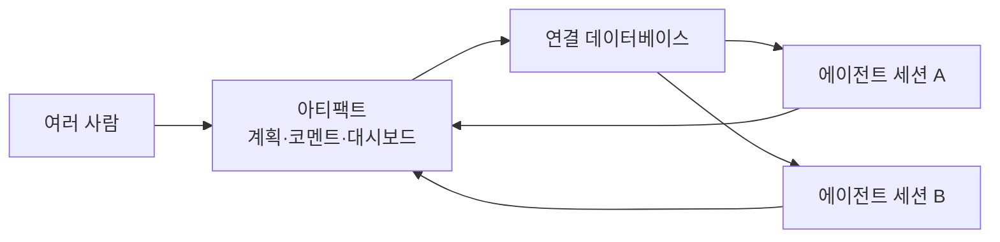

Claude Code는 지금까지 "한 사람이 터미널에서 여러 에이전트를 부리는 도구"에 가까웠다. Anthropic에서 Claude Code 설계를 이끄는 Thariq Shihipar가 Latent Space 팟캐스트(2026-09-29)에서 밝힌 방향은 이 전제를 "여러 사람과 여러 에이전트"로 넓히는 것이다. 이 글은 인터뷰에서 확인되는 세 축, 즉 하네스를 직접 바꾸는 Claude Mods, 멀티플레이어 에이전트, 공유 워크스페이스로서의 아티팩트를 정리하고, 이미 있는 것과 아직 만드는 중인 것을 나눠서 본다.

---

## 이미 있는 것과 말뿐인 것

인터뷰 내용은 제품 발표가 아니라 설계자의 구상이다. 그래서 먼저 구분이 필요하다.

| 항목 | 상태 | 근거 |
|------|------|------|
| Claude Mods (실행 루프·UI 커스터마이징) | 존재, CLI와 데스크톱 앱에서 동작 | 인터뷰 |
| Claude Tag (Slack 안의 멀티플레이어 에이전트) | 현재 제품 | 인터뷰 |
| 아티팩트 + 연결 데이터베이스, 여러 Claude의 MCP 접근 | 존재 | 인터뷰, 기사 요약 |
| 여러 에이전트를 지휘하는 리뷰·피드백 대시보드 | 지향점, 인프라 구축 중 | "we're still getting there from an infrastructure perspective" |
| 로컬 컴퓨터를 다루는 클라우드 Claude("local hands") | 계획 | "over time" 추가 예정 |
| 멀티플레이어 Projects | 싱글플레이어로 시작, 확장 예정 | 인터뷰 |
| Mods 제작을 돕는 스킬, Claude Tag에서의 Mods | 미정 | 인터뷰 |

## Claude Mods: 훅이 못 하는 것을 하는 확장

**Mods**는 Claude Code 하네스 전체, 즉 실행 루프와 UI를 사용자가 바꾸는 시스템이다. 인터뷰에서 든 예는 턴이 끝난 뒤 포크된 에이전트가 퀴즈를 내는 모드, 가정(assumption)을 추적하는 도구, 모델 라우터, 다른 플러그인이 등록할 수 있는 모드 선택기, 대시보드, 다음 할 일을 제안하는 감독(supervisor) 모드 등이다.

기존 훅과의 핵심 차이는 실행 위치다. Mods는 TypeScript 런타임 안에서 in-process로 돌기 때문에 서브에이전트를 직접 띄우고 UI를 수정할 수 있다. 훅은 외부 명령을 호출하는 방식이라 이런 일을 못 한다. Thariq는 Bun 팀의 사람과 함께 이 시스템을 만들었다고 말했다.

그는 이를 "mutable software", 즉 사용자가 안전하게 모양을 바꿀 수 있는 소프트웨어의 맛보기로 설명했다. 진행자 swyx는 무한한 설정 가능성이 사용자를 혼란스럽게 할 수 있으니 의견이 담긴 기본값이 여전히 중요하다고 짚었다. 모델 라우터가 기본 기능이 아닌 이유도 Thariq가 "어려운 문제"라고 답했기 때문이다. 라우터는 현재 모드로 만들어지는 중이다.

주의할 점이 있다. in-process 확장은 강력한 만큼 신뢰 경계가 사라진다. 외부 모드를 설치한다는 것은 하네스 안에서 임의 코드를 돌리는 것이므로, 훅보다 더 엄격한 출처 검토가 필요하다. 이는 인터뷰의 주장이 아니라 구조에서 나오는 필자의 해석이다.

## 멀티플레이어: Claude Tag와 Projects

현재의 멀티플레이어 제품은 Slack에 사는 **Claude Tag**다. 채널마다 설정이 다르고 고유한 정체성을 가지며, 장애 대응과 영업 정보 보강 같은 일에 쓰인다고 한다. Projects는 그 싱글플레이어 대응물로, 시간이 지나면서 멀티플레이어 쪽으로 넓어질 예정이다.

멀티플레이어가 되면 권한 문제가 생긴다. 공유된 MCP 연결을 누가 쓰는지, 개인 자격 증명은 어떻게 다루는지, 한 채널의 에이전트가 다른 채널을 통해 데이터를 새게 하지 않는지가 인터뷰에서 열린 질문으로 남았다. 에이전트 하나를 한 사람이 쓸 때는 "내 권한"으로 끝났던 것이, 여러 사람이 한 에이전트를 공유하는 순간 "누구의 권한으로 실행하는가"가 된다.

## 아티팩트: 채팅이 아니라 계획에 코멘트하기

Thariq는 아티팩트가 "하네스로 들어가는 인터페이스"가 될 것이라고 말했다. 아이디어는 채팅으로 에이전트에게 말하는 대신, 살아 있는 계획과 작업물에 사람이 코멘트를 달고 여러 에이전트 세션을 한 화면에서 따라가는 것이다. 처음에 몇 가지 질문으로 선호를 받는 방식은 프로젝트 도중 생기는 선호를 담지 못한다는 문제의식이 깔려 있다.

이미 가능한 부분은 데이터 공유다. 아티팩트는 연결된 데이터베이스에 지속 데이터를 저장할 수 있고, 여러 Claude 인스턴스가 아티팩트 MCP로 읽고 쓸 수 있다. 칸반 보드 같은 공유 대시보드가 이 방식으로 가능하다. 반면 여러 에이전트를 지휘하는 리뷰·피드백 대시보드는 아직 표준 워크플로우가 아니라 방향이다. 기사 요약에 따르면 이 아티팩트는 에이전트 자체가 아니라 작업을 보여 주고 지시하는 면이며, 장기적으로는 클라우드에서 도는 에이전트가 클라우드 또는 로컬 환경에서 세션을 시작하는 구조를 그린다.

## 그 밖의 발언

요약 기사들에서 확인되는 다른 주장도 있다. 보안·코드 리뷰 작업은 effort를 높이거나 최대로 둘 때 이득이 크지만, 일반 소프트웨어 개발에서는 늘어난 노력이 대부분 검증과 엣지 케이스 테스트에 쓰여 이득이 작다고 한다. 또 모델이 좋아질수록 Claude.md나 Agents.md 같은 지속 지침 파일이 필요 없어지거나 모델을 과하게 제약할 수 있어, 새 프로젝트를 이런 파일 없이 시작하는 것을 권하는 경우가 많다는 요지다. 이 두 가지는 daily.dev의 목록 요약에서 가져온 것이라 원문 맥락은 직접 확인하지 못했다.

## 판단 기준

- Mods는 훅으로 해결되지 않는 UI 변경이나 서브에이전트 호출이 필요할 때 검토한다. 단순 자동화라면 훅이 더 단순하고 경계가 분명하다.
- 팀이 한 에이전트 세션을 공유하는 흐름은 권한 모델이 정리되기 전까지 읽기 중심으로 시작하는 편이 안전하다.
- 공유 대시보드형 아티팩트는 데이터 공유 부분만 지금 쓸 수 있다. 다중 에이전트 지휘 화면을 전제로 한 프로세스는 아직 설계하지 않는 것이 맞다.

## 참고 및 출처

- [Thariq Shihipar, Latent Space 인터뷰](https://www.latent.space/p/thariq)
- [daily.dev 요약](https://daily.dev/posts/claude-code-s-next-era-thariq-shihipar-anthropic-b3ry44dzm)
- [Superpower Daily 요약](https://superpowerdaily.com/posts/anthropic-s-shihipar-explains-how-claude-code-could-coordinate-agents-through-artifacts)
