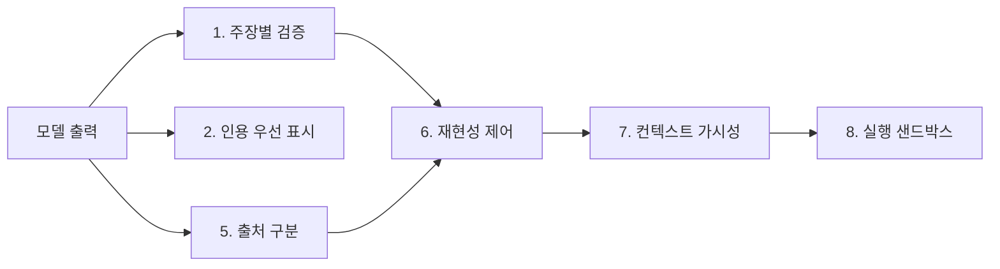

"AI는 실수할 수 있으니 결과를 직접 확인하세요." 거의 모든 AI 제품 하단에 붙어 있는 이 문구는 사실상 책임을 사용자에게 넘기는 문장이다. 그런데 정작 그 확인을 쉽게 해 주는 기능이 제품 안에 있는 경우는 드물다. Twisted 프레임워크 메인테이너로 알려진 Glyph Lefkowitz는 2026년 9월 27일 글 "What Would A Serious AI Product Look Like?"에서 바로 이 모순을 짚고, 제품이 자기 전제대로 행동한다면 어떤 기능이 있어야 하는지를 목록으로 내놓았다. 이 글은 그 목록을 항목별로 풀고, 각 항목이 어떤 문제를 겨냥하는지, 우리가 AI 도구를 고르거나 만들 때 어떻게 활용할 수 있는지 정리한다.

---

## 핵심 주장: 제품이 자기 전제를 따르지 않는다

Glyph의 논지는 단순하다. AI 제품은 "출력은 믿을 수 없다"고 스스로 인정한다. 그렇다면 검증 도구가 핵심 기능이어야 한다. 그러나 실제 제품은 검증을 돕기는커녕 확인 없이 받아들이도록 유도하는 쪽으로 설계되어 있다. 그는 이 격차를 프런티어 랩의 제품뿐 아니라 Ollama 같은 작은 도구에서도 같은 방식으로 본다.

여기서 나오는 결론이 날카롭다. 이런 기능이 정말 가치를 만든다면 벤더가 이미 대대적으로 홍보했을 것이므로, 목록이 비어 있다는 사실 자체가 AI 도구가 만드는 순가치가 0에 가까울 수 있다는 귀무가설을 지지한다는 것이다. 이 결론에 동의할 필요는 없다. 다만 목록의 각 항목은 "검증 가능성을 제품의 일급 기능으로 만든다"는 한 줄로 수렴하므로, 결론과 별개로 체크리스트로서 가치가 있다.

## 체크리스트 8가지

### 1. 실수 확인을 일급 기능으로

모든 주장 옆에 체크박스를 두고, 왼쪽에는 모델 출력, 오른쪽에는 사람이 적는 검증 노트를 놓는 2열 워크시트를 제안한다. 코딩 도구라면 테스트를 돌리기 전에 diff부터 검토하게 해서 테스트 컴퓨팅 낭비를 줄이는 흐름도 포함된다. 핵심은 "검증했음"이라는 상태를 제품이 추적한다는 점이다. 지금은 사용자가 머릿속에서만 검증하고, 제품은 그 사실을 모른다.

### 2. 인용을 본문처럼 다루기

리서치 결과를 도메인 이름 주석이 달린 요약으로 보여 주는 대신, 출처 사이트·게재일·저자가 있는 큰 객체로 보여 주고 그 안에 프로그램으로 추출한 원문 인용을 가장 눈에 띄게 둔다. AI가 만든 요약은 그 아래에 작게 둔다. "이 인용을 읽었는가" 체크박스도 포함된다. 요약이 먼저 눈에 들어오는 현재 UI는 사용자가 원문을 건너뛰도록 만든다는 문제의식이다.

### 3. 1인칭과 사과 제거

소프트웨어가 "제가 확인해 보겠습니다", "죄송합니다" 같은 말을 하지 않게 하자는 제안이다. 단순한 취향이 아니라, 사람처럼 말하는 인터페이스가 신뢰를 과대평가하게 만든다는 판단이 깔려 있다. 부수 효과로 덜 장황한 모델도 요구한다.

### 4. 열린 채팅 대신 과제 전용 UI

OWASP Top 10 취약점을 스캔하는 버튼처럼 과제별로 전용 컨트롤을 두고, 작은 전문 모델을 API로 덧붙이지 않고 제품 핵심에 통합하자고 한다. 모호한 자연어 입력으로 도구를 실행하는 MCP 식 접근은 줄이자는 방향이다. 입력이 좁을수록 검증도 쉬워진다.

### 5. 데이터 출처 표시

값이 모델의 생성물인지, 도구 호출 결과인지, API 응답인지, 사용자 입력인지를 구분해 표시한다. 표 형태 출력은 스프레드시트처럼 취급해 "프로그램으로 검증" 단계를 두고, 산술이 어디서 어떻게 적용되었는지 보여 준다. 환각과 정상 조회가 같은 글꼴로 섞여 나오는 현재의 문제를 직접 겨냥한다.

### 6. 재현성 제어

temperature 같은 무작위성 파라미터를 노출하고 그 한계를 설명한다. 같은 작업을 재실행해 얼마나 일관되게 수행하는지 시험하는 리플레이 기능과, 대화에서 비결정적 구간은 고정한 채 결정적 도구만 새 데이터로 다시 돌리거나 그 시점에서 대화를 분기(fork)하는 기능을 제안한다. 비결정성을 숨기는 대신 실험 대상으로 삼자는 것이다.

### 7. 컨텍스트 가시성

사용 가능한 컨텍스트와 사용량을 기본으로 보여 주고, 컨텍스트 압축(compaction)이 응답에 어떤 영향을 줬는지 설명하며, 하네스가 자동 생성한 프롬프트에 쉽게 접근하게 하자는 것이다. 리플레이 도구와 결합하면 사용자가 컨텍스트가 결과에 미치는 영향을 직접 실험해 이해할 수 있다.

### 8. 제대로 동작하는 샌드박스

코딩 에이전트에 대한 요구가 가장 구체적이다.

| 요구 | 의도 |
|---|---|
| 하네스 수준의 파일시스템 샌드박스, OS 무관 | 정해진 범위 밖 삭제를 엄격히 차단 |
| 모든 작업마다 저장소 전체 스냅샷 | 어떤 실수도 롤백 가능 |
| auto mode, `--dangerously-skip-permissions` 류 제거 | 승인 우회 경로 제거 |
| 배치 단위 계획 승인 | 건별 승인으로 인한 경고 피로 방지 |
| 목(mock) API 대상 실행 | 계획된 호출 사전 검토, 실제 호출과 사후 비교 |

개별 승인은 빈번할수록 형식적이 되므로, 계획을 한꺼번에 검토하게 하고 그 계획과 실제 호출을 대조하자는 설계가 눈에 띈다.

## 제품 밖의 과제: 사람과 조직

Glyph는 기능 목록에서 멈추지 않고 조직 차원의 대응도 제시한다. 항공 분야의 휴식 규정과 부기장 제도를 참고해, AI 없이 일하는 보호된 시간을 정기적으로 두는 교대 순환, 두 번째 검토자가 챗봇 로그를 독립 점검하는 주기적 표본 검사, 기술 유지를 위한 학습 예산과 의도적 연습, 정신 건강 지원, 누적 사용량을 보여 주는 개인 "선량계", 위험한 대화 패턴 플래깅을 든다. 마지막으로, 벤치마크가 아니라 사용자의 실제 업무에서 효과를 재는 내장 측정 도구를 요구하며, 아직 성공적으로 측정된 사례를 보지 못했다고 덧붙인다.

## 이 목록을 어떻게 쓸 것인가

이 체크리스트는 그대로 도구 평가표로 쓸 수 있다. 다만 현실적인 판단 기준 몇 가지를 덧붙인다.

- **검증 비용이 어디에 걸리는지 먼저 본다.** 1–3번은 리서치·요약 도구에, 6–8번은 코딩 에이전트에 무게가 실린다. 쓰는 용도에 맞는 항목만 추려 점수를 매기는 편이 낫다.
- **일부는 이미 부분 구현되어 있다.** 일부 모델 제공사는 인용 API, 컨텍스트 사용량 표시, 샌드박스·권한 모드를 제공한다. 빠진 것은 "전부 일급 기능으로 묶어 기본값으로 둔다"는 설계다. Glyph도 Anthropic의 citations API와 컨텍스트 압축 문서를 참고 자료로 링크한다.
- **"홍보했을 것"이라는 논증은 증거가 아니라 추론이다.** 기능이 없다는 사실은 수요 부족, 구현 난이도, 속도 경쟁 같은 다른 이유로도 설명된다. 귀무가설을 받아들이기 전에 자기 업무에서 이득을 직접 재 보는 쪽이 낫고, 이는 Glyph의 마지막 요구와도 같다.
- **조직 대책은 도입 비용이다.** AI 없는 시간, 표본 검사, 학습 예산은 생산성 향상분에서 차감해 계산해야 한다. 이 비용을 반영하고도 순이득이 남는지가 실제 질문이다.

## 마무리

Glyph의 글이 설득력 있는 지점은 AI에 대한 찬반이 아니라 "제품이 스스로의 면책 문구와 일관되게 설계되었는가"라는 물음에 있다. 검증, 출처, 재현성, 가시성, 안전한 실행 환경은 모델 성능과 별개로 제품이 책임질 수 있는 영역이다. 도구를 고를 때 이 여덟 항목 중 몇 개가 기본값으로 켜져 있는지 세어 보는 것만으로도 꽤 많은 것이 드러난다.

## 참고 및 출처

- [Glyph, "What Would A Serious AI Product Look Like?"](https://blog.glyph.im/2026/09/serious-ai-product.html), 2026-09-27
