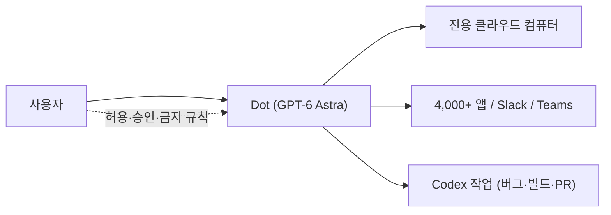

OpenAI가 DevDay 2026을 전후해 내놓은 발표들은 개별 기능보다 한 방향으로 읽을 때 의미가 커진다. 에이전트를 API 호출 하나로 파는 단계에서, 에이전트가 **상주할 환경** 자체를 제공하는 단계로 넘어가려는 시도다. 이 글은 Latent Space의 AINews 정리를 1차 출처로 삼아, 확인되는 사실과 거기서 끌어낼 수 있는 해석을 구분해 살펴본다.

---

## 확인되는 발표 내용

Latent Space가 2026-09-30자로 정리한 내용 중 이 글에서 다루는 항목은 아래와 같다. 정리 글 자체가 정확한 DevDay 날짜를 밝히지 않고, 항목마다 공개된 세부 정보의 양이 다르다.

| 항목 | 확인된 내용 | 공개되지 않은 부분 |
|---|---|---|
| Dots | GPT-6 Astra 기반 에이전트, 전용 클라우드 컴퓨터, 4,000개 이상 앱 연결, Slack·Teams 접근 | 세부 과금 구조 |
| Decisions API | GPT-6 Luna 위에서 텍스트·이미지 대상 객관식 분류·라우팅 | 가격, 지연 시간 수치 |
| Agents API | 제목에만 언급 | 기능·제공 시점 전부 |
| ChatGPT Spaces | 사람과 에이전트가 함께 쓰는 공유 작업 공간 | 가격, 제공 범위 |
| 마켓플레이스 | 기업이 OpenAI 약정(commitment)을 Baseten을 통해 오픈소스 모델에 쓸 수 있음 | 시작 시점 |

## Dots: 전용 컴퓨터를 가진 에이전트

<strong>Dots(닷츠)</strong>는 각각이 GPT-6 Astra로 구동되는 에이전트이며, 자체 클라우드 컴퓨터에서 돌아간다. 사용자가 원하면 자기 머신을 연결할 수도 있지만 필수는 아니다. 핵심은 "대화창에서 불러 쓰는 모델"이 아니라 "계속 켜져 있는 작업자"라는 위치 설정이다.

권한 모델이 눈에 띈다. 사용자는 에이전트가 혼자 해도 되는 일, 승인이 필요한 일, 절대 하면 안 되는 일을 나눠 정한다. 상시 작동 에이전트는 사용자가 지켜보지 않는 동안 행동하므로, 이 세 단계 구분이 곧 안전장치 역할을 한다.

제공 대상은 Pro, Business Premium, Enterprise 요금제다. 과금에서는 주 닷이 직접 한 작업은 요금제 사용량에 잡히지 않고, 닷이 파생시킨 Codex 작업은 잡힌다고 한다. 닷이 버그 분류, 실패한 빌드, 풀 리퀘스트를 Codex에 넘길 수 있다는 설명과 함께 보면, 닷은 사용자 대면 조정자이고 무거운 코드 작업은 Codex가 맡는 분업 구조임을 짐작할 수 있다.

초기 테스터 사례로는 고객센터와 협상해 연 약 500달러의 요금을 줄인 일이 소개됐다. 일화 수준의 보고이므로 일반적 성능 근거로 삼기는 어렵다.

## Decisions API: 생성하지 않고 고르는 모델

<strong>Decisions API</strong>는 GPT-6 Luna 위에서 텍스트와 이미지를 입력받아 미리 정한 선택지 중 하나를 즉시 고르게 하는 분류·라우팅 API다. Latent Space는 현 단계를 "Luna 위의 얇은 껍데기"로 평가했고, 비전 지원이 추가됐다고 적었다. The New Stack은 이 API를 TypeSafe의 Jev에 대한 OpenAI의 응답으로 제목에서 규정한다(본문은 접근하지 못해 확인하지 못했다).

이 흐름이 흥미로운 이유는, 상시 작동 에이전트가 늘수록 "긴 문장을 생성하는 호출"보다 "수많은 작은 결정을 싸고 빠르게 내리는 호출"이 더 자주 필요해지기 때문이다. 라우팅, 필터링, 승인 필요 여부 판정 같은 일을 큰 모델의 자유 생성에 맡기면 느리고 비싸다. 선택지를 닫아 두면 응답이 빨라지고 결과가 검증하기 쉬워진다. 다만 이것은 구조에서 도출한 해석이며, 지연 시간이나 가격 수치는 공개 자료에서 확인하지 못했다.

## Spaces와 마켓플레이스: 에이전트가 일하는 장소와 예산

ChatGPT Spaces는 사람과 에이전트가 함께 쓰는 공유 워크스페이스로, Latent Space는 Notion이나 사무용 생산성 도구에 대한 OpenAI의 답으로 위치 짓는다. 마켓플레이스 쪽에서는 기업이 OpenAI와 맺은 약정을 Baseten을 통해 오픈소스 모델에 쓸 수 있게 한다는 점이 눈에 띈다. 한 분석가는 이를 기업 AI 예산 전체를 가져가려는 경쟁으로 평했다. 관련해 "Sign in with ChatGPT"로 사용자가 자신의 플랜 한도를 Devin 같은 파트너 앱에서 쓰는 변화도 함께 언급됐다.

## 해석: 에이전트 판매에서 에이전트 거처 제공으로

위 조각들을 이어 붙이면 구조가 보인다. 에이전트가 오래 일하려면 실행 환경(클라우드 컴퓨터), 일을 나눌 하위 작업자(Codex), 값싼 판단기(Decisions API), 사람과 같이 쓰는 장소(Spaces), 예산과 유통(마켓플레이스·로그인)이 필요하다. DevDay 발표는 이 층들을 각각 채우는 모양새다. 앞서 ChatGPT Work가 기억·선제 행동·예약으로 제품 층에서 상시성을 흉내 냈다면, 이번에는 그 상시성을 인프라 층으로 내렸다는 해석이 가능하다.

한계와 불확실성도 분명하다. Agents API는 제목 외에 확인 가능한 정보가 없고, 일부 보도에 나온 마켓플레이스 파트너 수나 세부 기업명은 이 글에서 검증하지 못해 제외했다. OpenAI 공식 발표 페이지는 접근이 차단되어 열어 보지 못했다. 또 Dots의 권한 모델이 실제로 잘못된 자율 행동을 얼마나 막는지는 아직 독립적으로 검증된 자료가 없다.

## 마무리

| 판단 질문 | 현재 확인 가능한 답 |
|---|---|
| 무엇이 바뀌었나 | 에이전트 호출이 아니라 상주 환경을 제공하는 쪽으로 이동 |
| 누가 쓸 수 있나 | Pro, Business Premium, Enterprise |
| 개발자에게 의미는 | 작은 결정을 닫힌 선택지로 처리하는 API가 별도 상품이 됨 |
| 아직 모르는 것 | Agents API 상세, Decisions API 가격·지연, 권한 모델의 실효성 |

## 참고 및 출처

- [Latent Space, "OpenAI DevDay 2026: Dots" (AINews)](https://www.latent.space/p/ainews-openai-devday-2026-dots-61), 2026-09-30
- [The New Stack, OpenAI Decision API 기사](https://thenewstack.io/openai-decision-api-luna) (제목만 확인)
