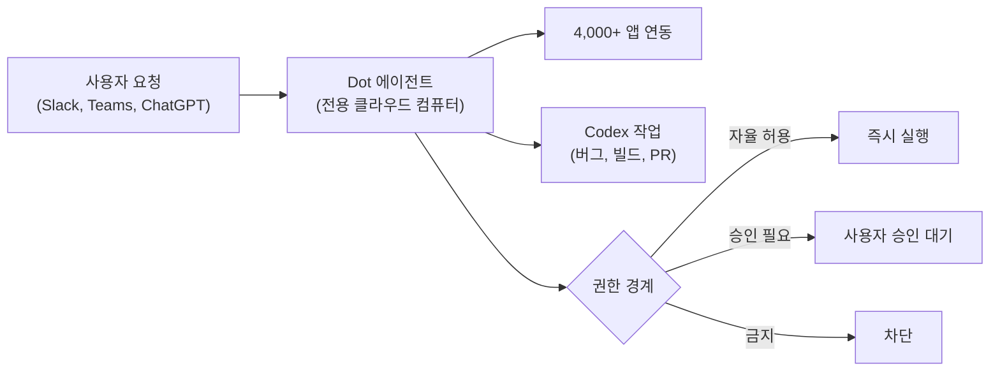

OpenAI가 DevDay 2026에서 내놓은 발표를 한 줄로 줄이면 "에이전트를 호출하는 API"에서 "에이전트가 상주하는 환경"으로의 이동입니다. 이 글은 Latent Space의 AINews 요약(2026-10-01)에서 확인되는 내용만 골라 정리하고, 확인하지 못한 부분은 그렇다고 밝혀 둡니다.

---

## 확인된 발표 내용

### Dots: 자기 클라우드 컴퓨터를 가진 상시 에이전트

**Dots**의 각 에이전트(dot)는 **GPT-6 Astra** 기반이고, 자신의 클라우드 컴퓨터에서 돌아갑니다. 4,000개 이상의 앱과 Slack·Teams에 연결되며, 사용자 자신의 기기 연결은 선택 사항입니다. 이는 챗 창에서 요청이 올 때만 깨어나는 기존 어시스턴트와 구조가 다릅니다. 에이전트가 사용자 PC의 켜짐 여부와 무관하게 계속 작업할 수 있기 때문입니다.

사용자는 세 가지 경계를 설정합니다. 스스로 해도 되는 일, 승인이 필요한 일, 절대 해선 안 되는 일입니다. 상시 에이전트의 핵심 위험이 "묻지 않고 한 행동"이므로, 이 3단 권한 모델이 제품 설계의 중심이라고 볼 수 있습니다.

제공 대상은 Pro, Business Premium, Enterprise 플랜입니다. 주 dot이 직접 수행하는 작업은 플랜 사용량을 소모하지 않고, dot이 띄운 Codex 작업은 소모한다고 합니다. 개발자는 버그 분류, 실패한 빌드, PR 처리를 Codex에 넘길 수 있습니다. 초기 사용자 사례로는 dot이 고객센터와 협상해 연 약 500달러의 청구를 줄였다는 보고가 있으나, 단일 일화이므로 일반화하긴 어렵습니다.

### Decisions API: 객관식 분류·라우팅에 특화

**Decisions API**는 텍스트와 이미지에 대한 거의 즉각적인 객관식 분류·라우팅을 제공합니다. **GPT-6 Luna** 위에 얹힌 얇은 계층이라 비전을 지원합니다. 선택지를 미리 정해 두면 모델이 자유 생성을 하지 않으므로 응답이 짧고 예측 가능합니다. 티켓 분류, 문서 라우팅, 이미지 검수처럼 "정해진 답 중 하나"가 필요한 파이프라인에 맞습니다. The New Stack은 이를 TypeSafe의 Jev에 대한 OpenAI의 대응으로 보도했습니다(본문은 접근하지 못해 헤드라인만 확인했습니다).

### ChatGPT Space와 Marketplace

**ChatGPT Space**는 Pages와 함께 Dots 출시 때 공개된 "사람과 에이전트가 공유하는 작업 공간"입니다. 요약 글은 이를 Notion이나 오피스 생산성 도구에 대한 OpenAI의 답으로 해석합니다. B2B **Marketplace**에서는 기업이 OpenAI 약정 금액을 Baseten에서 호스팅되는 오픈 모델에도 쓸 수 있습니다. 즉 OpenAI는 모델 판매자에서 기업 AI 예산 전체의 창구가 되려 하고 있습니다.

---

## 구조로 보면

## 판단 기준: 무엇을 보고 도입할까

| 질문 | 이유 |
|------|------|
| 권한 경계를 업무 단위로 쪼갤 수 있는가 | 3단 모델은 "승인 필요" 목록이 길수록 알림 피로가 커지고, 짧으면 사고 위험이 큽니다 |
| 과금이 주 에이전트와 Codex로 갈리는 점을 계산했는가 | 위임 작업이 많을수록 비용이 Codex 쪽으로 이동합니다 |
| 분류·라우팅 단계를 자유 생성에서 Decisions API류로 분리할 수 있는가 | 지연과 변동성이 줄지만 선택지 설계 책임이 개발자에게 넘어옵니다 |
| 에이전트 상주 환경을 벤더에 맡길 때 이탈 비용은 | 전용 클라우드 컴퓨터와 Space에 맥락이 쌓일수록 전환이 어려워집니다 |

한계도 분명합니다. 이 글의 근거는 2차 요약 한 건과 헤드라인뿐입니다. 공식 발표 페이지는 자동 접근이 막혀 직접 확인하지 못했고, 일부 정리 글이 언급하는 "Agents API(매니지드 Codex 하네스)"는 확인한 요약에 나오지 않아 다루지 않았습니다. 가격, 제외 지역, 안전성 평가 같은 세부는 공식 문서로 재확인하세요.

## 마무리

| 발표 | 한 줄 정리 |
|------|-----------|
| Dots | 전용 클라우드 컴퓨터에서 상시 작동하는 에이전트, 3단 권한 경계 |
| Decisions API | GPT-6 Luna 기반 객관식 분류·라우팅, 비전 지원 |
| ChatGPT Space | 사람과 에이전트의 공유 작업 공간 |
| Marketplace | OpenAI 약정을 Baseten 호스팅 오픈 모델에도 적용 |

## 참고 및 출처

- [Latent Space, "OpenAI DevDay 2026: Dots" (AINews)](https://www.latent.space/p/ainews-openai-devday-2026-dots-61)
- [The New Stack, "OpenAI answers TypeSafe's Jev with a Decision API built on Luna"](https://thenewstack.io/openai-decision-api-luna)
