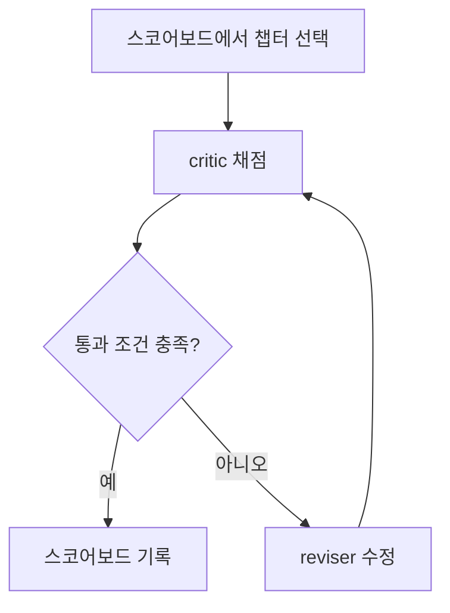

LLM이 쓴 글을 다른 LLM이 채점하고, 점수가 낮으면 고쳐서 다시 채점하게 하는 루프는 만들기보다 오래 돌리기가 어렵다. 이 블로그는 매일 스케줄 작업이 챕터 하나를 골라 `quality-critic` 서브에이전트가 루브릭으로 채점하고, 90점 미만이면 reviser가 고쳐 재채점하는 `post-quality-loop`를 몇 주째 돌리고 있다. 개별 글의 결함보다 루프 자체의 결함이 더 비싼 문제였다. 이 글은 그 운영 기록에서 반복해 나타난 네 가지 실패 패턴과, 각각에서 얻은 설계 교훈을 정리한다.

---

## 루프의 구조

구조는 Anthropic이 에이전트 패턴으로 정리한 <strong>evaluator-optimizer(평가자-최적화기)</strong>와 같다. 생성(또는 수정)하는 쪽과 평가하는 쪽을 분리하고, 평가 결과를 입력으로 다시 수정하는 반복이다([Building effective agents](https://www.anthropic.com/research/building-effective-agents)). 이 루프에서 critic은 읽기 전용으로 점수와 결함 목록만 반환하고, reviser만 파일을 고친다. 통과 조건은 총점 90 이상, 치명결함 0, 모든 항목 앵커 70 이상이다.

채점자와 작성자의 분리는 실제로 효과가 있었다. reviser가 수정 과정에서 잘못 귀속된 인용문을 만들어 냈을 때 다음 라운드의 critic이 다시 잡아냈고, 디자인 패턴 개요 장에서는 내부 링크 24개 중 4개가 404였던 것을 독립 재채점이 발견했다. 원인은 대상 챕터가 frontmatter의 `slug:`로 URL을 덮어써서 파일명 기반 URL과 갈라진 것이었다. 작성자가 자기 결과를 스스로 채점했다면 통과했을 결함이다.

## 패턴 1: 평가자 포화 — 점수가 85에서 멈춘다

가장 불쾌한 현상은 콘텐츠를 아무리 고쳐도 점수가 움직이지 않는 것이었다. 루브릭 1.1에는 "사소한 결점이 하나라도 있으면 100점을 앵커하지 않는다"는 규칙이 있었다. Clean Architecture 18장을 반복 재채점하자 critic은 라운드마다 새로운 사소한 지적을 찾아냈고 점수는 81.1에서 85.0으로 오른 뒤 모든 항목이 정확히 85점에서 멈췄다. 콘텐츠는 그대로 두고 루브릭 조항만 바꿨더니 89.4점까지 올랐다. 병목은 글이 아니라 채점 규칙이었다.

자연어 콘텐츠에서 결점의 완전한 박멸은 불가능하다. "결점 하나라도 있으면 만점 금지"는 LLM critic과 만나면 "항상 새 결점을 찾는다"로 바뀌고, 통과율은 사실상 0%가 된다. 루브릭 1.2는 지적을 둘로 나눴다.

| 구분 | 근거 요건 | 점수 영향 | reviser 의무 |
|---|---|---|---|
| 결함(defect) | 규칙 조항, 기계 린트, 사실·코드 오류 중 하나를 반드시 인용 | 항목 상한 85점 | 반영해야 함 |
| 개선 제안(suggestion) | 없음 | 상한 없음 | 반영하지 않아도 됨 |

결함이 없으면 100점을 앵커할 수 있게 되었고, 같은 챕터가 91.5점으로 통과했다. 남은 트레이드오프는 결함과 제안의 경계를 critic이 판단한다는 점이다. 그래서 결함 판정에 "인용 가능한 근거"를 강제했지만, 이 분류가 다시 채점자 간 비일관성의 원천이 될 수 있다는 위험은 완전히 사라지지 않았다.

## 패턴 2: 락 없는 스코어보드 — 같은 챕터를 둘이 고친다

"다음에 채점할 챕터"는 스코어보드 파일에서 고르는데, 이 선택에 상호배제가 없었다. 자동 세션과 수동 세션이 동시에 돌면 같은 챕터를 각자 고친다. 최소 세 번 관측됐다.

- 같은 디자인 패턴 챕터를 두 PR이 각각 3회, 6회 반복으로 따로 통과시켜 병합 불가능한 충돌이 났고, 나중에 만든 일괄 처리 PR만 남기고 다른 PR을 폐기했다.
- 채점 도중 다른 세션이 스코어보드 전체를 새로 시딩하는 PR을 먼저 병합해, 이 세션의 커밋이 붕 뜬 브랜치에 남았다. main을 리베이스하고 자기 행만 재적용해야 했다.
- 스케줄 작업의 브랜치 이름이 같은 날 수동 세션이 병합한 이름과 겹쳐, `git checkout -B main origin/main` 후 cherry-pick으로 우회했다.

공유 상태가 파일 하나이고 갱신이 "읽고 → 고르고 → 나중에 쓴다"의 비원자적 순서라면 고전적인 레이스 컨디션이다. 교훈은 두 가지다. 스케줄 작업의 브랜치 이름에는 날짜나 실행 ID를 넣어 충돌을 없앨 것, 그리고 스코어보드 행을 점유하는 표식(claim)을 먼저 커밋·푸시하는 락 대용 절차를 둘 것. 후자는 아직 완전히 해결하지 못했고, 지금은 충돌을 감지해 리베이스하는 사후 복구에 의존한다.

## 패턴 3: 환각된 직접 인용 — 같은 결함이 챕터마다 반복된다

C++ 최적화 컬렉션에서 가장 집요했던 결함은 cppreference 같은 1차 자료를 인용한 블록쿼트가 원문에 없는 문장인 경우였다. critic이 WebFetch로 원문을 대조해 3장, 6장, 7장, 8장을 연달아 잡았다. 3장은 Itanium C++ ABI 명세 인용이 실제 명세 어디에도 없어 74.05점으로 미달했고, 직접 인용을 지워 패러프레이즈로 바꾼 뒤 96.1점으로 통과했다. 개정 이력 같은 부수 사실은 맞는데 핵심 인용문만 그럴듯하게 지어낸 형태였다는 점이 특징이다.

같은 유형이 한 컬렉션에서 네 번 반복됐다는 것은 채점 단계가 아니라 작성 단계가 문제라는 신호다. 환각 인용은 겉보기에 자연스러워서 사람이 훑어서는 잡히지 않는다. 이후 작성 규칙에 "직접 인용은 작성 시점에 원문을 가져와 대조하고, 대조하지 못하면 인용하지 않고 패러프레이즈한다"를 명시했다.

채점 쪽에도 미묘한 점이 있었다. WebFetch는 페이지를 소형 모델로 요약해 돌려주기 때문에 원문과 표현이 다르게 나올 수 있다. 5장에서 critic은 `CharT`로 축약된 결과를 곧바로 환각으로 단정하지 않고 자신의 사전 지식과 대조해 결함으로 잡지 않았다. 반대로 6장은 curl로 원문을 직접 받아 대조했기에 불일치를 확정할 수 있었다. 인용 검증은 도구가 돌려주는 텍스트가 원문 그대로인지부터 확인해야 한다.

## 패턴 4: 통과선 간극 — 결함을 찾고도 고치지 않는다

5번째 사례인 9장은 새로운 교훈을 남겼다. critic은 이번에도 ranges/views 정의 인용이 원문에 없다는 것을 확인했다. 그런데 이 결함이 치명결함이 아니라 항목 점수 감점(12.6/18)으로만 처리됐고, 다른 항목이 높아 총점 91.2로 통과선을 넘었다. 통과하면 루프는 곧바로 기록 단계로 가므로 reviser가 실행되지 않았고, 환각 인용은 고쳐지지 않은 채 남았다.

원인은 게이트가 "결함의 존재"가 아니라 "배점 비중"을 본다는 데 있다. 총점 기반 통과 조건에서는 한 항목의 사실 오류가 다른 항목의 높은 점수에 희석된다. 설계 교훈은 사실 근거 항목에 별도의 하한을 두거나, 검증 가능한 오류(원문 불일치)를 점수 감점이 아니라 치명결함으로 분류하는 것이다. 이 루브릭에는 이미 "항목별 앵커 70 이상" 조건이 있지만, 감점이 70 아래로 내려가지 않는 한 작동하지 않는다.

## 보너스: "통과"와 "배포 가능"은 다른 질문이다

몇 가지 사례는 루브릭 통과가 실제 배포 건전성과 어긋날 수 있음을 보여 준다.

- **UTF-8 BOM**: 95.8점으로 통과한 챕터에 파일 선두 BOM이 남아 있었고, CI의 frontmatter 린트가 그 파일 전체를 조용히 건너뛰었다. 루브릭은 해당 항목만 85로 깎았을 뿐 통과를 막지 못했다.
- **대표 이미지 누락**: 린트가 `image` 필드가 있는데 파일이 없는 경우만 치명결함으로 봤기 때문에, 필드 자체가 없는 글이 97.3점으로 통과했다. 루브릭 1.3에서 필드 부재도 `image-missing`으로 확장했다.
- **HTTP 200은 유효하다는 뜻이 아니다**: 점검 배너를 띄우는 페이지도 200을 반환하고, 서비스가 종료된 사이트는 안내 페이지로 대체되어 모든 경로가 같은 응답을 준다. 링크 검증은 상태 코드만이 아니라 콘텐츠가 원래 목적과 맞는지까지 봐야 한다. 사이트 전역 장애에 대한 정책 공백도 있었는데, 죽은 링크를 하이퍼링크가 아닌 코드 서식 텍스트로 바꿔 "하이퍼링크에만 적용되는" 규칙을 우회해 100점을 받은 사례까지 나왔다. 영구 종료된 출처는 검증 대상에서 제외한다는 명시적 예외로 정리했다.
- **본문과 다이어그램의 자기모순**: Mermaid가 세부 기법 `Tr.01~08`을 "이 트랙에서 다루지 않음"으로 표기했는데 `Tr.01`은 그 챕터 자신이 속한 트랙이었다. 텍스트, 코드, 표뿐 아니라 다이어그램과 본문의 대조도 별도의 결함 축이다.

## 설계 교훈과 한계

| 문제 | 증상 | 대응 |
|---|---|---|
| 평가자 포화 | 점수가 특정 값에서 수렴 | 결함(근거 인용 필수)과 제안(상한 없음) 분리 |
| 공유 상태 경합 | 같은 대상을 두 세션이 수정 | 고유 브랜치 이름, claim 커밋, 충돌 시 리베이스 |
| 환각 인용 | 챕터마다 같은 결함 반복 | 작성 시점 원문 대조, 불가하면 패러프레이즈 |
| 총점 게이트 | 사실 오류가 통과 | 검증 가능한 오류는 치명결함으로 분류 |
| 루브릭과 CI 불일치 | 통과한 글이 린트 대상에서 빠짐 | 루브릭 통과 전에 기계 린트를 같은 기준으로 실행 |

이 기록의 한계도 분명하다. 수치는 한 저장소의 몇 주 운영 사례이고, 루브릭 개정 전후를 같은 조건에서 통제 실험한 것이 아니다. 81.1 → 85.0 → 89.4 → 91.5 같은 숫자는 한 챕터의 반복 재채점이라 일반화할 수 없다. critic과 reviser가 같은 계열의 모델이라면 맹점이 공유될 가능성도 남는다. 그럼에도 "LLM 채점자는 규칙이 요구하는 만큼 결점을 찾아낸다", "공유 파일은 락 없이 동시에 쓰면 깨진다", "통과 조건이 곧 품질은 아니다"라는 세 가지는 LLM 평가 루프를 설계할 때 먼저 점검해 볼 만한 항목이다.

## 참고 및 출처

- [Anthropic, Building effective agents](https://www.anthropic.com/research/building-effective-agents) — evaluator-optimizer 패턴 설명
- 이 블로그 저장소의 `post-quality-loop` 스킬, `quality-critic` 서브에이전트, 스코어보드 운영 기록(2026-07 ~ 2026-09)
