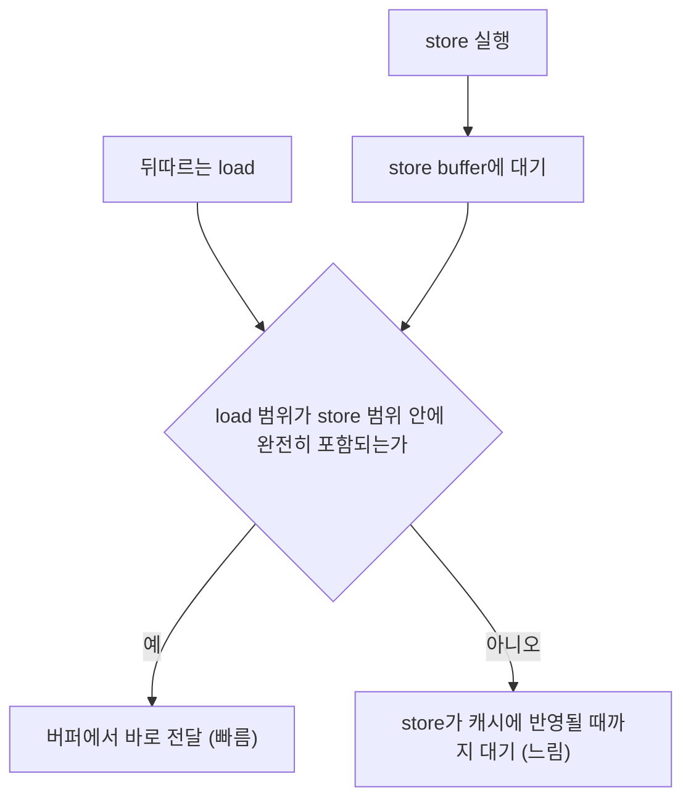

비트 필드나 바이트 버퍼를 다루는 코드에는 "바이트 하나를 쓰고, 곧바로 8바이트 워드로 다시 읽는" 패턴이 흔하다. 문법상 문제가 없고 결과도 맞지만, x86 서버 CPU에서는 이 패턴이 한 번에 14–19 사이클이 걸리는 느린 경로로 빠진다. Daniel Lemire가 2026년 11월 5일 블로그에서 5종의 CPU로 측정한 결과를 바탕으로, 이 글은 <strong>store forwarding(스토어 포워딩)</strong>이 무엇이고 언제 실패하며 어떻게 피하는지 정리한다. 모든 수치는 저자가 보고한 마이크로벤치마크 값이며, 필자가 직접 재측정한 것이 아니다.

## store buffer와 포워딩의 원리

CPU가 store 명령을 실행하면 값은 곧바로 L1 캐시에 들어가지 않는다. 먼저 <strong>store buffer(스토어 버퍼)</strong>라는 작은 큐에 주소와 데이터가 쌓이고, 명령이 은퇴(retire)한 뒤에야 캐시로 반영된다. 이 지연 때문에 뒤따르는 load가 같은 주소를 읽으면 캐시에는 아직 옛 값이 있다. 그래서 CPU는 load를 실행할 때 store buffer를 먼저 검사하고, 겹치는 store가 있으면 그 데이터를 바로 load에 넘겨준다. 이것이 **store-to-load forwarding**이며, 캐시를 기다리지 않으므로 빠르다.

포워딩은 load가 앞선 store와 **같은 크기이거나, store가 쓴 범위 안에 완전히 들어가는 더 작은 접근**일 때 잘 동작한다. load가 store보다 넓거나 두 범위가 일부만 겹치면 store buffer 한 항목만으로는 load가 필요로 하는 바이트를 다 채울 수 없다. 이때 포워딩은 실패하고, load는 해당 store가 캐시에 반영될 때까지 기다린다. 그 대기가 곧 지연 시간이 된다.



## 실패하는 접근 패턴

Lemire가 든 실패 사례는 세 가지다.

1. 1바이트 store 뒤 8바이트 load
2. 4바이트 store 뒤 8바이트 load
3. 8바이트 store 뒤, 4바이트 어긋난 위치에서 시작하는 8바이트 load

첫 번째 패턴은 아래 코드로 재현된다. `memcpy`는 컴파일러가 단일 명령으로 바꿔 주므로 의도한 크기의 store와 load가 그대로 나간다.

```cpp
#include <cstdint>
#include <cstring>

// 1바이트를 쓴 직후 같은 위치부터 8바이트를 읽는다 (포워딩 실패 패턴).
uint64_t reload_byte(char *p, unsigned char v) {
    std::memcpy(p, &v, 1);
    uint64_t w;
    std::memcpy(&w, p, 8);
    return w;
}
```

이 함수는 정확하지만 load가 방금 쓴 1바이트보다 넓다. 나머지 7바이트는 캐시(또는 더 이전 store)에서 와야 하므로 load는 1바이트 store가 캐시에 도달할 때까지 멈춘다. 이런 코드가 반복문의 의존 체인 위에 있으면 지연이 그대로 누적된다.

## 5개 CPU 측정 결과

아래 표는 Lemire가 보고한 반복 1회당 사이클 수다.

| 연산 | Xeon Gold 6548N | Xeon 6975P-C | EPYC 9R45 | Graviton 5 | Apple M4 Max |
|------|------|------|------|------|------|
| store 8 → load 8 (같은 주소) | 1 | 1 | 1 | 5 | 5 |
| store 8 → load 4 (+4 위치) | 5 | 5 | 7 | 6 | 5 |
| store 4 → load 8 | 19 | 19 | 14 | 5 | 5 |
| store 4, store 4 → load 8 | 20 | 20 | 15 | 5 | 8 |

읽는 법은 세 가지다. 첫째, 크기가 정확히 맞는 포워딩은 x86 서버에서 1사이클로 극단적으로 빠르다. 둘째, 같은 서버에서 좁은 store 뒤 넓은 load는 14–20 사이클로 약 14–20배 느려진다. 셋째, M4 Max와 Graviton 5는 일치 케이스도 5사이클이라 평소엔 느리지만, 넓은 load의 페널티가 작아(대부분 5사이클) 격차가 거의 없다. Lemire는 댓글에서 이 효과가 주로 x86 프로세서의 특징이라고 언급했다. 따라서 같은 코드가 개발용 Apple 노트북에서는 멀쩡하고 x86 서버에서만 느릴 수 있다는 점이 이 함정의 까다로운 부분이다.

## 레지스터에서 처리해 피하기

회피책은 좁은 store와 넓은 load의 조합 자체를 만들지 않는 것이다. 8바이트를 먼저 load해 레지스터에서 마스크와 OR로 바이트를 바꾼 뒤 8바이트를 다시 store하면 모든 접근 크기가 일치한다.

```cpp
#include <cstdint>
#include <cstring>

// 8바이트를 읽어 레지스터에서 하위 1바이트만 교체하고 8바이트로 되쓴다.
uint64_t update_byte(char *p, unsigned char v) {
    uint64_t x;
    std::memcpy(&x, p, 8);
    x = (x & ~0xffull) | v;
    std::memcpy(p, &x, 8);
    return x;
}
```

이 방식은 처음 load가 이전 store의 결과를 읽을 때만 포워딩이 필요하고, 그 경우에도 크기가 같아 빠른 경로를 탄다. 반환값 `x`가 이미 레지스터에 있어 이후 코드가 메모리를 다시 읽을 필요도 없다. 트레이드오프도 있다. 메모리에서 8바이트를 읽으므로 `p`가 가리키는 버퍼가 최소 8바이트 접근 가능해야 하고, 다른 스레드가 같은 워드의 다른 바이트를 쓰고 있다면 되쓰기가 그 값을 덮어쓸 수 있다. 단일 스레드가 소유한 버퍼에서만 안전한 변환이다.

또 하나 알아둘 점은 컴파일러가 때로 문제를 대신 없애 준다는 것이다. 8바이트를 store하고 같은 8바이트를 다시 읽는 코드는 재load 자체가 제거될 수 있다. 반대로 `reload_byte`처럼 크기가 다른 경우는 값을 합성해야 하므로 컴파일러가 메모리 경로를 유지하는 일이 많다. 어떻게 생성됐는지는 어셈블리로 직접 확인하는 것이 확실하다.

## 언제 신경 써야 하나

| 상황 | 영향 | 대응 |
|------|------|------|
| 바이트/비트 필드를 쓴 뒤 워드로 재해석(`memcpy`→정수) | 의존 체인 위라면 critical path가 직접 늘어남 | 레지스터에서 합성 후 한 번에 store |
| 서로 다른 크기로 같은 버퍼를 번갈아 접근 | x86에서만 느릴 수 있음 | 접근 폭을 통일 |
| 한 번만 실행되는 초기화 코드 | 사실상 무시 가능 | 프로파일링 근거 없이 바꾸지 않음 |

한계도 분명하다. 표의 값은 단일 마이크로벤치마크이고, 실제 프로그램에서의 영향은 해당 load가 의존 체인의 critical path 위에 있는지, 다른 명령이 지연을 가려 주는지에 달려 있다. 마이크로벤치마크가 큰 수치를 보여도 `perf`나 VTune 같은 프로파일러로 해당 지점이 병목인지 먼저 확인하는 편이 안전하다.

## 요약

- store 값은 캐시 대신 store buffer에서 load로 전달(포워딩)되며, load가 store 범위 안에 완전히 포함될 때만 빠르다.
- 좁은 store 뒤 넓은 load는 포워딩 실패로 x86 서버에서 14–20 사이클(일치 시 1사이클)이 걸린다. M4 Max·Graviton 5는 약 5–8 사이클이다.
- 회피책은 넓게 읽고 레지스터에서 합성해 넓게 쓰는 것이며, 단일 스레드 소유 버퍼에서만 안전하다.
- 적용 전에는 프로파일러로 critical path 위의 병목인지 확인한다.

## 참고 및 출처

- Daniel Lemire, "A performance trap: when store forwarding fails" (2026-11-05): <https://lemire.me/blog/2026/11/05/a-performance-trap-when-store-forwarding-fails/>
