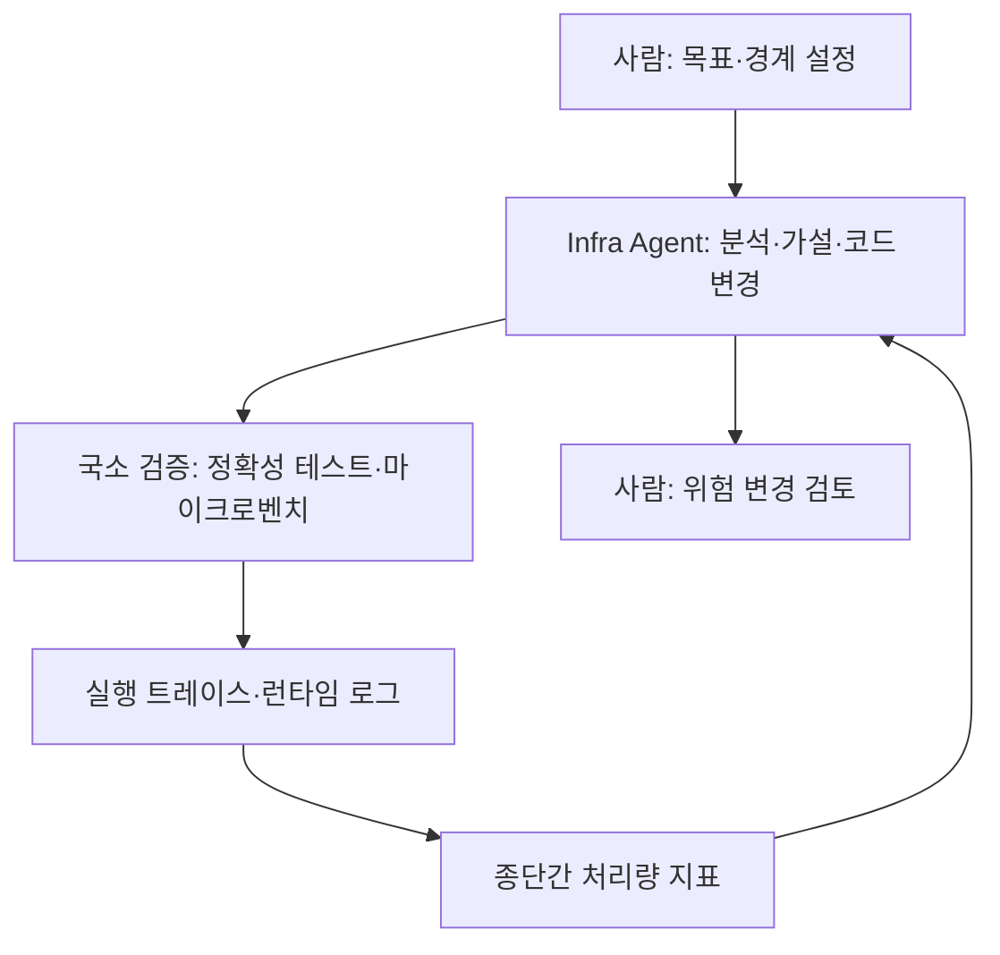

모델이 더 나은 모델을 만드는 재귀적 자기개선(RSI)은 대개 학습 절차를 둘러싼 논의였다. Z.ai(Zhipu AI)가 2026년 9월 공개한 사례는 대상이 다르다. GLM-5.3 기반의 "Infra Agent"가 GLM-5.3-Flash를 서빙하는 추론 인프라를 직접 분석하고 고쳤고, 초기 적용에서 프로덕션까지 2주 안에 종단간 처리량이 약 3배가 됐다고 한다. 이 글은 그 주장의 핵심인 피드백 설계를 중심으로, 구체 사례와 검증 가능한 범위를 정리한다. 수치는 모두 Z.ai가 스스로 밝힌 것이다.

---

## 무엇이 보고됐나

Jack Clark의 뉴스레터 Import AI 474호가 이 사례를 소개했고, 원문은 Z.ai 블로그의 "Toward Recursive Self-Improvement: How GLM Built Its Own Inference Infrastructure"다([Import AI 474](https://jack-clark.net/2026/09/28/import-ai-474-platonic-mindspace-tpus-in-space-zhipu-starts-an-outer-rsi-loop/), [Z.ai 블로그](https://z.ai/blog/glm-built-its-inference-infrastructure)). 요약하면 다음과 같다.

| 항목 | 보고된 내용 |
|---|---|
| 대상 | GLM-5.3-Flash의 프로덕션 추론 서비스 |
| 규모 | 10만 개 이상의 중국산 AI 가속기 |
| 기간 | 초기 모델 적응에서 프로덕션 준비까지 2주 미만 |
| 결과 | 초기 베이스라인 대비 종단간 처리량 약 3배 (한 2차 요약은 3.22배로 적음) |
| 사람의 역할 | 목표·경계 설정, 위험한 변경 검토 |
| 에이전트의 역할 | 분석, 가설 생성, 코드 변경 |

Z.ai 스스로 이것이 아직 RSI는 아니고 초기 형태가 나타나는 단계라고 선을 긋는다. Import AI가 "아우터(outer)" 루프라 부른 이유는, 개선 대상이 모델의 가중치나 학습법이 아니라 모델을 감싼 서빙 시스템이기 때문이다.

---

## 핵심 설계: dense feedback

이 사례에서 가장 재사용 가능한 부분은 에이전트의 능력보다 에이전트에게 준 피드백의 모양이다. "처리량이 20% 떨어졌다" 같은 종단간 수치 하나로는 어느 계층이 원인인지 알 수 없다. 그래서 Z.ai는 에이전트에게 작고, 국소적이고, 싸고, 객관적으로 검증되는 신호를 여러 층으로 줬다. 이를 <strong>dense feedback(조밀한 피드백)</strong>이라 부른다.

Import AI는 피드백 조건을 세 가지로 요약했다. 첫째는 엔진 실행 인자, 커널, 스레드, 코드 경로처럼 구체적 대상에 묶인 국소성이다. 둘째는 짧은 검증 주기로 막다른 가설에 쓰는 시간을 줄이는 저비용·적시성이다. 셋째는 참조 구현이나 테스트 결과와 비교할 수 있는 객관적 검증 가능성이다. 이 세 조건은 사람이 디버깅할 때도 그대로 통하는 원칙이라, 에이전트용 특수 기법이라기보다 좋은 엔지니어링 환경의 정의에 가깝다.

---

## 보고된 구체 사례

2차 요약들이 전하는 사례는 세 가지다. 원문 블로그는 렌더링 때문에 직접 읽지 못했고, 아래는 두 개의 독립 요약([Trending Topics](https://www.trendingtopics.eu/forget-agi-here-comes-rsi-z-ai-says-its-glm-model-built-its-own-inference-infra/), [mer.vin](https://mer.vin/news/how-glm-5-3-tuned-its-own-inference-stack-with-dense-feedback/))이 공통으로 전한 내용이다.

**정확성 버그.** KDA 커널의 context-parallel 경로가 비병렬 경로와 결과가 달랐고, 컨텍스트가 길수록 오차가 커졌다. 저정밀 행렬 연산에 원인이 있었다. 이 수정은 오픈소스 Flash Linear Attention에 병합됐다고 하며, 이 보고서에서 외부에서 확인하기 가장 쉬운 주장이다.

**동시성 버그.** KV 캐시를 옮기는 Python 스레드가, C++ 연산 호출이 GIL(Global Interpreter Lock)을 쥐고 있는 동안 굶었다. 테스트 시나리오 간 성능 격차가 20%를 넘었고 목표는 5%였다. C++ 호출 구간에서 락을 풀자 격차가 1% 아래로 내려갔다. 종단간 지표만 봤다면 "KV 전송이 느리다"까지만 알 수 있었을 문제다.

**커널 최적화.** SGLang, Flash Linear Attention, DeepGEMM의 기법을 "최적화 스켈레톤"으로 정리해 적용 조건과 함께 재사용했다. 한 디코드 커널에서는 메모리 절감 변경이 처음에 10% 회귀를 냈고, 이후 중복 타일을 합치고 워프 내 작업을 줄이는 재작성으로 원본 대비 1.71배를 얻었다. 개선이 단조롭지 않았다는 점이 눈에 띈다.

mer.vin 요약에 따르면 최적화 경로는 13단계였고, 전체 이득의 약 3분의 2가 첫 5일의 부트업·스케줄링·병렬화 작업에서 나왔다. 커널 단위 작업은 그 뒤에 더 작은 이득을 더했다. 에이전트가 화려한 커널 마법보다 구조적인 기본기에서 대부분을 얻었다는 뜻이다.

---

## 얼마나 믿을 수 있나

- 처리량, 기간, 클러스터 규모는 모두 Z.ai 자체 보고이며 독립 검증이 없다.
- 가속기 모델명이 공개되지 않아 "주류 Nvidia GPU에 근접한 효율"이라는 주장도 검증할 수 없다.
- Infra Agent, 하네스, 스켈레톤 라이브러리가 공개되지 않아 재현이 불가능하다.
- 에이전트가 전체 작업에서 차지한 비중과, 같은 팀이 에이전트 없이 걸렸을 시간(대조군)이 제시되지 않았다.

그래서 이 사례는 "에이전트가 인프라 엔지니어를 대체했다"는 증거가 아니라, 검증이 명확한 도메인에서 사람 개입을 줄인 루프가 실용적으로 돌 수 있다는 가능성 신호로 읽는 것이 적절하다. 모델 가중치는 MIT 라이선스로 공개됐지만 인프라 도구는 아니다. 모델 자체의 학습 구성은 [GLM-5.3 사후학습 글](/post/2026-10-14-glm-5-3-post-training-scaling-and-flash/)에서 다뤘다.

---

## 실전에서 가져갈 것

에이전트에게 성능·정확성 작업을 맡길 때 이 사례에서 바로 옮길 수 있는 점검 항목은 다음과 같다.

- 종단간 지표 외에 계층별 정확성 테스트(분할 경로 vs 참조 경로), 실행 트레이스, 마이크로벤치를 에이전트가 직접 돌릴 수 있게 한다.
- 각 가설의 검증 주기를 배포·부하 테스트 없이 닫을 수 있는 크기로 쪼갠다.
- 회귀를 허용하되(10% 후퇴 뒤 1.71배 사례) 되돌릴 수 있는 단위로 변경한다.
- 아키텍처, 동시성, 프로덕션에 닿는 변경은 사람 검토를 남긴다. Z.ai도 이 경계를 사람 몫으로 유지한다고 밝혔다.

## 참고 및 출처

- [Jack Clark, Import AI 474 (2026-09-28)](https://jack-clark.net/2026/09/28/import-ai-474-platonic-mindspace-tpus-in-space-zhipu-starts-an-outer-rsi-loop/)
- [Z.ai, Toward Recursive Self-Improvement: How GLM Built Its Own Inference Infrastructure](https://z.ai/blog/glm-built-its-inference-infrastructure)
- [Trending Topics, Z.ai says its GLM model built its own inference infra](https://www.trendingtopics.eu/forget-agi-here-comes-rsi-z-ai-says-its-glm-model-built-its-own-inference-infra/)
- [mer.vin, How GLM-5.3 tuned its own inference stack with dense feedback](https://mer.vin/news/how-glm-5-3-tuned-its-own-inference-stack-with-dense-feedback/)
