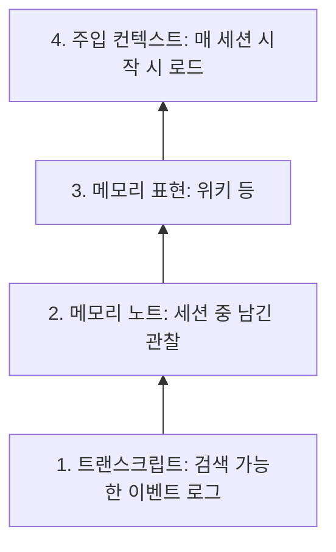

에이전트에게 메모리를 붙이면 잘 기억할 것 같지만, 실제로는 무엇을 적을지, 언제 정리할지, 틀린 기억을 누가 고칠지가 먼저 문제가 된다. Anthropic Engineering이 2026-11-06 공개한 "The components of agent memory"(저자 Lance Martin)는 이 문제를 구성요소별로 나눠 실험 수치와 함께 보여준다. 핵심 개념은 세션 사이에 에이전트가 자기 노트를 원본 로그와 대조해 고치고 위키로 엮는 오프라인 과정, **dreaming**이다. 아래 수치는 모두 Anthropic이 자체 평가로 보고한 것이며 외부 재현은 확인하지 못했다.

---

## 메모리의 정의와 4계층

글은 에이전트 메모리를 "Claude가 경험(사용자 상호작용, 과제)에서 얻어 세션 사이에 읽을 수 있는 컨텍스트로 보존하는 지식"으로 한정한다. 가중치 변경, 한 대화 안의 in-context learning, 컴팩션은 제외한다. 사람의 해마가 경험을 빠르게 기록하고 수면 중 재생해 장기 기억으로 옮기는 분업에 빗대어, 에이전트도 작업 중에는 기록하고 나중에 오프라인으로 재구성하자는 구도다.

아래층일수록 원본에 가깝고 넓으며, 위층일수록 작고 비싸지만 검색 없이 항상 보인다. 이 계층 구분이 이후 모든 실험의 기준축이다.

## 학습 루프와 노트의 가치

노트는 "이 패턴이 다시 중요해질 것"이라는 예측이다. CL-Bench 1.0 데이터베이스 과제에서 Claude가 질문에 답하고 정답을 본 뒤 실패·가설·규칙을 기록하게 했더니, 메모리가 없을 때 대비 평균 보상이 다음처럼 올랐다.

| 모델 | 메모리 없음 | 메모리 있음 |
|---|---|---|
| Opus 5.5 | 0.655 | 0.838 |
| Sonnet 5.5 | 0.644 | 0.833 |
| Opus 5 | 0.564 | 0.828 |
| Opus 4.7 | 0.383 | 0.700 |
| Sonnet 5 | 0.306 | 0.610 |
| Sonnet 4.6 | 0.330 | 0.364 |

흥미로운 지점은 모델 세대별로 "루프를 닫는 정도"가 다르다는 관찰이다. Sonnet 4.6은 검증하지 않은 이론만 쌓았고, Opus 4.7은 노트를 참조 문서로 합치며 검증된 사실을 표시했으며, Opus 5가 처음으로 규칙·근거·경고까지 갖춘 루프를 완전히 닫았다고 한다.

## 무엇을 적을지: 중요도 판단

포켓몬 레드 실험은 중요도 판단 차이를 극적으로 보여준다. 약 1만 스텝 시점에 Sonnet 3.7은 폴더 225개에 메모리 파일 413개를 만들고도 뱃지 1개였다. 돈, 위치 같은 금방 낡는 상태를 적고 메모리 재정리에 스텝을 쓴 탓이다. 같은 시점의 Fable 5는 파일 약 10개와 `global.md` 대시보드로 뱃지 4개를 얻었다. 모델이 직접 도출한 전략과 검증된 규칙처럼 "Claude가 계산해야만 존재하는 정보"만 남겼기 때문이다.

글쓰기 지침도 같은 방향이다. 메모리가 무엇을 위한 것인지만 알려주고 사용법은 정하지 않는 편이 Opus 4.7·Opus 5에서 잘 통했다. 반대로 "실패만 기록하라"는 고정 규칙은 이득을 깎았다(Opus 5 −0.234, Opus 4.7 −0.150, Sonnet 4.6 −0.020). 약한 모델에는 반대로 명시적 지시가 필요했다. Sonnet 4.6에게 메모리를 먼저 읽고 이론을 검증하라고 시키자 점수가 0.364에서 0.641로 올랐다.

## dreaming: 틀린 기억을 고치는 오프라인 정리

dreaming은 로그와 트랜스크립트를 되돌아보며 실수를 고치고, 노트를 쓰고, 다음 세션에 미리 로드할 내용을 정하는 오프라인 과정이다. 글은 Letta와 UC Berkeley의 sleep-time compute 아이디어와 연결한다.

포켓몬 Mt. Moon 사례가 교정 효과를 보여준다. 어떤 노트가 포켓몬 센터 위치를 산의 반대편으로 잘못 적었고, Claude는 동굴을 통과했다고 결론 냈다. 틀린 노트 그대로 진행한 경우 외길 절벽에서 세 번 떨어진 끝에 Pewter City로 되돌아갔다. dreaming이 노트를 트랜스크립트와 대조해 고친 뒤에는 동굴에 다시 들어가 action 1,935에서 Cerulean City에 도달했다. 메모리 없는 실행은 Cerulean에 도달하지 못했다. 즉 메모리는 틀리면 없는 것보다 나쁠 수 있고, 트랜스크립트가 그 진위를 가리는 기준(ground truth)이 된다.

## 위키 vs 검색: 실험 결과

Stainless 내부 파일 약 35만 개(약 4.2억 토큰)와 평가 질문 25개로 비교한 결과는 다음과 같다. Opus 5가 dreaming 세션에서 위키 페이지를 쓰고 링크하고, 중복을 합치고, 주장을 원본과 대조했다.

| 구성 | 결과 |
|---|---|
| 검색만 | 53% |
| 위키만 (dreaming 2회 → 128회) | 13% → 48% |
| 위키 + 검색 | 54% → 61%, 질문당 약 2만 토큰 절감 |

위키는 103페이지·링크 766개에서 222페이지·링크 12,893개로 자랐다. 여러 문서를 종합해야 하는 Harvey LAB 합병 질문 24개에서는 위키가 87%, 검색만이 73%였다. 한계 사례도 함께 제시된다. 기준이 한 문서에 몰려 있는 과제에서는 위키가 검색 대비 뚜렷한 이득이 없었고, 다른 위키는 115KB 코퍼스에서 203KB(1.77배)로 불어나면서 추상화가 거의 안 된 채 일부 페이지는 링크도 없었다.

정리하면 위키는 검색을 대체하지 못하고, 종합이 필요한 질문에서 검색 위에 얹을 때 가치가 크다. 위키 단독 13%라는 시작점은 dreaming을 충분히 돌리지 않은 위키가 얼마나 쓸모없는지도 보여준다.

## 설계 지침: 구조와 승격

**주입 컨텍스트는 작게.** dreaming은 노트를 매 세션 로드되는 최상위 층으로 승격할 수 있지만, 토큰을 쓰고, 틀린 노트가 모든 세션에 전파되고, 지침이 길수록 준수율이 떨어진다. Claude Code는 `MEMORY.md`의 앞 200줄 또는 25KB만 로드하므로, 이 파일은 상세 노트를 가리키는 작은 인덱스로 쓰는 것이 맞다.

**목표에 맞춘 구조.** 계약서 과제에서 여러 에이전트가 공유 표 하나에 쓰자 서로 덮어써 57개 사실 중 41개(72%)만 남았다. reflect-propose-rebuild 루프로 지침을 고치자 계약마다 페이지를 따로 두고 조항을 원문 그대로 인용하게 되어 57개가 모두 남았다. 공유 메모리를 여러 에이전트가 쓸 때는 작성자를 분리하라는 교훈이다.

**세션 간 빈틈 메우기.** 한 과제에서 두 번째 패스가 없는 페이지를 가리키던 링크 9개를 고치고 인덱스를 추가해 위키를 38→41항목, 링크 225→278개로 키웠다. 단일 세션에서는 보이지 않는 패턴을 여러 세션을 가로질러 볼 수 있다는 점이 dreaming의 고유한 이점이다.

## 열린 문제

글이 스스로 꼽는 한계는 네 가지다.

- **시점**: 작업 중 기록은 중요도를 현장에서 잡지만 과제를 방해하고, dreaming은 백그라운드로 미루는 대신 결과가 즉시 쓸 수 없을 수 있다.
- **신선도**: 처음부터 틀렸거나 환경 변화로 낡은 기억을 고쳐야 하는데 전부 점검하면 비싸다. 바뀔 가능성이 큰 정보에 집중하거나 접근 빈도에 맞춰 주기를 조절하자는 제안이 나온다.
- **기반**: 트랜스크립트 검색이 바닥이고 위키·검색이 그 위에 얹힌다는 구도지만, 표현을 유지하는 데 계산이 들고 오류·환각이 쌓일 위험이 있다.
- **미래 수요**: 어떤 모델도 미래 대화가 필요로 할 것을 미리 알 수 없다.

## 적용 시 판단 기준

| 상황 | 권장 |
|---|---|
| 강한 모델, 열린 과제 | 메모리 용도만 알려주고 중요도 판단은 모델에 맡긴다 |
| 약한 모델 | 메모리를 먼저 읽고 가설을 검증하라고 명시한다 |
| 여러 문서를 종합하는 질문 | 위키 + 검색 조합, dreaming을 충분히 반복한다 |
| 핵심 정보가 한 문서에 있음 | 검색만으로 충분할 수 있다 |
| 여러 에이전트가 함께 씀 | 작성자·페이지를 분리해 덮어쓰기를 막는다 |
| 매 세션 로드하는 파일 | 인덱스 수준으로 작게 유지하고 상세는 링크한다 |

이 글의 수치는 Anthropic 자사 모델과 자체 평가 세트 기준이라는 점을 감안해야 한다. 그래도 "메모리는 쓰는 것보다 고치고 줄이는 것이 어렵다"는 메시지는 자체 노트나 위키를 운영하는 입장에서 재현하기 쉬운 교훈이다.

---

## 참고 및 출처

- Anthropic Engineering, [The components of agent memory](https://www.anthropic.com/research/components-of-agent-memory) (2026-11-06)
- [GeekNews 토픽](https://news.hada.io/topic?id=36775)
