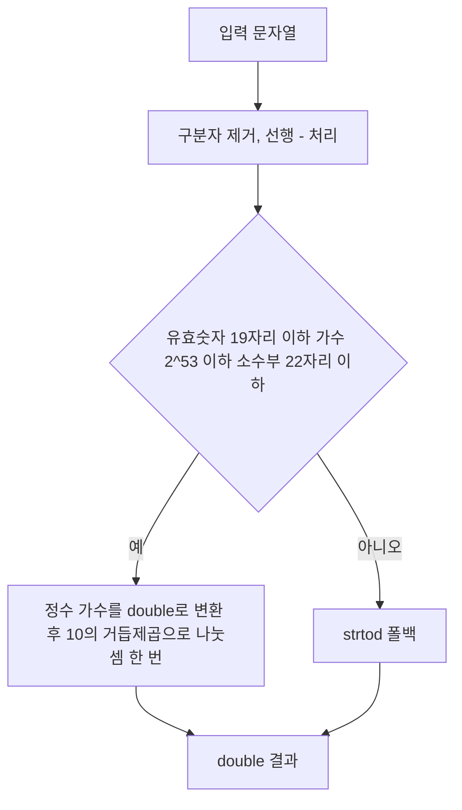

"Rust 확장이 C 확장보다 빠르다"는 결과가 나왔을 때, 그 차이가 언어에서 온 것인지 확인해 볼 만하다. Simon Willison은 2026년 11월 8일 글에서 SQLite 확장 함수 <strong>parse_number()</strong>를 C와 Rust로 각각 구현해 비교했고, 첫 결과의 원인이 언어가 아니라 glibc의 `strtod` 비용이었음을 보였다. 이 글은 그 측정과 원리를 정리한다. 모든 수치는 저자가 단일 환경에서 보고한 값이며 필자가 재측정한 것이 아니다.

## 무엇을 만들었나

`parse_number()`는 문자열에서 `,`, `$`, `£`, `%`를 제거하고 선행 `-`를 처리해 숫자로 바꾸며, 파싱할 수 없는 입력에는 NULL을 돌려주는 SQLite 확장 함수다. 구현과 탐색은 Claude(Opus 5.5)에게 맡기는 방식으로 진행됐다. 비교 대상은 일반 C 구현, 빠른 경로를 넣은 C 구현, Rust 바인딩 두 종류(rusqlite, sqlite-loadable), 그리고 순수 SQL의 `replace()` 체인이다.

## 측정 설정

각 확장을 Python `sqlite3`에 로드해 `select sum(parse_number(v)) from t`를 200만 행에 실행한다. 버전을 번갈아 돌리고, 값은 15회 중 최소에서 기준선 `sum(length(v))` 스캔 시간을 뺀 행당 순비용이다. 환경은 2 vCPU Linux x86-64 VM, SQLite 3.53.1, gcc 13.3, rustc 1.97, rusqlite 0.41, sqlite-loadable 0.0.6-alpha.6이다.

| 데이터 (ns/행) | 일반 C | 빠른 경로 C | rusqlite | sqlite-loadable | 순수 SQL replace() |
|---|---|---|---|---|---|
| 혼합 | 67.3 | 19.2 | 45.9 | 40.5 | 328.9 |
| 정수 | 25.1 | 15.8 | 36.4 | 32.1 | 342.5 |
| 소수 | 106.3 | 17.5 | 54.5 | 46.5 | 356.9 |

일반 C는 소수 데이터에서 106.3ns로 Rust 두 버전보다 느렸다. 빠른 경로를 넣은 C는 세 데이터셋 모두에서 Rust의 약 2배 빠르다. 공유 라이브러리 크기는 C가 약 14KB, Rust 두 버전이 약 298–321KB다(글 본문과 레포 표기가 약간 다르다).

## Clinger 빠른 경로의 원리

`strtod`는 임의 길이 입력도 올바르게 반올림해야 하므로 일반 경로가 비싸다. 그런데 대부분의 입력은 짧다. <strong>Clinger 방식</strong>은 가수(mantissa)와 10의 거듭제곱이 모두 double로 정확히 표현되는 좁은 영역에서, IEEE 나눗셈 한 번이 정확히 반올림된 결과를 준다는 점을 이용한다. 두 피연산자가 정확하면 나눗셈 결과는 올바르게 반올림되기 때문에 `strtod`와 같은 값을 얻는다.

레포의 적용 조건은 유효숫자 19자리 이하, 가수 ≤ 2^53, 소수점 뒤 22자리 이하이며, 이를 벗어나면 `strtod`로 폴백한다. 또 `FLT_EVAL_METHOD == 0`일 때만 켠다. x87처럼 확장 정밀도로 평가하는 환경에서는 중간 결과의 정밀도가 달라져 결과가 바뀔 수 있기 때문이다. 코드는 약 30줄이지만 조건이 하나라도 틀리면 조용히 잘못된 값이 나오므로 검증이 핵심이다.

## 정확성 검증

저자는 값과 `typeof()`를 확인하는 손작성 40케이스와, Python `float()`를 기준으로 비트 단위로 비교하는 퍼저(4개 시드 × 50만 입력 × 4개 확장, `-0.0`과 2^53 근처 값 포함)를 사용했고 불일치는 없었다고 보고한다. 최적화가 정확성 보장을 좁은 영역에 의존하는 경우, 이런 경계값 중심의 차분(differential) 테스트가 사실상 필수다.

## 해석할 때 주의할 점

- 이 벤치마크는 파싱과 함수 호출 비용을 잰다. Rust의 장점인 메모리 안전성과 짧은 코드는 반영되지 않으며, 저자도 Rust 쪽이 쓰기 더 안전하고 짧고 C는 수동 버퍼 관리와 검사가 필요하다고 정리했다.
- Rust 쪽에 같은 빠른 경로를 적용한 비교는 없다. 따라서 "C가 Rust보다 빠르다"가 아니라 "알고리즘 선택이 언어 선택보다 컸다"가 더 정확한 읽기다(이는 필자의 해석이다).
- 2 vCPU VM, 단일 환경 결과이므로 절대값보다 상대 비교로 읽어야 한다.

| 교훈 | 실무 적용 |
|---|---|
| 언어 비교 전에 표준 라이브러리 호출을 먼저 프로파일 | 핫 경로의 `strtod`, `printf` 류 호출 비용 확인 |
| 좁은 영역에서 정확한 빠른 경로 + 폴백 | 조건과 폴백을 명시하고 경계값 퍼저로 검증 |
| 크기·안전성은 속도와 별개 축 | 14KB 대 약 300KB, 메모리 안전성까지 함께 판단 |

## 참고 및 출처

- Simon Willison, parse_number() as a SQLite extension: C vs Rust: <https://simonwillison.net/2026/Nov/8/sqlite-parse-number-c-vs-rust/>
- 연구 보고서(방법·벤치마크 표·퍼저): <https://github.com/simonw/research/tree/main/sqlite-parse-number-c-vs-rust>
