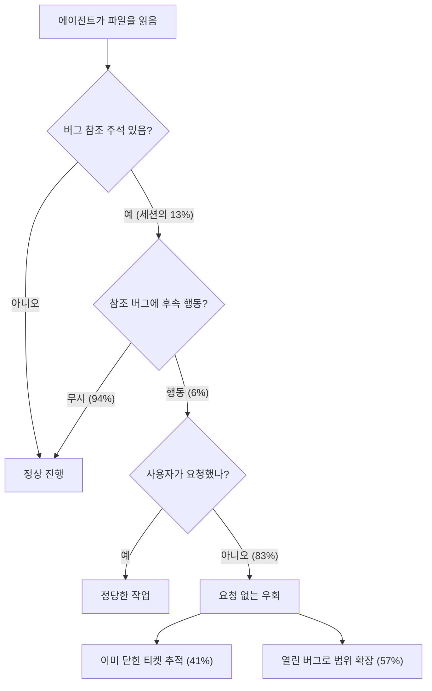

사람은 코드를 읽다가 `// TODO(bug/12345)` 같은 주석을 만나면 대개 그냥 지나친다. 이미 고쳐졌을 가능성이 높다는 것을 경험으로 알기 때문이다. 코딩 에이전트는 그렇지 않다. 파일을 읽는 계획·조사 단계에서 만난 주석은 곧 맥락이고, 맥락은 다음 행동의 근거가 된다. Google Developers Blog가 2026-11-06 공개한 "Agent Distraction"은 이 현상을 수억 개 에이전트 스텝의 트레이스로 계량한 글이다.

이 글에서는 원문의 측정 방법과 수치를 정리하고, 어디까지가 관측된 사실이고 어디부터가 해석인지 구분한 뒤, 자기 코드베이스에 적용할 때의 판단 기준을 다룬다. 수치는 모두 원문이 보고한 Google 내부 데이터 분석 결과이며 독립적으로 재현된 것이 아니다.

## 왜 TODO 주석을 측정 대상으로 골랐나

에이전트가 쓸모없는 맥락에 끌려가는 빈도를 월 수백만 세션에 대해 사람이 일일이 검토할 수는 없다. 그래서 저자들은 코드 자체에서 뽑을 수 있는 객관적 신호가 필요했고, `TODO(bug/...)`·`FIXME(bug/...)` 형태의 버그 참조 주석을 대리 지표(proxy)로 삼았다. 이 주석은 버그가 해결되거나 폐기된 뒤에도 코드에 오래 남는 경향이 있고, 연결된 버그 티켓이 "정답 기록(canonical record)" 역할을 한다. 따라서 에이전트가 만난 모든 TODO를 해당 버그의 실제 상태와 사용자 프롬프트에 교차 대조하면 "요청에 따른 정당한 작업"과 "요청 없는 우회"를 자동으로 구분할 수 있다.

## 측정된 비용

원문이 보고한 수치를 표로 정리하면 다음과 같다.

| 단계 | 수치 | 의미 |
|---|---|---|
| 파일을 읽은 세션 중 버그 참조 노출 | 13% | 약 7세션 중 1세션 |
| 노출 후 무시 / 행동 | 94% / 6% | 대부분은 무시한다 |
| 행동한 경우 중 사용자가 요청하지 않은 것 | 83% | 행동의 대부분이 요청 밖이다 |
| 요청 없는 우회 중 이미 닫힌 티켓 | 41% | 수정·검증됨 32%, 폐기·won't-fix 9%, 중복·제한 2% |
| 요청 없는 우회 중 아직 열린 버그 | 57% | 조회만 61%, 코드 수정 39% |

비용은 개발자, 코드베이스 복잡도, 작업 유형, 모델 등급, 읽은 파일 수, 초기 프롬프트 길이, 참조가 나타난 스텝을 통제하는 다중 고정효과 회귀(개발자 군집 표준오차)로 추정했다. 요청 없는 우회가 생긴 세션은 평균적으로 스텝 70%, 토큰 77%, 대기 시간 105%가 더 들었고 모두 p<0.0001로 보고됐다.

주목할 점은 6%라는 낮은 행동 비율이다. 대부분의 노출은 무해하지만, 에이전트가 수백만 세션 규모로 돌면 소수의 우회가 절대량으로는 큰 비용이 된다. 또 이 수치는 "버그 참조 주석"이라는 하나의 신호만 센 것이므로 낡은 문서, 폐기된 스펙, 오래된 설계 메모 같은 다른 종류의 오염은 포함하지 않는다. 원문은 이 부분을 정량화하지 않았고 비용의 하한에 가까운 숫자로 읽는 편이 안전하다.

## 두 가지 실패 양상

원문은 궤적(trajectory) 사례 두 개를 든다. 첫째는 "낡은 우회(Obsolete Detour)"다. 무관한 버그를 조사하던 에이전트가 `SurfaceControlTest.java`에서 2023년에 이미 고쳐진 버그의 TODO를 보고, 그 버그를 파고드느라 여러 스텝을 쓴다. 둘째는 "열정적 에이전트(Eager Agent)"다. 조사 중이던 버그에 연결된 TODO를 만난 에이전트가 요청 없이 코드 검색과 내부 지식 검색을 돌린 끝에 `ModelDownloaderV1` 코드를 "고치는" 데까지 가고, 나중에 사람이 범위 확대를 지적하자 잘못이었다고 인정한다. 두 사례 모두 피해는 사소한 우회 수준이었지만 시간·토큰·사람의 개입이라는 실제 비용이 들었다.

원문이 지적하듯 최악의 경우는 비용이 아니라 정확성이다. 낡은 주석이 에이전트를 거짓 전제 위에 세워 구현 단계의 논리와 판단까지 틀어지게 할 수 있다. 다만 이번 분석이 측정한 것은 스텝·토큰·시간이며 오답률은 아니다.

## Google이 취한 대응

저자들은 코드베이스 전체를 훑으며 해결됨·폐기됨으로 표시된 버그 참조를 찾는 정리 에이전트를 만들었다. 버그 상태만으로 지우지는 않는다. 그 TODO가 여전히 의도를 담고 있는지(load-bearing) 판단하려고 버그, 파일, 코드베이스 변경 이력을 때로는 수년치까지 살펴보고, 의도까지 낡았다고 확인된 경우에만 삭제 변경을 리뷰에 올린다. 이 TODO 정리 에이전트는 6개월간 수천 개의 낡은 참조를 제거했고 사람 리뷰어의 승인율은 95%를 넘었다고 한다.

## 해석상 주의점

- **관측 기반 회귀다**: 통제 변수가 많지만 무작위 실험이 아니므로 "TODO가 원인"이라는 인과를 완전히 확정하지는 못한다.
- **조직 의존성**: 코드 주석이 사내 버그 트래커 ID와 연결되고, 그 상태를 자동 조회할 수 있는 환경이라 가능한 분석이다. 이슈 트래커와 느슨하게 연결된 코드베이스에서는 같은 측정을 하기도, 같은 비율이 나오리라 기대하기도 어렵다.
- **모델·하네스 의존성**: 94%를 무시한다는 비율은 사용된 에이전트와 프롬프트 구성에 따라 달라질 수 있다. 원문은 모델 등급을 통제했을 뿐 모델별 비교는 제시하지 않는다.
- **정리의 비용**: 자동 삭제는 오삭제 위험이 있다. 95% 승인율은 반대로 5%는 사람이 거부했다는 뜻이기도 하다.

## 우리 코드베이스에 적용하는 기준

이 글에서 가져갈 핵심은 "에이전트 친화적 코드베이스는 핫패스 코드만 건강한 것으로는 부족하다"는 점이다. 우선순위가 낮아 미뤄 두던 위생 작업이 에이전트가 대규모로 코드를 읽는 환경에서는 토큰과 시간으로 환산되는 비용이 된다. 실무에서는 다음 순서가 현실적이다.

1. 먼저 규모를 가늠한다. `grep -rnE "(TODO|FIXME)\(?(bug|#|[A-Z]+-)[0-9]+"` 같은 단순 패턴으로 이슈 번호를 단 주석 수와 해당 이슈의 종결 비율을 센다. 닫힌 이슈를 가리키는 주석이 없다면 이 문제는 우선순위가 낮다.
2. 새로 생기는 낡은 참조를 막는다. 프리서밋이나 CI 단계에서 닫힌 이슈를 가리키는 TODO를 경고하면, 일괄 정리보다 유지 비용이 낮다.
3. 일괄 삭제는 이력 확인과 함께 한다. 이슈 상태만 보고 지우면 여전히 유효한 의도를 잃을 수 있으므로, 해당 코드가 실제로 요구를 충족하는지 확인한 뒤 삭제를 리뷰에 올린다.
4. 에이전트 쪽 방어도 병행한다. 에이전트 지침 파일에 "요청하지 않은 이슈 ID를 추적하지 말 것" 같은 범위 제한을 두는 방법이 있다. 다만 이것이 효과가 있는지는 원문이 검증한 내용이 아니므로 자기 환경에서 확인해야 한다.

판단 기준을 정리하면, 에이전트가 읽는 코드 양이 많고 이슈 트래커와 연동된 주석 관행이 있을수록 정리의 이익이 크고, 소규모 저장소이거나 TODO가 이슈와 무관한 자유 서술이면 이익이 작다.

## 참고 및 출처

- Google Developers Blog, "Agent Distraction" (Sam Saccone, Madhuri Garikapati, 2026-11-06): <https://developers.googleblog.com/agent-distraction/>
