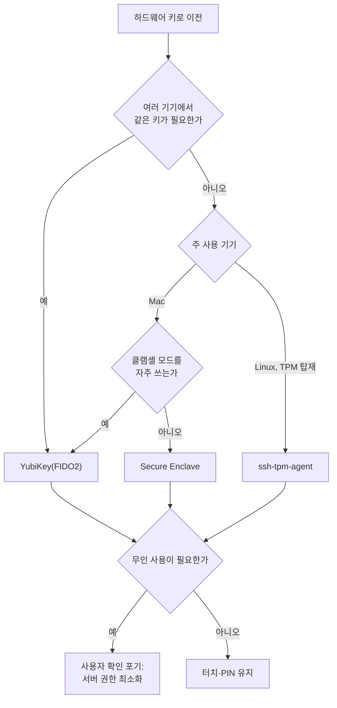

SSH 개인키는 대개 `~/.ssh/id_ed25519` 같은 파일 하나로 존재한다. 노트북을 백업하다 딸려 나가거나, 악성 패키지가 홈 디렉터리를 훑거나, 개발 도구의 취약점으로 읽히는 순간 그 파일은 곧 "내가 접속할 수 있는 모든 서버의 열쇠"가 된다.

2026-11-03에 Alex Haydock이 쓴 글 "I deleted all my SSH keys"는 이 문제를 아예 "디스크에 보호받지 못하는 키 재료를 남기지 않는다"는 방향으로 푼 사례다. 이 글은 그 내용을 바탕으로 세 가지 하드웨어 기반 방식(YubiKey, TPM, Apple Secure Enclave)의 명령어, 구조적 차이, 무인 사용 시 대가, 선택 기준을 정리한다. 명령어와 한계는 원문 저자가 자신의 환경(LXC 컨테이너, SSHFS 마운트 등)에서 시험한 결과이므로 본인 환경에서 한 번 더 확인하는 것을 전제로 읽자.

## 먼저 정할 것: 무엇을 막으려는가

저자는 패스프레이즈를 건 키(bcrypt KDF + AES)도 대부분의 위협 모델에서는 "아마 충분하다"고 본다. 다만 `ssh-agent`에 한 번 풀어 넣으면 복호화된 키가 메모리에 남고, 패스프레이즈가 없는 키는 파일 유출이 곧 침해다. 하드웨어 기반 키가 막아 주는 것은 정확히 **키 파일이 복사돼 다른 기기에서 쓰이는 시나리오**다.

반대로 하드웨어 키가 막지 못하는 것도 분명하다. 내 기기가 장악된 상태에서 에이전트나 하드웨어 장치가 "사용 가능" 상태라면, 공격자는 키를 훔치지 못해도 **내 키를 빌려 쓸 수는** 있다. 그래서 아래에서 반복해서 나오는 "터치(사용자 존재 확인)를 요구하느냐"가 설계의 핵심 축이다.

## 핵심 구분: resident와 bound

하드웨어 키는 키 재료가 어디에 있느냐에 따라 두 부류로 나뉜다.

- **상주(resident)**: 키 재료가 장치 안에서 생성돼 밖으로 나오지 않는다. YubiKey와 Secure Enclave가 여기에 속한다. 디스크에 있는 파일은 장치 안의 키를 가리키는 **핸들**일 뿐이라, 파일이 유출돼도 키 재료는 나가지 않는다.
- **결합(bound)**: 암호화된 키 재료가 디스크에 남아 있고, 해당 기기의 TPM만 그것을 복호화할 수 있다. TPM 방식이다. 파일만 훔쳐서는 쓸 수 없지만, 키가 장치 "안에" 있는 것은 아니다.

| 구분 | YubiKey (FIDO2) | TPM (ssh-tpm-agent) | macOS Secure Enclave |
|---|---|---|---|
| 키 위치 | 장치 내부(resident) | 디스크에 암호화 저장, TPM이 복호화(bound) | Secure Enclave 내부(resident) |
| 추가 소프트웨어 | OpenSSH 외 불필요(`ykman`은 선택) | ssh-tpm-agent | 불필요(`sc_auth`, `ssh-keychain.dylib`) |
| 사용자 확인 | 터치(기본) 또는 없음 | PIN 또는 없음(무인) | Touch ID(`-t bio`) 또는 없음 |
| 비용 | 장치 구매 | 기존 TPM 활용 | 기존 Mac 활용 |
| 주된 단점 | 분실 시 키 상실, 구매 비용 | 키 파일이 디스크에 있음, PCR 미결합 | 덮개를 닫으면 Touch ID 불가, 개별 내보내기 불가 |
| 이식성 | 높음(다른 PC에 꽂아 사용) | 기기에 종속 | 기기에 종속 |

## 방법 1: YubiKey와 FIDO2 `ed25519-sk`

YubiKey 5 시리즈 이상이면 OpenSSH만으로 쓸 수 있다. 키 생성은 다음과 같다.

```bash
ssh-keygen -t ed25519-sk -O resident -O application="ssh:yournamehere" -f ~/.ssh/id_ed25519-sk
```

`-O resident`는 자격증명을 장치 안에 저장하라는 뜻이고, `application`은 나중에 장치에서 자격증명을 식별하는 이름표다. 생성되는 `.pub`는 일반 공개키처럼 `authorized_keys`, `ssh-copy-id`, Git 호스팅 서비스에 그대로 등록하면 된다. 개인키 파일(`~/.ssh/id_ed25519-sk`)에는 키 재료가 없고 장치 안의 키를 가리키는 핸들만 들어 있다. `ssh-add`로 올리거나 `~/.ssh/config`의 `IdentityFile`로 지정한다.

장치에 저장된 자격증명 목록과 FIDO PIN은 `ykman`으로 관리한다.

```bash
ykman fido credentials list
ykman fido access change-pin
```

기본 설정에서는 인증할 때마다 장치를 **터치**해야 한다. 이 터치가 앞서 말한 사용자 존재 확인이다. 크론이나 마운트처럼 사람이 없는 환경에서는 터치를 끌 수 있다.

```bash
ssh-keygen -t ed25519-sk -O resident -O no-touch-required -O application="ssh:nameyourkey" -f ~/.ssh/id_ed25519-sk
```

이때 서버의 `authorized_keys` 항목 앞에도 `no-touch-required` 옵션을 붙여야 OpenSSH가 해당 키를 받아 준다. 키가 장치 밖으로 나가지는 않지만, YubiKey가 꽂혀 있는 동안에는 그 장치에 접근 가능한 누구든 사람 확인 없이 인증할 수 있다는 점은 감수해야 한다.

## 방법 2: TPM과 ssh-tpm-agent

서버나 데스크톱처럼 별도 장치를 사고 싶지 않다면 이미 내장된 TPM을 쓸 수 있다. Go로 작성된 [ssh-tpm-agent](https://github.com/Foxboron/ssh-tpm-agent)가 이를 맡는다. Ubuntu는 패키지를 제공하고, 저자는 Fedora 패키징을 진행 중이라고 밝혔다.

```bash
# PIN을 건 키 생성
ssh-tpm-keygen -N "your-pin"

# Go로 직접 설치했다면 systemd 소켓 유닛 설치·활성화
ssh-tpm-agent --install-user-units && systemctl --user enable --now ssh-tpm-agent.socket

# 셸 설정(.bashrc 등)에서 SSH가 이 에이전트를 보도록 지정
export SSH_AUTH_SOCK="$(ssh-tpm-agent --print-socket)"
```

여기서 반드시 이해해야 할 점은 **키가 장치 안에 상주하지 않는다**는 것이다. 개인키는 `.tpm` 확장자의 암호화된 파일로 디스크에 남고, TPM만 이것을 풀 수 있다. 파일이 유출돼도 그 기기의 TPM 없이는 쓸 수 없지만, 기기 자체를 장악당하면 에이전트를 통해 쓰일 수 있다. 또 하나, 에이전트는 키를 PCR(펌웨어·OS 상태를 측정한 레지스터) 값에 묶지 않는다. 그래서 펌웨어나 OS가 바뀌어도 언실링(복호화)이 막히지 않는다. 디스크 암호화에서 BitLocker가 부팅 상태에 키를 묶는 것과는 다른 동작이므로, "부팅 변조까지 막아 준다"고 기대하면 안 된다.

무인 사용은 PIN을 빈 값으로 만들어 해결한다.

```bash
ssh-tpm-keygen -N ""
```

```text
# ~/.ssh/config
IdentityAgent /run/user/1000/ssh-tpm-agent.sock
IdentityFile ~/.ssh/id_ecdsa
```

소켓 경로의 `1000`은 UID가 고정이라는 가정이다. 셸이 없는 systemd 마운트 유닛 같은 서비스에서 유용하지만, 빈 PIN이면 그 기기에서 코드를 실행할 수 있는 누구나 키를 쓸 수 있다.

## 방법 3: macOS Secure Enclave

macOS Sequoia 이상에서는 스마트 카드 인증 기능이 SSH 키를 기본 지원한다. 내보낼 수 없고 Touch ID로 보호되는 키는 다음처럼 만든다.

```bash
sc_auth create-ctk-identity -l "ssh-labelyourkey" -k p-256-ne -t bio
```

`-l`은 나중에 핸들 파일을 찾는 라벨, `-k p-256-ne`는 내보내기 불가(non-exportable) P-256 키, `-t bio`는 사용할 때마다 Touch ID를 요구한다는 뜻이다. 목록은 `sc_auth list-ctk-identities`로 보고, 핸들은 다음 명령으로 `~/.ssh`에 내보낸다.

```bash
(cd ~/.ssh && ssh-keygen -w /usr/lib/ssh-keychain.dylib -K -N "")
```

PIN은 빈 값으로 둔다. 저자는 키를 하나씩 골라 내보내지 못하고 **모든** Enclave 키의 핸들이 내보내졌다고 보고한다(Apple 문서와 달랐다고 한다). 그래서 라벨을 알아보기 쉽게 짓는 것이 중요하다. 참고로 [ssh-keychain man 페이지](https://keith.github.io/xcode-man-pages/ssh-keychain.8.html)가 있다. 이어서 `~/.zshrc`에 provider를 지정하고, macOS 에이전트가 키를 자동 탐색하지 못했기 때문에 `IdentityFile`을 명시했다.

```bash
export SSH_SK_PROVIDER=/usr/lib/ssh-keychain.dylib
```

```text
Host blog.infected.systems
    IdentityFile ~/.ssh/id_ecdsa_sk_rk_ssh-labelyourkey
```

가장 현실적인 걸림돌은 **덮개를 닫고 외부 모니터로 쓰는 클램셸 모드**다. 이때는 Touch ID를 쓸 수 없어 `-t bio` 키 생성이 실패한다(키체인이나 Apple Pay와 달리 암호로 대체되지 않는다). 우회책은 `-t none`으로 사용자 확인을 끄는 것(YubiKey 무인 사용과 같은 위험), Touch ID가 달린 Magic Keyboard를 쓰는 것, 또는 상시 꽂아 두는 [YubiKey 5C Nano](https://www.yubico.com/gb/product/yubikey-5c-nano/)와 방법 1을 조합하는 것이다. 마지막 방법은 터치 확인이 유지된다는 장점이 있다.

## 어떤 방식을 고를까



판단 기준을 말로 정리하면 다음과 같다. 설정 난이도는 대체로 YubiKey가 가장 쉽고 TPM, Secure Enclave 순으로 번거롭다는 것이 저자의 평가다. 비용은 YubiKey만 별도 구매가 필요하다. 이식성은 YubiKey만 기기를 넘나들 수 있고 나머지는 기기에 종속된다.

무인 사용이 필요하다면 어떤 방식이든 사용자 존재 확인을 포기하는 대가를 치른다는 것이 공통 결론이다. 이 경우 해당 키로 접속되는 계정의 권한을 줄이거나, 접속 가능한 명령을 `authorized_keys`의 옵션으로 제한하는 보완이 현실적이다(이 부분은 원문이 아니라 일반적인 OpenSSH 운용 관행에 기대어 덧붙인 의견이다).

## 분실에 대비하라

하드웨어에 묶인 키는 장치가 고장 나거나 분실되거나 교체되면 쓸 수 없게 된다. 저자의 권고는 단순하다. `authorized_keys`에는 키를 여러 개 등록할 수 있으니, 방식을 섞어 최소 두 개 이상을 올려 두라는 것이다. 예컨대 YubiKey 두 개, 또는 YubiKey 하나와 노트북 TPM 키를 함께 등록해 두면 한쪽을 잃어도 서버에서 쫓겨나지 않는다. 키를 없애기 전에 이 여분 경로가 실제로 동작하는지부터 확인하는 것이 순서다.

## 마무리 체크리스트

- 어떤 위협을 막으려는지 정했는가(파일 유출 vs 기기 장악).
- 상주 키(YubiKey, Secure Enclave)와 결합 키(TPM)의 차이를 이해했는가.
- 무인 사용 키는 사용자 확인이 없다는 사실을 받아들이고 서버 측 권한을 줄였는가.
- 백업 키가 최소 하나 이상 `authorized_keys`에 등록돼 있고 실제로 접속해 봤는가.
- 기존 평문·패스프레이즈 키는 새 키 동작을 확인한 뒤에 지웠는가.

## 참고 및 출처

- Alex Haydock, ["I deleted all my SSH keys"](https://blog.infected.systems/posts/2026-11-03-i-deleted-all-my-ssh-keys/) (2026-11-03)
- [ssh-tpm-agent (GitHub)](https://github.com/Foxboron/ssh-tpm-agent)
- [ssh-keychain(8) man 페이지](https://keith.github.io/xcode-man-pages/ssh-keychain.8.html)
- [ssh-keygen(1) — OpenBSD man](https://man.openbsd.org/ssh-keygen)
- [YubiKey 5C Nano](https://www.yubico.com/gb/product/yubikey-5c-nano/)
