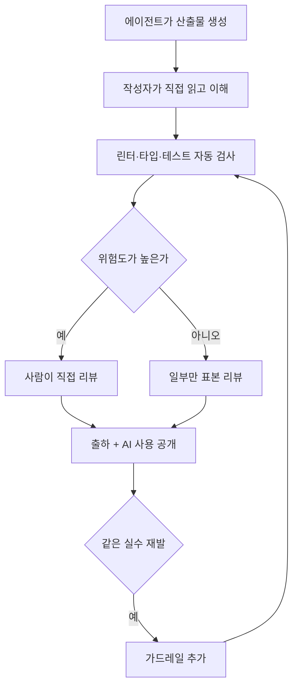

AI가 코드·문서·계획·메시지를 대신 써 주는 시대에, 우리는 누구나 "읽는 데 시간만 잡아먹는 AI 산출물"을 받아 본 적이 있고 보내 본 적도 있다. 2026년 AIE Code Summit의 연사와 참가자들이 이 문제에 이름을 붙이고, 2001년 Agile Manifesto 형식을 빌려 원칙을 적었다. 그것이 **No AI Slop** 선언문이다. 이 글은 선언문의 내용을 요약하고, 개발 실무에서 어떻게 읽을 수 있는지 정리한다.

> 선언문은 규범적 문서라서 실증 데이터가 없다. 아래 1–3절은 원문 요약이고, 4절 이후의 해석은 글쓴이의 의견이다.

---

## 선언문은 무엇이고 누가 썼나

원문은 <https://www.slopmanifesto.com/>에 있다. AIE Code Summit 2026의 연사와 참가자들이 작성했고, 2001년 유타주 스노버드의 스키 롯지에서 소프트웨어 리더 17명이 썼던 Agile Manifesto의 형식을 따른다. 페이지 스냅샷 기준 서명자는 352명이며 서명은 GitHub gist 댓글로 받아 문서에 주기적으로 반영한다. 선언문 스스로도 아직 아무도 완전히 정답을 갖고 있지 않으며 커뮤니티 의견으로 계속 고쳐 가겠다고 밝힌다.

형식은 세 부분이다. **가치**(무엇을 더 중시하는가) 다섯 개, **신념**(왜 그렇게 보는가) 아홉 개, **결의**(그래서 무엇을 하는가) 열두 개다.

## 다섯 가지 가치

Agile Manifesto처럼 "A보다 B"의 꼴로 쓰였다.

| 더 중시 | 덜 중시 |
|---|---|
| 결과(outcomes) | 산출량(output) |
| 이해(understanding) | 속도 |
| 자기 자신의 사고 | 모델의 첫 초안 |
| 더 나은 작업 | 더 쉬운 작업 |
| 시스템 개선 | 개별 산출물 땜질 |

핵심은 AI를 쓰지 말자는 것이 아니다. 같은 도구를 쓰면서 무엇을 목표로 삼는가의 문제다.

## 신념: 슬롭은 왜 생기고 왜 퍼지는가

슬롭의 정의가 인상적이다. 선언문은 슬롭을 "만드는 데 들인 노력이 받는 사람이 이해하는 데 들여야 하는 노력보다 작을 때" 생긴다고 본다. 그리고 AI를 썼다고 자동으로 슬롭이 되는 것은 아니며, 품질과 독자의 경험에 책임지지 않은 채 결과물을 넘길 때 슬롭이 된다고 말한다. 결국 슬롭은 도구의 속성이 아니라 **책임의 공백**이다.

신념 중 실무에서 특히 곱씹을 만한 것은 세 가지다.

1. **비대칭성**: 생성 비용은 0에 가까워지는데 검토 비용은 그대로다. 에이전트는 하루에 사람이 평생 검토할 분량을 만들 수 있다.
2. **복리성**: 문서·채팅·코드에 쌓인 슬롭을 다음 에이전트가 읽고 그대로 복제한다. 낡은 TODO 주석이 코딩 에이전트의 비용을 올린다는 [Google의 Agent Distraction 분석](/post/2026-11-12-google-agent-distraction-stale-todo-cost/)도 같은 계열의 현상으로 읽을 수 있다. 다만 이 연결은 선언문이 한 말이 아니라 글쓴이의 해석이다.
3. **사기 저하**: 슬롭이 쌓이면 팀이 저항할 동기를 잃고, 소통과 품질이 서서히 내려간다.

이 밖에 선언문은 AI 이전에도 문제를 고치지 않고 우회만 하면 슬롭이 늘었고(도구가 덧붙이기 쪽으로 치우쳐 있기 때문), 조직이 사람이 해낼 수 있는 범위를 늘리라고 압박할 때도 슬롭이 늘어난다고 짚는다.

## 열두 결의 중 실무적인 것

결의는 태도와 구체적 행동이 섞여 있다. 바로 옮길 수 있는 것만 추리면 다음과 같다.

가장 근본적인 결의는 책임의 귀속이다. AI가 얼마나 도왔든 출하물의 의도와 품질과 결과는 보낸 사람의 몫이며, 에이전트가 쓴 내용을 보낼 때는 그 사실을 밝히고 중요한 부분을 보내기 전에 직접 확인해야 한다. 반대로 슬롭을 받았다면 친절하게 알리고 먼저 검토해 달라고 요청하라고 권한다. 이는 슬롭의 비대칭성, 즉 보내는 쪽은 공짜이고 받는 쪽만 비용을 치르는 구조를 사회적 규범으로 교정하려는 시도다.

검증에 관해서는 에이전트 리뷰·린터·검증기가 유용하지만 충분하지 않다는 입장이다. 위험도에 따라 산출물의 일부는 사람이 직접 보아야 하고, 모델이 좋아져도 검토를 완전히 끊으면 결과가 다른 모두와 같은 평균으로 수렴한다고 본다. 성과 측정도 바뀌어야 한다. 코드 줄 수, 병합된 PR 수, 토큰 사용량, 병렬 에이전트 수가 아니라 무엇이 출하됐고 누가 쓰며 어떤 도움이 되는지로 성공을 재라는 것이다.

마지막으로 같은 실수가 두 번 나오면 개인의 주의력에 기대지 말고 린터·타입 검사기·자동 검사 같은 가드레일로 시스템을 고치라고 한다. 사람의 검토 시간을 아끼는 가장 확실한 방법이 반복되는 지적을 기계에 넘기는 것이기 때문이다.

## 실무로 옮기면

선언문의 결의를 평소 개발 흐름에 대응시켜 보면 대략 이렇다.

몇 가지 적용 포인트를 덧붙인다.

- PR 설명에 "에이전트가 작성, 이 부분은 직접 확인함" 같은 한 줄을 습관으로 두면 결의 6을 비용 거의 없이 지킬 수 있다.
- 리뷰어가 같은 지적을 두 번 하게 됐다면 그것이 린트 규칙이나 CI 검사로 바뀔 신호다. 결의 12는 리뷰 노동을 줄이는 방법이기도 하다.
- 에이전트 사용량 대시보드(토큰·병렬 에이전트 수)를 성과 지표로 쓰고 있다면 결의 10의 경고 대상이다.

푸시 전에 이해도 퀴즈를 거치게 하는 방식이나 하네스 엔지니어링 논의는 "이해 우선, 시스템 개선"이라는 같은 방향의 구체 도구로 볼 수 있다. 하네스 쪽은 [AI 코딩 에이전트 하네스 엔지니어링](/post/2026-08-10-ai-coding-agent-harness-engineering/)에서 다뤘다. 이 역시 선언문이 직접 언급한 것은 아니다.

## 한계와 비판적 읽기

- **측정 불가능한 선언**: "슬롭이다/아니다"의 기준이 노력 비대칭이라 정성적이다. 팀마다 합의한 체크리스트로 번역하지 않으면 구호에 그친다.
- **리뷰 병목 문제는 그대로**: 일부를 직접 리뷰하라는 권고는, 생성량이 늘 때 어느 부분이 일부인지 고르는 문제를 풀어 주지 않는다. 위험도 분류 기준은 각자 만들어야 한다.
- **원샷·바이브 코딩을 부정하지 않음**: 선언문도 검토되지 않은 결과물이 항상 나쁜 것은 아니라고 인정한다. 일회용 스크립트와 장기 유지 제품은 다른 기준을 적용해야 한다.
- **서명 수는 합의의 증거가 아님**: 352명은 한 행사 커뮤니티의 규모일 뿐, 업계 합의로 읽으면 곤란하다.

## 정리

| 질문 | 선언문의 답 |
|---|---|
| 슬롭이란 | 만드는 노력이 이해하는 노력보다 작은, 책임 없이 넘긴 산출물 |
| 왜 퍼지나 | 생성은 공짜, 검토는 그대로(비대칭), 그리고 다음 에이전트가 복제(복리) |
| 누가 책임지나 | AI가 얼마나 도왔든 보낸 사람 |
| 무엇으로 막나 | 직접 사고, 공개, 위험도별 사람 리뷰, 재발 시 자동 가드레일 |
| 무엇으로 재나 | 출하물과 사용자 가치, 산출량 지표는 아님 |

---

## 참고 및 출처

- No AI Slop 선언문 원문: <https://www.slopmanifesto.com/>
- GeekNews 토픽(발견 경로): <https://news.hada.io/topic?id=37128>
