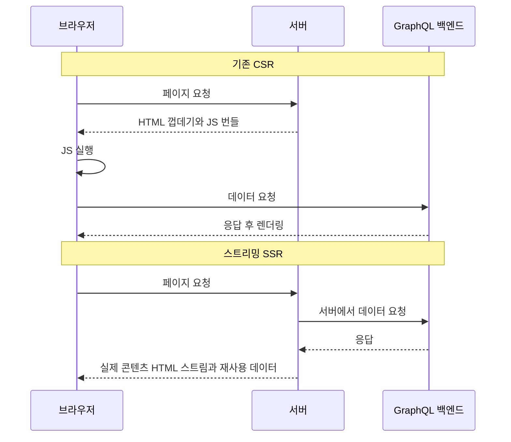
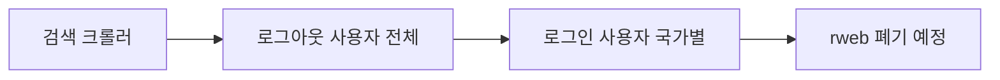

대형 서비스의 웹 프런트엔드를 처음부터 다시 만드는 일은 보통 "절대 하지 말아야 할 재작성"의 대표 사례로 꼽힌다. 그런데 X(구 트위터)가 엔지니어링 블로그에서, 엔지니어 5명과 AI 코딩 에이전트로 웹 앱을 약 6개월 만에 다시 만들고 서버 3개를 하나로 합쳤다고 밝혔다. 이 글은 그 보고를 정리하고, 어떤 부분이 기술적으로 의미 있고 어떤 부분은 검증되지 않았는지 구분해 읽어 본다.

> 아래 수치와 서술은 모두 X의 자체 보고이며 독립 검증은 없다. 원문(X Engineering 블로그의 "Rebuilding the global town square from scratch")은 이 글을 쓰는 시점에 자동 접근이 차단되어 직접 열어 보지 못했고, 이를 요약한 [GeekNews 토픽](https://news.hada.io/topic?id=37245)을 통해 내용을 확인했다. 그래서 원문 표현과 세부 조건은 달라질 수 있다.

---

## 무엇이 바뀌었나

기존 구조는 사용자용 웹 앱(rweb), 검색 크롤러·링크 프리뷰용 SSR 서버(rweb SSR), 별도의 Jetfuel SSR까지 **서버 3개**로 나뉘어 있었다고 한다. 세 시스템이 같은 화면을 각자 다른 방식으로 만들어 내니, 기능 하나를 바꿀 때마다 여러 곳을 맞춰야 했을 것이다(이 부분은 글쓴이의 추정이다). 새 앱은 이를 **스트리밍 서버 사이드 렌더링(Streaming SSR)** 앱 하나로 합쳤다.

## 클라이언트 렌더링에서 스트리밍 SSR로

**CSR(Client-Side Rendering, 클라이언트 사이드 렌더링)** 에서는 브라우저가 빈 HTML 껍데기와 JavaScript 번들을 받고, 번들을 실행한 뒤에야 GraphQL로 데이터를 요청한다. 네트워크 왕복이 직렬로 쌓이므로 느린 회선에서 첫 콘텐츠까지 걸리는 시간이 크게 늘어난다. 로그아웃 사용자나 검색 크롤러처럼 첫 화면이 곧 전부인 트래픽에서 특히 불리하다.

스트리밍 SSR은 서버가 HTML을 조각 단위로 흘려보내 **첫 응답부터 실제 콘텐츠**를 담는다. 서버가 이미 가져온 데이터는 브라우저가 다시 요청하지 않고 재사용하도록 직렬화해 함께 보낸다. React에서는 [renderToPipeableStream](https://react.dev/reference/react-dom/server/renderToPipeableStream) 같은 스트리밍 서버 API가 이 방식의 기반이다.

보고된 스택은 Vite, 스트리밍 SSR을 지원하는 React, Fastify, Relay(GraphQL), TypeScript, Tailwind CSS다. 링크 프리뷰 이미지를 만드는 서비스는 JavaScript에서 **Rust**로 다시 썼다고 한다. 크롤러에게 내보내는 HTML은 Googlebot이 읽는 용량 한도인 2MB 아래로 줄였다고 하는데, 이 한도는 [Google의 Googlebot 문서](https://developers.google.com/search/docs/crawling-indexing/googlebot)에 명시된 개념이다.

## 보고된 수치

| 지표 | 이전 | 이후 |
|------|------|------|
| 느린 네트워크에서 로그인 프로필의 첫 게시물까지 | 약 23.9초 | 약 2.7초 |
| 압축 JavaScript 다운로드(페이지별) | 약 4.1–4.8MB | 약 1.3–2.3MB |
| 프로필·게시물 로딩(랩 벤치마크) | 기준 | 8–13배 빨라짐 |

23.9초에서 2.7초는 약 8.9배 개선이다. 다만 "느린 네트워크"가 어떤 대역폭·지연 설정인지, 측정 횟수와 기기 조건은 확인하지 못했다. 번들이 절반 이상 줄었다는 점은 SSR 전환 자체보다 코드 정리와 분할의 효과가 섞여 있을 가능성이 크다(해석).

## AI 에이전트를 어떻게 운영했나

보고에 따르면 역할 분담은 분명하다. **엔지니어**가 아키텍처와 요구사항을 정하고 모든 변경을 검토했으며, **에이전트**는 기존 동작 이식, 페이지 변환, 테스트 작성, CI 실패 수정을 맡았다. 생성 코드의 품질을 지키는 장치는 세 가지였다.

- **[AGENTS.md](https://agents.md/)** 규칙 파일로 프로젝트 관례를 에이전트에게 고정한다.
- **25개 이상의 재사용 스킬**로 반복 작업의 절차를 묶는다.
- **커스텀 린트 규칙**으로 AI가 자주 만드는 패턴을 자동으로 거부한다.

여기서 눈여겨볼 점은 세 번째다. 사람 리뷰만으로는 에이전트가 쏟아 내는 변경량을 감당하기 어렵기 때문에, "AI 특유의 나쁜 패턴"을 기계가 먼저 걸러 내도록 린트를 만든 것이다. 이는 [No AI Slop 선언문](/post/2026-11-17-no-ai-slop-manifesto-aie-code-summit/)이 강조한 직접 검토와 가드레일 원칙을 대규모로 실행한 사례로도 읽힌다(해석).

## 위험을 줄인 이전 전략

재작성이 실패하는 전형적인 이유는 한 번에 갈아타려는 데 있다. 이들은 기존 서버를 **동작 기준(오라클)** 으로 삼고, 두 시스템을 병렬로 운영하며, 트래픽을 단계적으로 옮겼다.

크롤러는 결과가 눈에 띄게 깨져도 사용자 불만으로 이어지지 않으므로 가장 먼저 옮기기에 안전하다. 로그아웃 트래픽은 이미 전부 새 앱으로 넘어갔고, 로그인 사용자는 국가별로 이전 중이다. 기능 스위치로 즉시 기존 앱으로 되돌릴 수 있게 했고, 로그인 이전이 끝나면 rweb을 없앨 계획이다. 이 전략은 AI가 없어도 통하는 고전적인 스트랭글러(strangler) 방식의 변형이며, 에이전트가 만든 코드의 불확실성을 **되돌릴 수 있는 구조**로 흡수한다는 점에서 AI 시대에 더 중요해진다.

## 어떻게 읽어야 하나: 한계와 적용 판단

- **반사실 비교가 없다.** 5명 6개월이 에이전트 덕분인지, 원래 가능했던 규모인지 알 수 없다. 기존 코드가 이미 명세 역할을 하고 있었다는 점이 에이전트의 성과를 키웠을 수 있다.
- **자체 보고다.** 수치 측정 조건과 품질 지표(버그 건수, 접근성, 회귀)는 공개되지 않았다. 아직 이전이 끝나지 않았으므로 최종 평가는 이르다.
- **전제 조건이 중요하다.** 동작을 비교할 기존 시스템, 단계 이전을 가능하게 하는 라우팅, 되돌리기 스위치가 있었기에 가능한 방식이다. 이런 기반이 없는 팀이 같은 속도를 기대하면 위험하다.

실무에 가져갈 만한 것은 속도 숫자가 아니라 **운영 방식**이다. 규칙 파일과 스킬로 맥락을 고정하고, 린트로 반복 실수를 자동화하며, 기존 시스템을 오라클로 두고 트래픽을 조금씩 옮기는 것. 이 세 가지는 에이전트를 쓰는 어떤 마이그레이션에도 적용해 볼 수 있다.

## 정리

| 항목 | 내용 |
|------|------|
| 규모 | 엔지니어 5명, 약 6개월 |
| 구조 | 서버 3개를 스트리밍 SSR 앱 1개로 통합 |
| 가드레일 | AGENTS.md, 스킬 25개 이상, 커스텀 린트 |
| 이전 방식 | 크롤러, 로그아웃, 로그인(국가별) 순, 병렬 운영과 즉시 롤백 |
| 주의 | 모든 수치는 X 자체 보고, 독립 검증 없음 |

## 참고 및 출처

- X Engineering, "Rebuilding the global town square from scratch" (원문 직접 접근은 차단되어 요약본으로 확인)
- [GeekNews 토픽: X.com 재구축](https://news.hada.io/topic?id=37245)
- [React renderToPipeableStream](https://react.dev/reference/react-dom/server/renderToPipeableStream)
- [Google Googlebot 문서](https://developers.google.com/search/docs/crawling-indexing/googlebot)
- [AGENTS.md](https://agents.md/)
