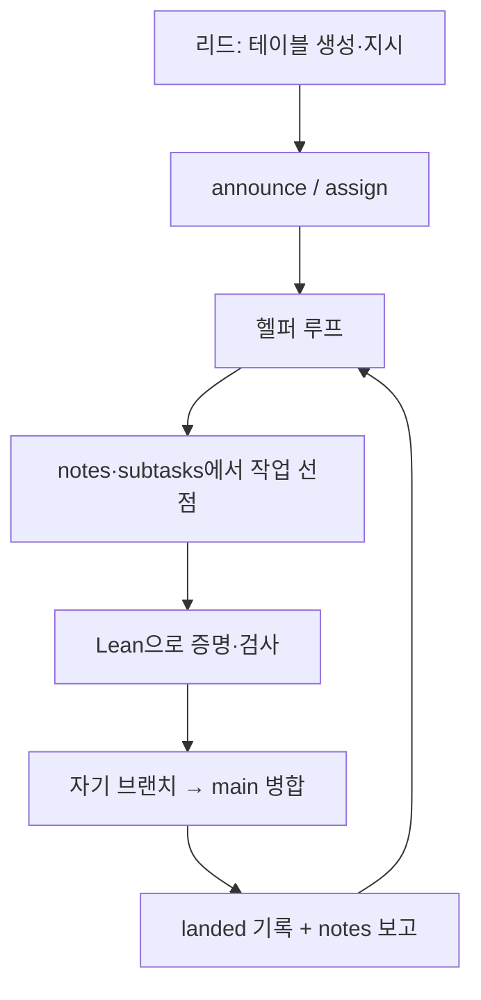

에이전트를 여러 개 띄우면 곧바로 "서로 어떻게 일을 나누고 충돌 없이 합칠 것인가"라는 문제가 생긴다. 보통은 전용 메시지 버스나 오케스트레이션 프레임워크를 떠올리지만, Anthropic이 공개한 실험은 그 반대 방향을 택했다. Claude Fable 5.2 초기 버전 에이전트 1,000개(리드 1, 헬퍼 999)가 Git과 공유 PostgreSQL이라는 범용 도구만으로 페르마의 마지막 정리를 Lean으로 형식화한 증명을 재현했다. 이 글은 그 조율 구조와 안전장치를 설계 관점에서 읽는다.

> 아래 수치는 모두 저자(Anthropic)의 자체 보고이며 독립 검증은 확인하지 못했다. 저자도 이를 일반화할 수 없는 "토이 실험"이라고 밝힌다. 원문은 글 끝의 참고 자료를 본다.

---

## 실험 설정

에이전트에게는 증명할 명제 60개(최종 정리 1개와 중간 마일스톤 59개), 고전적 증명 경로를 한 문장으로 적은 스케치, 관련 정의, 그리고 9월 형식화 작업에서 이미 증명된 보조정리 47개가 주어졌다. 각 에이전트는 자기 경량 VM 안에서 셸과 파일 편집기, Lean과 Mathlib, 자기 Git 브랜치(머지 요청 가능), 공유 PostgreSQL을 쓴다. 처음에는 한 대의 공유 머신에서 돌렸으나 약 100개 에이전트에서 자원 한계에 부딪혀 에이전트별 VM으로 바꿨다고 한다.

| 항목 | 9월 선행 작업 | 이번 실험 |
|---|---|---|
| 규모 | 연구자 + 수십 에이전트, Prove2Me 플랫폼 | 에이전트 1,000개, 범용 도구만 |
| 기간 | 11일 | 28.7시간 |
| 산출 | 출력 토큰 약 60억, Lean 약 1,300만 줄 | 출력 토큰 약 1/3, 증명 길이 약 1/7 |

선행 작업은 더 이른 시기의 내부 모델로 수행했으므로 이 비교에는 모델 차이가 섞여 있다. 토큰·길이 감소를 조율 방식만의 효과로 읽으면 안 된다.

## 조율: 메시징 없이 테이블 다섯 개

에이전트에게는 메시징 도구가 없다. 협업 채널은 Git과 공유 DB뿐이다. 리드는 실행 초반에 다섯 개 테이블을 만들었다.

| 테이블 | 역할 |
|---|---|
| announce | 리드의 지시 |
| assign | 명제별 담당 배정 |
| notes | 선점·진행 상황을 올리는 게시판 |
| subtasks | 누구나 추가하고 먼저 가져간 헬퍼가 소유하는 작업 목록 |
| landed | 완료 기록 |

이 구조의 핵심은 **작업 소유권을 "먼저 가져간 쪽"으로 정하는 것**이다. 서브태스크를 누구나 추가할 수 있으므로 작업 트리가 아래로 자란다. 가장 어려운 명제인 Langlands–Tunnell는 약 750명의 헬퍼가 달라붙어 2,418개 작업, 최대 10단계 깊이의 트리로 분해된 끝에 28.4시간 시점에 증명됐고, 최종 정리는 28.7시간에 main에 올라갔다고 한다. 시간이 지날수록 헬퍼들이 리드를 기다리지 않고 스스로 쪼개고 가져갔다는 점도 보고됐다.

흥미로운 장면은 난이도 판단이다. 리드는 처음에 60개 중 47개를 헬퍼 대부분이 예산 안에서 불가능하다고 본 것으로 분류해 두고 나머지 10개에 인력을 돌렸고, 그 10개는 약 70분 안에 증명됐다. 그런데 보류했던 명제도 결국 대부분 증명됐다. 에이전트가 어려운 문제를 너무 일찍 포기하는 경향이 있어 사람의 격려가 도움이 됐다는 것이 저자들의 관찰이다. 중간에 약 18시간 시점의 저장 지점에서 재시작해 12시간을 더 돌렸다는 점도 운영상 기억할 만하다.

## 안전장치 3계층

1,000개의 에이전트가 셸 명령을 실행하는 환경이므로 안전 설계가 절반을 차지한다. 저자들은 모델이 정렬되지 않았을 가능성을 가정하고 설계했다고 말한다.

**1) 샌드박싱.** 샌드박스에는 네트워크가 없고, 모든 외부 통신은 요청마다 에이전트 신원을 붙이는 게이트웨이를 거친다. 에이전트는 비특권 사용자로 실행되고 커널은 lockdown 모드이며, 자기 브랜치에만 push할 수 있고 main 병합은 별도 작업이 맡는다. DB 호출도 공유 비특권 역할로 문장당 5초, 쓰기 256 MiB 제한을 둔다.

**2) 실시간 모니터링.** 프롬프트 기반 LLM 분류기가 모든 도구 호출(셸 명령·파일 편집)을 실행 전에 검사하며, 판단이 서지 않으면 막는 fail-closed 방식이다. 리드가 차단되면 실행 전체가 멈추고 사람이 검토해야 하며, 헬퍼가 차단되면 그 헬퍼만 제거된다.

**3) 오프라인 모니터링.** 같은 위협 모델에 다른 에이전트의 행동을 조회하는 권한을 더한 별도 모니터가 사후에 팀 행동을 검토한다. 100만 회가 넘는 도구 호출 중 차단 기준을 넘은 것은 없었고, 실행 이후 추가한 CoT(사고 과정) 모니터로 재생했을 때 root 접근 확인 호출 한 건만 기준에 근접했다고 한다.

## 설계에서 가져갈 점

- **조율 비용을 낮추는 최소 프리미티브**: 공유 테이블 + Git이면 에이전트 수가 늘어도 프로토콜을 새로 만들 필요가 없다. 다만 DB가 병목·단일 장애점이 될 수 있어 문장 시간·쓰기량 제한이 필요했다.
- **격리 단위는 에이전트**: 공유 머신은 100개에서 무너졌다. 에이전트 수에 비례해 격리·자원 단위를 늘려야 한다.
- **차단의 파급 범위 설계**: 리드 차단은 전체 중단, 헬퍼 차단은 개별 제거로 비대칭이다. 비용 대비 안전을 맞추는 방식으로 참고할 만하다.
- **형식 증명이라는 검증 가능한 목표**: Lean 검사기가 정답 판정을 해 주므로 1,000개 에이전트의 출력을 사람이 읽지 않고도 합칠 수 있다. 검증기가 없는 일반 코딩 과제로 그대로 옮기기 어려운 이유이기도 하다.

## 한계

저자들은 토이 규모이고, 보조정리를 미리 주었으며, 초기 모델이라는 점을 명시한다. Prove2Me 같은 도메인 특화 도구가 Lean 컴파일 가속이나 기존 인간 결과 재사용 면에서 여전히 효율을 높일 수 있다고도 인정한다. 또한 Anthropic 자사 모델에 대한 자사 블로그 보고이므로, 독립 재현 전까지는 "가능성의 시연"으로 받아들이는 것이 적절하다.

## 참고 및 출처

- [Safely scaling multi-agent teams with Fable 5.2 (원문)](https://claude.dev/blog/safely-scaling-multi-agent-teams-with-fable-5-2/)
- [GeekNews 토픽](https://news.hada.io/topic?id=37159)
