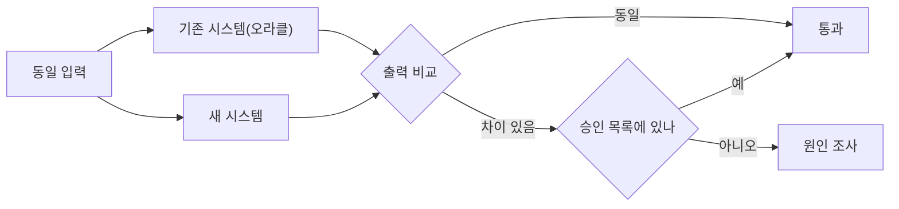
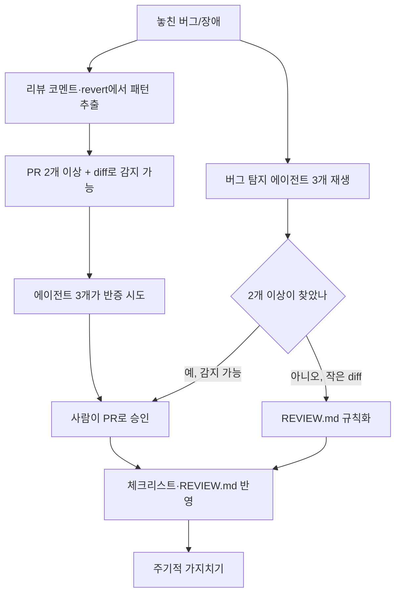

에이전트를 한두 개 돌릴 때는 사람이 결과를 전부 읽으면 된다. 하지만 수십, 수백 개를 병렬로 돌리는 순간 "모든 diff를 읽는" 방식은 병목이 된다. Addy Osmani가 2026-11-16 claude.dev 블로그에 쓴 글은 이 지점을 정면으로 다룬다. Claude Code 팀은 코드의 약 90%를 Claude가 작성하고 리뷰하는데, 그 규모를 가능하게 하는 것이 <strong>검증 루프(verification loop)</strong>라는 주장이다. 이 글은 원문의 내용을 설계 관점에서 정리하고, 도입할 때 따져볼 점을 덧붙인다.

> 수치와 운영 방식은 모두 원문 저자(팀)의 자체 보고이며 독립 검증은 확인하지 못했다. 원문에는 코드 샘플이 없다.

---

## 핵심 주장: 검증이 위임의 상한을 정한다

원문의 논지는 단순하다. 검증이 없으면 사람이 전부 확인해야 하므로 동시에 돌릴 수 있는 Claude는 한두 개다. 검증 루프가 있으면 사람은 "완료의 기준을 정의하고 증거를 검토하는" 역할로 옮겨가고, 병렬 에이전트 수가 늘어난다.

과거에는 테스트·벤치마크·스펙·E2E 실행이 만들기 비싼 검증 수단이었다. 에이전트가 이런 산출물을 싸게 만들 수 있게 되었고, 한번 만들어진 검증은 소프트웨어로서 반복 실행되므로 추가 토큰이 거의 들지 않는다. 팀은 자체 테스트(구조화된 파일 생성 과제)에서 별도 채점기가 루브릭으로 결과를 확인하게 했더니 일반 프롬프트 루프보다 과제 성공률이 최대 10포인트 올랐고, 어려운 문제일수록 이득이 컸다고 보고한다. 다만 세부 조건은 공개되지 않았다.

## 투자할 가치가 있는 세 가지 테스트

원문은 먼저 피해야 할 실패 모드를 꼽는다. 불안정한(flaky) 테스트는 에이전트가 코드를 고치지 않고 재실행하는 법을 학습하게 만든다. 느린 테스트는 배치당 실행 횟수를 줄여 문제 위치를 찾기 어렵게 한다. 무거운 테스트는 커밋 전에 돌리는 편이 낫다. 그 위에서 세 종류를 권한다.

| 테스트 | 무엇을 검증하나 | 에이전트에게 주는 이점 | 주의점 |
|---|---|---|---|
| E2E | 장바구니→결제→확인 같은 실제 사용자 흐름 | 속이기 어렵고 완료 기준이 명확하며, 단계별 트레이스·스크린샷으로 실패 지점을 알려줌 | CDP·시뮬레이터·API 하네스로 실행 중 시스템을 조작할 수단이 필요 |
| 속성(property) | "깨질 수 없는" 명제를 수천 개 입력으로 반증 시도 | 작성자가 예상 못 한 엣지 케이스 발견 | 명제를 잘 고르는 것이 핵심 |
| 차분(differential) | 이전 시스템을 오라클로 두고 같은 입력의 출력을 비교 | 스펙이 production 동작과 어긋난 재작성·마이그레이션에 강함 | 공백 같은 무관한 차이는 정규화, 의도된 변경은 승인 목록으로 관리 |

E2E에서는 단위 테스트가 "Error: Timeout after 30s" 한 줄을 돌려주는 것과, E2E가 단계 트레이스·스크린샷·실패 단계 설명을 돌려주는 것의 차이가 크다. 에이전트는 후자로만 다음 수정을 결정할 수 있다. 사용자 관점으로 기능을 기술한 **feature map**(경로·단축키·셀렉터·기대 결과)은 채점 루브릭으로도 쓸 수 있다고 한다.

속성 테스트의 대표 명제는 네 가지다. 라운드트립(인코딩 후 디코딩하면 원본), 불변식(계좌 잔액은 음수가 되지 않음), 멱등성(두 번 해도 한 번과 같음), 동등성(최적화 코드가 단순하지만 올바른 코드와 같은 결과). 라이브러리로는 fast-check(JS/TS), Hypothesis(Python), proptest(Rust)가 언급된다. 에이전트가 쓴 코드와 에이전트가 쓴 예제 테스트는 같은 편향을 공유하기 쉬우므로, 입력을 무작위로 생성하는 속성 테스트가 그 사각지대를 메운다는 것이 이 선택의 논리다.

차분 테스트의 입력은 무작위 생성이나 production 트래픽 샘플 중에서 고를 수 있다.

## Claude Code 팀의 운영 방식

### 검증은 "변경을 실제로 실행하는 것"이다

팀이 말하는 검증은 앱을 끝까지 띄워 사용자처럼 조작하는 일이다. 웹은 Claude Chrome 확장, 모바일은 iOS/Android MCP, 데스크톱은 computer use, 백엔드는 로컬 실행으로 한다. 이 절차를 저장소의 `.claude/skills/`에 **verify 스킬**로 코드화하고, 관련 코드에 최대한 가깝게 두며, 커밋 전에 Claude가 이를 쓴다. 팀은 이 스킬이 스모크 테스트 하네스이므로 빠르고 안정적이며 스트레스 테스트를 거치도록 투자한다고 한다.

### 실패 처리와 체크 소유권

검사가 실패하면 Claude가 고쳐 보되 **3라운드** 안에 안 풀리면 멈추고 사람을 부른다. 체크는 코드 오너가 직접 쓰고, 오너가 지적했을 법한 것을 잡을 때까지 다듬는다. 체크가 리뷰어에게 올라갈 때는 이유를 설명해야 한다.

### diff 기반 신뢰성 체크리스트

팀은 **39개 항목**의 신뢰성 체크리스트를 둔다. 각 항목은 diff에서 읽을 수 있는 트리거, 체크, 그 근거가 된 장애·PR로 구성된다. 예를 들어 "--resume이 오래된 트랜스크립트를 로드한다" 항목은 세션 저장 구조나 메시지 타입이 바뀔 때 "새 필드가 예전 트랜스크립트에서도 안전하게 로드되는가"를 묻는다. Claude는 변경에 맞는 항목만 확인하며 보통 3–10개다. 리뷰어를 쌓지 않고 한 명을 튜닝하며, 그 지침이 `REVIEW.md`다. 이후 라운드는 처음부터 다시 보지 않고 이전 맥락과 과거 실패 위에서 진행한다.

### 변경이 자기 검사를 수정할 수 없게 한다

핵심 설계 하나는 Code Review가 `REVIEW.md`를 PR의 변경분이 아니라 **기본(base) 브랜치에서** 읽는다는 점이다. 심판 기준을 심판받는 쪽이 고칠 수 있으면 검증이 무의미해지기 때문이다. 리뷰는 특정 커밋에만 유효하며 오래된 커밋의 통과는 의미가 없다. 값싼 검사(테스트·빌드·린터)는 PR을 열기 전에 먼저 돌리고, 이를 강제하려면 Claude 종료 시 테스트를 실행하는 hook이나 통과를 요구하는 `/goal`을 쓴다.

### 새 게이트는 observe 모드로 시작한다

각 커밋에 어떻게 검증되었는지(없으면 "none")를 기록해 미검증 커밋을 조회할 수 있게 한다. 세션에 `/code-review`나 `/verify`가 없으면 커밋을 막는 게이트는 세 모드를 가진다.

| 모드 | 동작 |
|---|---|
| off | 비활성 |
| observe | 막았을 커밋을 기록만 해서 오탐을 먼저 찾음 |
| enforce | 커밋을 차단. 미검증 사유를 커밋 메시지로 남길 수 있음 |

enforce에서도 한 세션에서 두 번 막히면 다음 커밋은 통과시켜 Claude가 갇히지 않게 한다. 새 규칙을 곧바로 강제하지 않고 관찰부터 하는 방식은 어떤 팀의 CI 게이트에도 옮겨 쓸 수 있는 습관이다.

## 검사기 자체를 검증하고, 미스를 규칙으로 바꾼다

원문에서 가장 눈에 띄는 부분은 검증 계층 자체를 평가 대상으로 삼는다는 점이다. 팀은 revert 수, 머지 전 메인테이너 거절 수, 같은 크기의 깨끗했던 변경 집합을 추적한다. Code Review의 공식 평가는 장애·revert 기반 사례를 쓰고, 리뷰 시점에 저장소를 재구성하며 한 문장짜리 정답 키를 둔다. 버그를 올바르게 서술한 지적만 점수를 받고, 머지되어 안정적인 변경은 과다 지적을 재는 대조군이다. 튜닝 세트와 테스트 세트는 분리하고, recall은 원시 지적·검증 후·최종 리뷰 단계별로 따로 재서 뒤 단계에서 버그가 사라지는지 본다. 지적은 Important, Nit, Pre-existing으로 태깅하며, recall은 더 올리면 평가셋에 과적합이 되는 지점까지만 튜닝한다.

미스를 규칙으로 만드는 방법은 두 가지다.

1. 사람의 리뷰 코멘트와 revert에서 패턴을 추출한다. PR 2개 이상에서 반복되고 diff로 감지 가능해야 하며, 에이전트 3개가 반증을 시도한 뒤 사람이 PR로 승인한다.
2. 알려진 장애와 연결된 PR에 버그 탐지 에이전트 3개를 재생해 2개 이상이 찾으면 감지 가능한 것으로 본다. 작은 diff에서 놓쳤다면 `REVIEW.md` 규칙이 된다.

flaky 테스트에는 엄격하다. Claude는 건너뛰기, sleep 추가, 통과할 때까지 재시도를 할 수 없고, 근본 원인을 못 찾으면 테스트를 삭제하고 이유를 문서화한다. 규칙·테스트·`.md` 파일은 방치하면 불어나므로 주기적인 가지치기도 필요하다고 덧붙인다.

## 도입할 때 따져볼 점

원문이 설명하는 구조에서 일반화할 수 있는 판단 기준은 다음과 같다.

- **심판은 피심판자와 분리한다.** 변경이 자기 검사 기준을 바꿀 수 없어야 한다. 기본 브랜치에서 기준을 읽는 것이 가장 단순한 구현이다.
- **실패 신호의 질이 에이전트의 수정 품질을 정한다.** 한 줄 타임아웃보다 트레이스·스크린샷이 있는 실패가 낫다. 불안정한 테스트는 신호를 오염시키므로 우선 제거 대상이다.
- **게이트는 observe부터.** 오탐을 보지 않고 enforce하면 에이전트가 우회법을 학습하거나 막혀 버린다. 막힘 횟수에 상한을 두는 탈출구도 같은 이유로 필요하다.
- **검사기도 측정한다.** 과거 장애 기반 평가셋을 만들고 튜닝/테스트를 분리하지 않으면 과적합된 리뷰어를 얻는다.

반대로 한계도 분명하다. 이 접근은 E2E 하네스, verify 스킬, 장애 이력 같은 선행 투자가 큰 팀에 맞는다. 90%라는 비율, 10포인트 향상, 39개 체크리스트는 모두 팀 내부 보고라 그대로 기대치로 삼기 어렵다. 소규모 프로젝트라면 가장 먼저 도입할 것은 flaky 테스트 제거, 커밋 전 값싼 검사 강제, 핵심 흐름 하나의 E2E 정도로 보인다. 이는 원문의 주장이 아니라 글쓴이의 해석이다.

## 정리

| 원칙 | 원문의 구체적 장치 |
|---|---|
| 실행으로 검증 | verify 스킬, E2E 하네스 |
| 사람은 기준과 증거에 집중 | 3라운드 실패 시 호출, 오너가 체크 작성 |
| 검증 계층 보호 | 기본 브랜치의 REVIEW.md, 커밋 단위 리뷰 |
| 점진적 강제 | off/observe/enforce, 두 번 막힘 후 통과 |
| 검사기 평가·학습 | 장애 기반 평가셋, 규칙화 절차, 가지치기 |

## 참고 및 출처

- Addy Osmani, ["How the Claude Code team thinks about verification"](https://claude.dev/blog/how-the-claude-code-team-thinks-about-verification/), claude.dev, 2026-11-16
