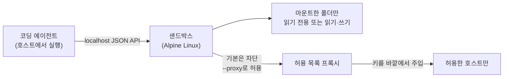

코딩 에이전트에게 셸을 열어 주는 순간, 에이전트가 읽고 쓸 수 있는 모든 것이 위험 범위가 됩니다. 실수 한 번, 혹은 웹 문서에 숨은 프롬프트 인젝션 한 줄이면 홈 디렉터리와 API 키까지 닿을 수 있습니다. 그래서 대부분은 "매번 승인"을 누르거나, 아예 전체 권한을 주고 운에 맡깁니다.

Prime Radiant(Superpowers를 만든 AI 연구 랩)가 Simon Willison과 함께 2026-11-16에 공개한 <strong>External Sandbox(외부 샌드박스)</strong> 패턴은 다른 길을 제안합니다. 에이전트는 평소처럼 호스트에서 돌리고, 에이전트가 실행하는 **명령과 파일 편집만** 별도의 Linux 샌드박스로 보내는 방식입니다. 이 글은 원문을 바탕으로 구조와 선택의 이유, 도입 전에 따져볼 한계를 정리합니다. 수치나 성능 주장은 원문에 없고, 세 구현은 모두 프로토타입이라는 점을 먼저 밝혀 둡니다.

---

## 왜 기존 방식으로는 부족한가

원문은 두 가지 흔한 대응을 짚습니다.

| 대응 | 아이디어 | 한계 |
|------|----------|------|
| 모든 동작 수동 승인 | 사람이 매번 허용 | 느리고, 결정 피로로 반사적으로 승인하게 된다 |
| 제품 내장 AI 검사 (Claude Code auto mode, Codex auto-review) | 모델이 안전 여부를 추가로 판단 | 잘 작동하는 것으로 보이지만 해당 제품의 기능이며, 결국 모델이 각 동작을 올바르게 판단한다는 가정에 기댄다 |

원문의 핵심 논거는 이것입니다. 샌드박스는 **어떤 모델의 판단에도 의존하지 않는 보호 장치**입니다. 저렴한 모델이나 로컬 모델은 실수가 잦고 의도적인 프롬프트 인젝션에도 더 쉽게 당하므로, 그런 모델을 시험해 보려는 쪽일수록 안전을 앞에 두어야 한다는 설명입니다.

## 패턴: 에이전트는 밖, 실행은 안

샌드박스에 에이전트를 통째로 넣는 접근(Fly의 Sprites 같은 시스템)과, 에이전트를 밖에 두고 명령만 샌드박스로 보내는 접근을 모두 검토한 뒤 후자를 택했다고 합니다. 이유는 두 가지입니다.

- 에이전트가 자기 자신이나 자기 실행 환경을 수정하는 이상 동작을 피할 수 있다.
- 샌드박스 경계가 명확해져 감사하기 쉽다.

이름의 "external"은 컴퓨터 바깥이라는 뜻이 아니라 **에이전트 바깥**이라는 뜻입니다. 에이전트와 샌드박스는 같은 머신에서 돌아도 됩니다.



샌드박스가 보장하는 것은 다섯 가지로 정리됩니다.

1. 에이전트 프로세스는 호스트에 남는다. 모델 로그인과 설정은 평소 그대로다.
2. 샌드박스는 사용자가 마운트한 폴더만 본다. 읽기 전용인지 읽기·쓰기인지는 사용자가 정한다.
3. 네트워크는 기본적으로 막혀 있다. `--proxy` 옵션을 주면 허용한 호스트에만 HTTP/HTTPS 프록시로 나갈 수 있다.
4. 프록시의 **자격증명 대체(credential replacement)**: 특정 호스트로 가는 요청에 API 키를 샌드박스 바깥에서 붙인다. 에이전트는 키를 볼 수 없다.
5. 웹 UI가 브라우저 터미널, 실행 중 프록시 규칙 변경, 네트워크 요청 로그를 제공한다.

자격증명 대체가 특히 실용적입니다. 에이전트가 `api.example.com`을 호출해야 한다면 에이전트 환경에는 키를 넣지 않고, 프록시가 그 호스트로 나가는 요청에만 키를 얹습니다. 인젝션으로 환경 변수를 통째로 읽혀도 훔칠 비밀이 없습니다.

## 두 줄로 해 보기

원문의 가장 간단한 시연입니다. Node.js 22.19 이상이 필요하고, 프로젝트 디렉터리에서 첫 번째 터미널에 샌드박스를 띄웁니다.

```bash
npx --yes external-sandbox-v86 \
  --preserve-paths --mount-rw "project=$PWD"
```

같은 디렉터리의 두 번째 터미널에서 Pi 코딩 에이전트가 그 샌드박스로 명령을 보내도록 실행합니다.

```bash
npx --yes @earendil-works/pi-coding-agent \
  -e npm:external-sandbox-pi --no-builtin-tools \
  --sandbox-url http://127.0.0.1:8686
```

에이전트에서 `!uname -a`를 실행하면 호스트가 아니라 Alpine Linux 커널이 응답합니다. 이때 에이전트는 마운트한 프로젝트 폴더 안에서만 명령 실행과 파일 읽기·쓰기를 할 수 있고, 머신의 나머지는 보이지 않습니다. 첫 실행 때는 모델 접근 권한을 위해 에이전트 안에서 `/login`이 필요합니다.

## 세 가지 구현

세 서버는 같은 localhost API를 제공하므로 에이전트와 샌드박스를 섞어 쓸 수 있습니다. 기본 포트도 8686·8687·8688로 달라서 나란히 띄울 수 있습니다.

| 구현 | 런타임 | 설치·실행 | 특징 |
|------|--------|-----------|------|
| external-sandbox-v86 | Node.js + v86(WebAssembly로 컴파일한 x86 에뮬레이터) | npm, `npx` | 리눅스 배포판이 npm 패키지에 통째로 들어 있다 |
| external-sandbox-container | Python + Apple Containers | PyPI | 컨테이너를 띄우고 종료 시 정리한다 |
| external-sandbox-quicksand | Python + Microsoft Quicksand(QEMU) | PyPI | QEMU와 Alpine 이미지가 Python wheel로 오므로 별도 설치가 없다 |

세 구현 모두 API 명세와 적합성 테스트 도구가 함께 공개되어, 다른 기술 위에 호환 서버를 새로 만들 수 있습니다. 별도 기술에 얹은 구현이 늘어나면 에이전트와 샌드박스를 독립적으로 고르는 시장이 생길 수 있다는 점에서, 구현보다 이 **프로토콜**이 더 중요한 산출물일 수 있습니다.

## 에이전트별로 달라지는 경계

"에이전트 하나를 샌드박스에 연결"하는 방식은 에이전트마다 다릅니다. 이 차이가 곧 보호 범위의 차이입니다.

| 에이전트 | 샌드박스로 보내는 것 |
|----------|----------------------|
| Pi | bash, read, write, edit, grep, find, ls |
| Codex | 프로세스 실행과 파일시스템 연산(`apply_patch` 포함) |
| Claude Code | Bash 도구 명령만. 기본 Read·Edit 도구는 여전히 호스트에서 실행된다 |

Claude Code의 경우 셸 명령은 격리되지만 기본 읽기·편집 도구는 호스트 파일시스템을 직접 만집니다. "에이전트가 샌드박스 안에서만 논다"고 받아들이면 곤란하고, 연결 방식별로 어떤 도구가 경계 밖에 남는지 확인해야 합니다. 이 부분은 원문 설명을 바탕으로 한 해석이므로, 실제 적용 전에 해당 저장소의 설정 문서로 확인하세요.

## 도입 전에 따져볼 점

- **마운트는 곧 권한이다.** 읽기·쓰기로 마운트한 폴더는 여전히 손상될 수 있습니다. 가능하면 읽기 전용을 기본으로 하고, 쓰기가 필요한 경로만 열어 주세요.
- **허용 호스트 정책이 유출 경로가 된다.** 프록시 허용 목록을 넓게 열면 그 경로로 데이터가 나갈 수 있습니다. 로그 UI로 실제 요청을 확인하는 습관이 필요합니다.
- **프로토타입이다.** 세 구현은 시연용이며, Quicksand 구현은 Apple silicon macOS(HVF)에서 테스트됐다고 합니다. 운영 환경의 격리 수준은 직접 검토해야 합니다.
- **보완이지 대체가 아니다.** 샌드박스는 모델 판단과 무관한 하한선을 제공하지만, 마운트된 코드가 잘못 수정되는 문제는 막지 못합니다. 앞서 다룬 [검증 접근법](/post/2026-11-20-claude-code-team-verification-e2e-property-differential/)처럼 결과를 증거로 확인하는 층과 함께 써야 합니다.

비교하자면 에이전트를 통째로 컨테이너에 넣는 방식은 인증·설정도 안으로 옮겨야 하지만, 이 패턴은 에이전트를 호스트에 두면서 키는 프록시에서 주입합니다. 다만 이 비교는 원문 설명에서 추론한 것이며 원문이 직접 비교한 내용은 아닙니다.

## 마무리

| 항목 | 요약 |
|------|------|
| 핵심 | 에이전트는 호스트, 명령 실행·파일 편집은 외부 샌드박스 |
| 차별점 | 모델 판단에 의존하지 않는 격리, 프로토콜 표준화로 에이전트·샌드박스 교체 가능 |
| 비밀 관리 | 프록시가 키를 바깥에서 주입해 에이전트는 값을 볼 수 없음 |
| 주의 | Claude Code는 Read·Edit가 호스트에 남음, 마운트·허용 호스트 설정이 곧 위험 범위, 프로토타입 |

에이전트를 믿을 수 있는지가 아니라, 믿지 않아도 피해가 제한되는지로 질문을 바꾸는 패턴입니다. 로컬 모델이나 저렴한 모델을 시험해 보려는 분이라면 v86 버전으로 두 줄 시연부터 해 볼 만합니다.

## 참고 및 출처

- Prime Radiant, [External sandboxes for coding agents](https://blog.primeradiant.com/external-sandboxes-for-coding-agents/) (2026-11-16)
- Simon Willison, [External sandboxes for coding agents](https://simonwillison.net/2026/Nov/17/external-sandboxes-for-coding-agents/) (2026-11-17)
- [external-sandbox-v86](https://github.com/prime-radiant-inc/external-sandbox-v86)
- [external-sandbox-quicksand](https://github.com/prime-radiant-inc/external-sandbox-quicksand)
- [external-sandbox-container](https://github.com/prime-radiant-inc/external-sandbox-container)
- [Microsoft Quicksand](https://github.com/microsoft/quicksand)
