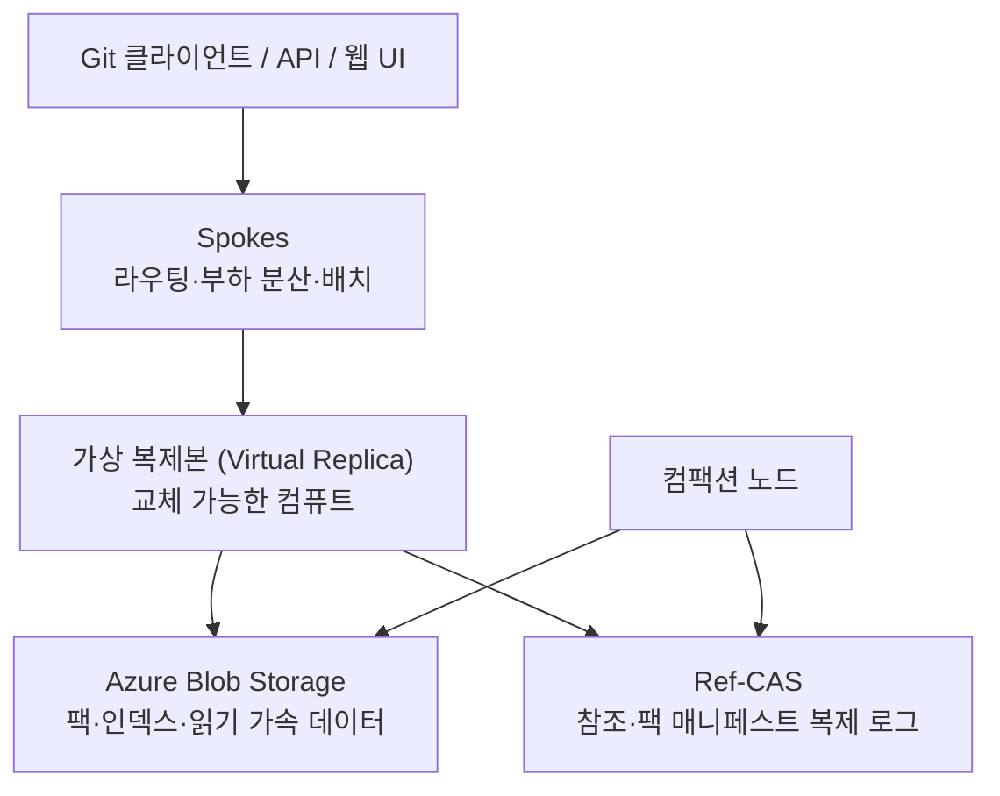

Git 저장소 하나에 사람이 아니라 에이전트 수천 개가 동시에 푸시한다면 어떤 일이 벌어질까요. GitHub Engineering은 2026-11-05 블로그 글에서 이 질문에 대한 답으로 **Project Rubicon**이라는 새 Git 스토리지 아키텍처를 설명했습니다. 이 글은 그 구조를 "무엇을 어디에 저장하고, 왜 그렇게 나눴는가"의 관점에서 정리합니다.

---

## 배경: 쓰기 패턴이 바뀌었다

원문에 따르면 GitHub의 가장 바쁜 저장소도 지금은 짧은 순간에 초당 수십 회 쓰기 정도지만, 저자들은 1년 안에 이것이 지속적인 처리율이 될 것으로 내다봅니다. 에이전트 개발이 늘면서 한 저장소의 일일 요청이 2026년 3월 평균 4,400만 건에서 5월 1억 8,100만 건으로 약 4배 늘었다는 수치도 제시됩니다. 설계 목표는 계획한 규모보다 두 자릿수 이상 확장하는 것입니다.

원문은 두 가지 원칙으로 설계를 요약합니다. 첫째 **조정(coordination)을 최소화**하고, 둘째 **저장소와 컴퓨트를 분리**합니다. 이후의 모든 결정은 이 두 원칙에서 나옵니다.

## 전체 구조

요청이 들어오는 입구는 그대로 **Spokes**입니다. Spokes는 라우팅, 부하 분산, 배치, 내부 API를 계속 맡고, 그 아래 데이터 평면이 새로 바뀝니다.

- **가상 복제본**은 읽기·쓰기를 모두 처리하는 일회용 컴퓨트이며, 로컬 디스크는 언제든 다시 만들 수 있는 캐시일 뿐입니다. 한 저장소의 트래픽은 가능하면 같은 복제본으로 보내 캐시를 데우지만, 정확성은 어느 복제본에 요청이 도착하느냐에 의존하지 않습니다.
- **Azure Blob Storage**에는 Git 객체가 팩 형태로, 그리고 읽기 가속 데이터(multi-pack index, reachability bitmap 등)가 저장됩니다. 대부분 한 번 쓰고 바뀌지 않는 데이터라 객체 스토리지에 잘 맞습니다.
- **Ref-CAS**(Reference Compare-and-Swap)는 참조(브랜치·태그가 가리키는 값)와 저장소를 구성하는 팩 목록(팩 매니페스트)만 저장하는 복제 로그 서비스입니다.

쓰기 흐름은 이렇습니다. 가상 복제본이 들어온 팩을 인덱싱해 Blob에 올린 뒤, 팩을 매니페스트에 등록하고 참조를 갱신하는 트랜잭션 하나를 Ref-CAS에 커밋합니다. 읽기는 Ref-CAS로 참조 버전을 확인하고, 필요한 팩을 Blob에서 캐시로 가져와 서빙합니다. 팩을 먼저 올리고 참조를 나중에 커밋하므로, 참조는 항상 이미 내구성이 확보된 객체만 가리킵니다.

## 왜 참조만 따로 뗐는가

참조는 객체와 정반대 성질을 가집니다. 객체는 고유 키에 한 번 쓰이면 바뀌지 않지만, 바쁜 저장소의 참조는 작은 데이터에 쓰기가 몰려 경쟁합니다. 원문은 Blob Storage만으로 이를 처리하려던 두 시안이 왜 부족했는지 설명합니다.

| 시안 | 방식 | 한계 |
|------|------|------|
| 1안 | 모든 참조를 단일 블롭 하나로 색인한 write-ahead log, 조건부 쓰기로 갱신 | 한 번에 조건부 쓰기 하나만 진행 가능해 쓰기가 초당 수백 회 중반에서 막힘 |
| 2안 | 참조를 해시로 여러 세그먼트 블롭에 분산 | 쓰기는 늘지만 읽기가 모든 세그먼트를 확인해야 해 가장 느린 세그먼트에 묶임 |

읽기가 쓰기보다 자릿수로 많기 때문에, 2안은 쓰기 지연을 읽기 지연과 맞바꾼 셈이었습니다. 그래서 참조 전용 복제 로그인 Ref-CAS를 만들었습니다.

Ref-CAS에서 참조 갱신은 쿼럼(과반 복제본)이 커밋하는 compare-and-swap입니다. 트랜잭션은 자기가 건드리는 참조만 잠그고, 쓰는 쪽이 기대한 값이 그대로인지 확인한 뒤, 로그 복제본 과반이 기록하면 가시화됩니다. 에이전트는 대개 자기 브랜치에 푸시하므로 대부분 경합하지 않고 병렬로 복제되며, 같은 참조를 두 푸시가 갱신하면 하나만 로그에 추가됩니다.

읽기를 싸게 만드는 장치는 로그 시퀀스 번호(LSN)입니다. 커밋마다 LSN이 붙고 저장소 버전이 곧 최신 LSN이므로, 복제본이 자기 버전을 보내 아직 최신이면 응답에 참조가 전혀 없습니다. 변하지 않은 저장소를 읽는 비용이 비교 한 번으로 줄어드는 것입니다. 원문은 이 방식으로 참조 상태만 초당 수만 건 처리할 수 있다고 밝힙니다.

## 컴팩션: 쓰기가 늘어도 팩 수는 일정하게

푸시마다 팩이 하나 생기고, Git은 여러 팩에서 서빙할 수 있지만 팩이 늘수록 조회가 조금씩 비싸집니다. 기존 구조에서는 컴팩션이 트래픽을 서빙하는 복제본마다 돌아야 했지만, 새 구조에서는 별도 노드가 Blob과 Ref-CAS를 직접 대상으로 백그라운드에서 수행합니다. 덕분에 복제본의 CPU와 메모리를 요청 처리에 거의 전부 쓸 수 있습니다.

컴팩션 노드의 한 샤드 처리 순서는 다음과 같습니다.

1. Blob에서 샤드에 대한 임대(lease)를 잡아 한 번에 한 노드만 그 샤드를 처리하게 합니다.
2. 매니페스트에서 새 팩을 찾아 열린 세그먼트에 모읍니다.
3. 세그먼트가 팩 수·크기·나이 한도에 이르면 봉인하고, 팩들을 더 적고 큰 팩으로 합칩니다.
4. 발행 전에 새 팩이 입력 팩과 정확히 같은 객체를 담는지 검증합니다.
5. 새 팩을 올려 매니페스트에 추가하고, 두 번째 트랜잭션으로 입력 팩을 매니페스트에서 제거합니다. 실제 삭제는 나중에 정리 단계에서 합니다.

팩의 해시가 샤드를 결정하므로 샤드와 노드를 늘리면 컴팩션 처리량도 늘고, 한도 미만의 합쳐진 팩은 자기 해시로 다시 샤드에 들어가 계층적으로 커집니다. 가비지 컬렉션(삭제된 브랜치나 force-push가 남긴 도달 불가 객체 제거)도 전용 워커가 비슷한 방식으로 처리합니다.

## 수치를 읽는 법

GitHub는 내부 테스트에서 한 저장소에 동시 에이전트 5,000개가 초당 7,200회 푸시하는 상황에서도 읽기 지연이 일관되게 낮고, 쓰기가 늘어도 지연 곡선이 평탄했다고 보고합니다. 다만 이 수치는 **GitHub 자체 테스트 결과**이고 독립 검증된 벤치마크가 아닙니다. 원문 시점에 현재 제한적 비공개 프리뷰이며, 일반 확대 배포 일정은 별도 공지에 달려 있습니다.

GeekNews 토픽의 댓글에는 회의적인 시각도 있었습니다. 이 설계가 최근의 GitHub 장애를 바로 해결하는 것은 아니라는 지적, 초당 수천 푸시는 과하게 구성한 에이전트 워크플로의 결과일 수 있다는 의문, 하루 수천 건의 변경을 사람이 검토하기 어렵다는 우려입니다. 커뮤니티 의견이므로 사실로 검증된 내용은 아니지만, "스토리지가 감당해도 리뷰 병목은 남는다"는 점은 설계 문서가 다루지 않는 영역입니다.

## 우리가 가져갈 판단 기준

Rubicon은 GitHub 규모가 아니어도 참고할 만한 분리 원칙을 보여줍니다.

- **불변 데이터와 경합 데이터를 다른 저장소에 둔다.** 한 번 쓰고 마는 데이터는 객체 스토리지에, 작고 경합이 심한 상태는 합의 기반 로그에 둡니다.
- **읽기 경로는 "바뀌지 않았다"를 싸게 답하게 만든다.** 단조 증가 버전 하나로 변경 없음을 한 번의 비교로 확인합니다.
- **유지보수 작업은 서빙 노드에서 떼어낸다.** 컴팩션과 GC를 별도 노드로 옮기면 서빙 지연과 유지보수 처리량을 따로 확장할 수 있습니다.
- **경합 범위를 좁힌다.** 저장소 전체가 아니라 참조 단위로 순서를 정하면 서로 다른 브랜치에 쓰는 에이전트들은 충돌하지 않습니다.

반대로, 쓰기가 초당 수십 회 이하인 저장소라면 이런 분리는 운영 복잡도만 늘립니다. 원문이 말하듯 병목이 실제로 드러난 뒤에 도입할 구조입니다.

## 참고 및 출처

- GitHub Blog, [Inside GitHub's new Git storage architecture](https://github.blog/engineering/architecture-optimization/inside-githubs-new-git-storage-architecture/) (2026-11-05)
- GeekNews 토픽 36751 댓글 논의 (봇 접근이 막혀 링크는 생략)
