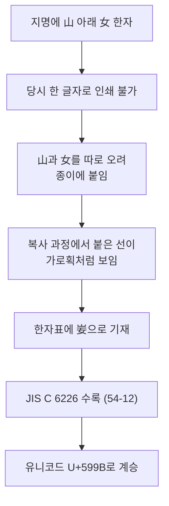

글자 칸 12개가 격자로 놓여 있고, 칸마다 한자 하나와 `54-12`, `U+599B` 같은 숫자가 붙어 있는 표를 본 적이 있다면 그 정체는 <strong>유령 문자(幽霊文字, 유레이모지)</strong>다. 일본 공업 규격 JIS X 0208에 들어 있지만, 어떤 옥편이나 한자 사전에서도 쓰임을 찾을 수 없는 한자를 가리킨다. 이 글은 표에 적힌 코드의 뜻부터 읽는 법을 설명한 뒤, 이 글자들이 왜 생겼고 어떻게 추적됐으며 왜 지금도 모든 컴퓨터에 남아 있는지를 정리한다.

---

## 표를 읽는 법: 쿠텐과 유니코드

표의 각 칸에는 한자 아래에 두 개의 코드가 있다. 앞의 `54-12`는 **쿠텐(区点)** 코드이고, 뒤의 `U+599B`는 유니코드 부호점이다.

JIS X 0208은 94행 × 94열의 격자에 문자를 배치한다. 행을 구(区, ku), 열을 점(点, ten)이라 부르므로 `54-12`는 "54구 12점"이다. 한자는 이 격자에서 16–47구가 제1수준(자주 쓰는 한자), 48–84구가 제2수준(덜 쓰이는 한자)에 배정되어 있고, 합쳐 6,355자다. 표의 12자는 모두 52구 이상, 즉 제2수준 영역에 있다. 덜 쓰이는 한자일수록 출처 확인이 느슨했다는 점과도 맞아떨어진다.

아래 표는 이미지의 12자를 정리하고, 파이썬의 `euc_jp`·`shift_jis` 코덱으로 쿠텐 코드와 바이트를 직접 계산해 대조한 결과다. 이미지의 쿠텐·유니코드 값과 모두 일치했다.

| 문자 | 쿠텐 | 유니코드 | Shift_JIS 바이트 |
|:---:|:---:|:---:|:---:|
| 墸 | 52-55 | U+58B8 | 9AD5 |
| 壥 | 52-63 | U+58E5 | 9ADD |
| 妛 | 54-12 | U+599B | 9BAA |
| 彁 | 55-27 | U+5F41 | 9C5A |
| 挧 | 57-43 | U+6327 | 9D6A |
| 暃 | 58-83 | U+6683 | 9DF1 |
| 椦 | 59-91 | U+6926 | 9E9B |
| 槞 | 60-57 | U+69DE | 9ED7 |
| 蟐 | 74-12 | U+87D0 | E5AA |
| 袮 | 74-57 | U+88AE | E5D7 |
| 閠 | 79-64 | U+95A0 | E880 |
| 駲 | 81-50 | U+99F2 | E971 |

재현하려면 다음과 같이 하면 된다. EUC-JP는 쿠텐에 0xA0을 더한 값이 그대로 바이트가 되는 구조라, 쿠텐을 되돌려 계산하기 쉽다.

```python
for c in "妛挧暃椦槞蟐袮閠駲墸壥彁":
    euc = c.encode("euc_jp")
    ku, ten = euc[0] - 0xA0, euc[1] - 0xA0
    print(c, f"{ku}-{ten:02d}", f"U+{ord(c):04X}", c.encode("shift_jis").hex().upper())
```

출력의 첫 줄은 `妛 54-12 U+599B 9BAA`다. 이 코드는 "이 칸에 이 글자가 있다"는 사실만 보여 줄 뿐, 글자의 뜻이나 읽는 법은 알려 주지 않는다. 유령 문자가 문제가 되는 이유가 바로 이것이다.

---

## 유령 문자란 무엇인가

JIS X 0208 한자 6,355자 가운데 12자가 유령 문자로 분류된다. 영어 위키백과는 이 용어가 사전에는 실려 있으나 실제 쓰임이 없는 단어를 뜻하는 <strong>유령어(ghost word)</strong>에서 따온 말이라고 설명한다. 가장 대표적인 예는 妛과 彁이고, 둘 다 강희자전(康熙字典)이나 『대한화사전(大漢和辞典)』 같은 대형 한자 사전에 없다.

12자의 핵심 목록은 Language Log의 [Spectral Sinographs](https://languagelog.ldc.upenn.edu/nll/?p=39411)에도 妛挧暃椦槞蟐袮閠駲墸壥彁로 올라 있다. 개별 글자의 추정 출처는 자료마다 서술이 조금씩 다르므로, 아래에서는 영어 위키백과가 정리한 1997년 조사 결과를 따른다.

---

## 1978년: 네 개의 한자표가 만든 규격

일본 통상산업성은 1978년 JIS C 6226(나중의 JIS X 0208)을 제정했다. 이 규격은 제1·제2수준 한자를 합쳐 6,349자를 정의했고, 이 집합을 JIS 기본 한자라고 부른다. 한자를 고를 때 참조한 자료는 네 가지였다.

| 번호 | 자료 | 편자·연도 |
|:---:|---|---|
| 1 | 표준 코드용 한자표(안) | 정보처리학회 한자코드 위원회, 1971 |
| 2 | 국토 행정 구획 총람 | 일본지리학회, 1972 |
| 3 | 일본생명 성씨표 | 일본생명, 1973 (현존하지 않음) |
| 4 | 행정 정보 처리용 기본 한자 | 행정관리청, 1975 |

문제는 제정 당시 각 글자가 어느 자료에서 왔는지 명시되지 않았다는 점이다. 규격이 퍼진 뒤에야 의미도 읽는 법도 쓰임 예도 모르는 글자가 섞여 있다는 사실이 알려졌다. 실제로 이런 글자를 구현한 장비에서는 임시 읽기를 붙이는 일이 많았고 일부 사전도 그 읽기를 실었는데, 사사하라는 1982–1983년 업계 보고서와 NEC·IBM 일본 자료가 그 출처였을 가능성을 지적한다. 유령 문자의 읽기는 어디까지나 편의상 붙은 것이다.

---

## 1997년: 출처 추적 조사

JIS X 0208의 개정을 맡은 위원회는 1997년, 위원장 시바노 고지(芝野耕司)와 국립국어연구소 사사하라 히로유키(笹原宏之)를 중심으로 1978년 규격이 참조한 자료를 다시 조사했다. 조사 결과는 JIS X 0208:1997의 부속서 7 「구점 위치의 상세 설명」에 정리됐다.

조사에서 드러난 사실은 세 가지다.

- 유령 문자로 여겨지던 글자 상당수는 사실 **지명에 쓰이는 한자**였다.
- 한자 선정에는 원전이 아니라, 1974년 행정관리청이 만든 한자 사용 빈도·대응 분석 결과가 참조됐다. 이 분석 결과에는 8종 한자표가 들어 있었고, 유령 문자는 특히 국토 행정 구획 총람과 인명 한자표(일본생명) 계열에서 많이 발견됐다.
- 일본생명의 인명 한자표는 최초 규격 제정 당시에도 출처 근거가 없었고 내용이 부실했다는 점이 지적됐다.

위원회는 1972년판 국토 행정 구획 총람을 교정 이력에서 복원해 책에 나오는 모든 한자를 전 페이지에 걸쳐 대조했고, 없어진 인명 한자표를 대신해 NTT 전화번호부 데이터베이스 비교와 30종 이상의 옛 자서(字書) 조사를 병행했다. 그 결과 72자는 출처가 확인됐다.

그래도 끝내 정체가 불확실하게 남은 글자가 12자였다. 이 12자 중 3자는 오타로 보이고, 8자는 옛 일본·중국 자서에서 발견됐으며, 彁은 구체적 출처가 전혀 확인되지 않았다.

---

## 12자 가운데 몇 가지 사례

### 妛: 종이를 오려 붙이다 생긴 한 획

54구 12점의 妛은 가장 유명한 사례다. 위키백과는 이 글자를 𡚴(山 아래 女)의 오기일 가능성이 높다고 설명한다. 한 블로그 글(Paul O'Leary McCann)은 조사 과정에서 확인된 경위를 이렇게 전한다. 국토 행정 구획 총람의 지명에 山 아래에 女가 놓인 글자가 있었는데, 당시에는 그 글자를 한 글자로 인쇄할 수 없어 山과 女를 따로 인쇄해 오려 붙이고 그것을 복사했다. 복사본에서 두 종잇조각이 맞닿은 선이 가로획처럼 보였고, 그 획이 글자에 잘못 더해졌다는 것이다.

이 과정을 순서대로 놓으면 다음과 같다.



한 가지 주의할 점이 있다. 이 오려 붙이기 일화는 조사 과정에서 확인된 경위로 소개되지만, 위키백과는 같은 사례를 "그림자 같은 인쇄 자국이 있고 이를 잘못 옮긴 것으로 보인다"는 식으로 서술한다. 정확히 어떤 물리적 과정이었는지는 자료에 따라 표현이 다르다.

### 彁: 끝내 출처를 찾지 못한 글자

55구 27점의 彁은 12자 중 유일하게 구체적인 출처도, 역사적 선례도 발견되지 못했다. 가장 유력한 설명은 彊(굳셀 강)의 오기라는 추정이다. 흥미로운 후일담도 있다. 아사히신문 데이터베이스에는 1923년 2월 23일자 지면의 단체명 「埼玉自彊会」가 디지털화 과정에서 「埼玉自彁会」로 잘못 입력됐다가 나중에 고쳐진 일이 있다. 흐릿한 인쇄를 彊 대신 유령 문자로 읽은 사례다.

### 袮: 오타가 현실로 퍼진 글자

74구 57점의 袮은 祢의 오기로 보이는데, 실제로 신사의 직위 祢宜를 袮宜로 잘못 쓰는 일이 있다. 袮은 『신찬자경(新撰字鏡)』·『류취명의초(類聚名義抄)』 등 옛 자서에서도 발견되지만, 규격에 들어간 경위는 오기에 가깝다. 유령 문자가 현실의 표기에 영향을 준 대표적 사례다.

### 閠: 같은 글자가 나라에 따라 다른 운명

79구 64점의 閠은 閏(윤달 윤)의 아래 부분이 王 대신 玉으로 잘못 쓰인 글자로 여겨진다. 위키백과에 따르면 일본의 15세기 자서 『화옥편(和玉篇)』 16세기 필사본에 이 글자가 있으나 외로운 사례이고, 중국과 베트남 한문 문헌에서는 閠이 閏의 이체자로 쓰이기도 한다. 일본에서는 오기였는데 중국에서는 정당한 이체자였다는 점이 유니코드 문자 통합에서 중요해진다.

### 12자 한눈에 보기

영어 위키백과가 정리한 12자의 출처 추정은 다음과 같다. 읽기는 모두 편의상 붙인 것이다.

| 문자 | 추정 | 
|:---:|---|
| 墸 | 출처 불명. 오기일 가능성 있으나 『집운』 약본에 있다는 기록 |
| 壥 | 출처 불명. 㕓의 오기일 가능성 |
| 妛 | 𡚴의 오기일 가능성 |
| 彁 | 출처 없음. 彊 등의 오기일 가능성 |
| 挧 | 栩 등의 이체 또는 오기일 가능성 |
| 暃 | 杲 등의 오기일 가능성 |
| 椦 | 橳 등의 오기일 가능성 |
| 槞 | 境 등의 오기일 가능성 (櫳의 이체로 보는 해석도 있음) |
| 蟐 | 인명 한자표 계열이 출처로 적혀 있으나 용례 없음. 『신찬자경』에서 발견 |
| 袮 | 祢의 오기일 가능성. 옛 자서에서도 발견 |
| 閠 | 閏의 오기일 가능성 |
| 駲 | 馴의 이체로 처리하는 사전도 있음 |

---

## 유니코드로 이어진 유령

JIS 한자는 유니코드의 CJK 통합 한자 영역을 구성할 때 입력 자료가 됐다. 그래서 이 12자는 JIS X 0208에서 유니코드로 그대로 넘어갔고, 위 표의 `U+599B` 같은 부호점이 그 결과물이다. 영어 위키백과는 이미 유니코드 같은 국제 규격에 채택된 탓에 변경하면 호환성 문제가 생기므로 수정하거나 삭제하기 어렵다고 설명한다. 문자 한 개를 규격에서 빼면 그 글자가 이미 들어간 문서·데이터베이스·폰트가 모두 영향을 받기 때문이다.

유니코드 통합 과정에서는 오히려 유령 문자가 다른 나라의 실제 글자와 겹쳐 버린 경우도 있다. 위키백과 설명을 정리하면 다음과 같다.

| 문자 | 일본의 사정 | 다른 나라의 사정 |
|:---:|---|---|
| 妛 | 𡚴의 오기로 추정 | 중국에는 媸의 이체로 쓰이는 妛이 별도로 있어, 우연히 닮은 글자와 같은 부호점으로 통합 |
| 閠 | 閏의 오기로 추정 | 중국·베트남에서는 閏의 이체자로 쓰임 |
| 岾 | 민둥산을 뜻하는 국자(일본식 한자)로 보는 견해, 岵의 오기로 보는 견해 | 한국에서는 고개를 뜻하는 한자로 만들어져 쓰임 |

(岾은 12자에는 들어 있지 않지만, 위 맥락에서 소개되는 비슷한 사례다.) 자세한 통합 원리는 [Han unification](https://en.wikipedia.org/wiki/Han_unification)에서 확인할 수 있다.

---

## 현재 취급과 대중문화 속 유령

1997년 조사 결과가 공개된 뒤 사전들은 대체로 그 내용을 받아들였다. 『대한화사전』은 2000년 보권을 내 垈·垉·岾·橸·汢·粭·糘·膤·軅·鵈를 수록했고, 가도카와 『신자원(新字源)』은 2017년 개정판에서 유령 문자를 포함해 JIS 제1–4수준 전 문자를 실었다고 한다.

유령 문자는 창작물에도 쓰였다.

- 특촬 드라마 『고세이 전대 다이란저』에는 賈詡(가후)를 바탕으로 한 캐릭터 嘉挧(카쿠)가 나온다. 詡가 JIS X 0208에 없어 유령 문자 挧로 바꿨다.
- 요미사카 유지의 소설 『5A73』은 피해자 몸에 유령 문자 暃이 쓰이는 연쇄 살인으로 시작한다.
- 리듬 게임 비트매니아 IIDX에는 유령 문자로 지은 곡 「閠槞彁の願い」가 있다.
- 태고의 달인 시리즈에는 곡명이 彁 한 글자인 곡이 있고, 2021년 만우절 업데이트로 QR 코드로만 해금된다.

---

## 유령 문자가 가르쳐 주는 것

이 이야기는 "한자 12개가 틀렸다"는 소소한 일화를 넘어 몇 가지 교훈을 준다.

1. **출처 표기가 없으면 오류를 검증할 수 없다.** 1978년 규격은 각 글자의 근거를 남기지 않았고, 20년 뒤에야 겨우 추적됐다.
2. **한 번 규격에 들어간 오류는 사실상 영구적이다.** 호환성 때문에 빼는 대신 "존재하지 않는 글자"로 표기하며 안고 가게 된다.
3. **글자는 '맞고 틀림'보다 '사용 여부'로 존재가 결정된다.** 袮宜처럼 오타가 퍼지면 현실의 표기가 되고, 閠처럼 나라마다 판단이 갈리기도 한다.
4. **문자열 처리 시스템은 이런 예외를 견뎌야 한다.** 검색·정규화·폰트 대체에서 사전에 없는 글자를 만나도 깨지지 않도록 설계해야 한다.

유니코드 안에는 JIS와 무관하게 유래가 불분명한 비슷한 사례도 있다. 영어 위키백과는 CCITT 중국어 기본 집합에서 들어온 螀(U+8780), 1972년 모노타입이 수학 기호 세트에 이유 없이 넣었다는 ⍼(U+237C), 가타카나 '바트'를 잘못 표기한 ㌬(U+332C)을 예로 든다.

---

## 마무리

| 항목 | 요약 |
|---|---|
| 정의 | JIS X 0208의 한자 6,355자 중 쓰임을 확인할 수 없는 12자 |
| 코드 읽기 | `54-12`는 54구 12점, `U+599B`는 유니코드 부호점 |
| 원인 | 출처 미표기, 오기·오려 붙이기, 인명·지명 한자표의 부실 |
| 조사 | 1997년 JIS 개정 위원회가 1978년 참조 자료를 재조사 |
| 결과 | 12자 중 3자는 오타 추정, 8자는 옛 자서에서 확인, 彁은 출처 없음 |
| 현재 | 유니코드에 계승되어 삭제 불가, 사전·창작물에서 다뤄짐 |

이 글은 영어 위키백과의 정리를 뼈대로 삼았고, 일부 경위는 다른 블로그 글과 Language Log의 소개를 참고했다. 세부 사항(특히 개별 글자의 추정 출처)은 자료마다 서술이 달라 확정적으로 단정하지 않았다. 더 깊이 알고 싶다면 아래 출처의 일본어 원자료와 사사하라 히로유키의 연구를 찾아보면 좋다.

---

## 참고 및 출처

- [Ghost characters – Wikipedia](https://en.wikipedia.org/wiki/Ghost_characters)
- [JIS X 0208 – Wikipedia](https://en.wikipedia.org/wiki/JIS_X_0208)
- [Han unification – Wikipedia](https://en.wikipedia.org/wiki/Han_unification)
- [A Spectre is Haunting Unicode – Paul O'Leary McCann (Dampfkraft, 미러본)](https://www.gwern.net/docs/www/www.dampfkraft.com/9878ca6970d3a607457a47c4a8fcb9392fb434cf.html)
- [Spectral Sinographs – Language Log](https://languagelog.ldc.upenn.edu/nll/?p=39411)
