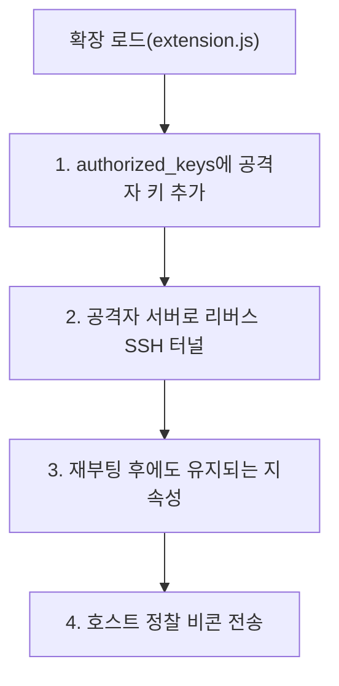

개발자가 "공식"이라는 이름이 붙은 확장을 설치할 때, 그 이름이 실제 게시자를 보증하는지 확인하는 사람은 많지 않습니다. 2026년 10월 말 보안 업체 Phorion이 공개한 권고는 바로 그 신뢰 지점을 겨냥한 사건을 다룹니다. Cursor 마켓플레이스로 배포된 "Claude Code for VS Code" 확장의 변조 빌드에 영구 SSH 백도어가 들어 있었다는 내용입니다.

이 글은 Phorion의 단일 1차 분석(2026-10-30 게시, 10-31 갱신)에 기반합니다. Anthropic이나 CVE 등 별도 확인은 찾지 못했으므로, 아래 내용은 모두 이 권고의 주장이라는 점을 전제로 읽어 주세요.

---

## 사건 개요

권고에 따르면 영향 버전은 `2.1.312`와 `2.1.313`입니다. 최초 권고에는 2.1.313만 있었으나 Cursor의 보안 공지를 인용해 10-31에 두 버전으로 정정되었고, Cursor는 두 버전을 마켓플레이스에서 제거했습니다. 처음에는 대상 마켓플레이스가 잘못 적혀 있다가 같은 날 Cursor로 바로잡혔다는 개정 이력도 있습니다.

핵심은 실행 시점입니다. 변조된 `extension.js` 맨 앞에 즉시 실행 함수(IIFE)가 덧붙어 있어, Node가 파일을 로드하는 순간 확장의 `activate` 콜백보다 먼저 실행됩니다. 사용자가 확장을 열거나 클릭할 필요가 없습니다. 확장은 IDE를 실행한 사용자의 권한으로 돌기 때문에 로컬 파일, 소스 코드, 개발 도구에 곧바로 닿습니다. macOS·Linux·Windows 로직이 모두 있으나 권고는 macOS 중심으로 분석했습니다.

## 공격 동작 4단계

**1단계, SSH 접근 준비.** `~/.ssh/authorized_keys`에 코멘트가 `svc-telemetry`인 Ed25519 공개키를 추가하고, 플랫폼별로 SSH 서버 활성화를 시도합니다. 권한 상승 익스플로잇은 없습니다. macOS의 `sudo -n`은 비밀번호 없는 sudo가 이미 설정된 경우에만 통하므로 일반 사용자 권한에서는 실패할 수 있습니다.

**2단계, 리버스 SSH 터널.** 공격자 서버의 22번 포트에 사용자 `tunnel`로 접속해 `-R *:0:localhost:22` 역방향 터널을 엽니다. 피해 머신이 밖으로 먼저 연결을 만들기 때문에 NAT나 인바운드 방화벽이 있어도 공격자가 터널을 통해 되돌아 들어올 수 있습니다. `autossh`가 있으면 그것을, 없으면 `ssh`를 쓰고 60초 간격 재시도 루프로 분리 실행해서 IDE를 닫아도 터널이 유지됩니다. 터널 인증용 개인키는 임시 디렉터리의 `.stk_` 접두 파일로 풀립니다.

**3단계, 지속성.** 운영체제별로 다릅니다.

| 플랫폼 | 지속성 수단 | 비고 |
|---|---|---|
| macOS | `~/Library/LaunchAgents/com.apple.sysmond.plist` | Apple 이름으로 위장한 사용자 LaunchAgent, `~/.config/.smt` 실행 |
| Linux | `~/.config/.smt` + `@reboot` cron | 권고는 반복 실행 시 기존 cron을 지울 수 있는 버그도 지적 |
| Windows | `SysMon` 예약 작업, 실패 시 시작 프로그램 폴더 `sysmon.cmd` | SYSTEM 작업은 관리자 권한 필요 |

**4단계, 정찰 비콘.** 호스트명, 사용자, 공인 IP, git 이메일, 그리고 `KEY|TOKEN|SECRET|PASS|AWS|GCP`에 매칭되는 환경변수 **이름**(값은 아님, 최대 40개)을 평문 HTTP로 `/beacon`에 보냅니다. 값을 훔치지 않는 대신 어떤 클라우드 자격증명이 있는 머신인지 목록을 만들어 공격 우선순위를 정하게 해 줍니다.

## macOS 로직 버그: 막힌 줄 알았던 길

권고가 특히 짚는 부분입니다. 스크립트는 `systemsetup -getremotelogin`을 관리자 권한 없이 실행하는데, 일반 사용자에게 이 명령은 오류 문구를 stdout에 찍고 **종료 코드 0**으로 끝납니다. 스크립트는 출력이 `/Off/i`와 맞을 때만 원격 로그인을 켜므로, "확인할 권한이 없다"를 "이미 켜져 있다"로 오해해 활성화 단계를 건너뜁니다.

그래서 원격 로그인이 꺼진 Mac에서는 터널은 연결돼도 되돌아오는 22번 포트가 닫혀 있어 인바운드 경로가 끊깁니다. 그러나 권고는 이것을 방어책으로 믿지 말라고 못 박습니다. 키와 지속성은 그대로 남아 있어서, 사용자가 이미 원격 로그인을 켜 두었거나 나중에 켜면 백도어가 즉시 작동하기 때문입니다.

## 탐지 포인트

- IDE 헬퍼 프로세스(`Code Helper`, `Cursor Helper` 등)가 `~/.ssh/authorized_keys`를 쓰는 행위. Node의 `fs.appendFileSync`는 `echo`·`tee` 같은 셸 명령 기반 룰을 우회하므로 파일 수정 텔레메트리가 필요합니다.
- Apple 프로세스가 아닌 쪽이 `com.apple.*` 라벨의 LaunchAgent를 만들거나, LaunchAgent가 홈 아래 숨김 스크립트를 `/bin/sh`로 실행하는 패턴.
- `-R *:0:localhost:22`를 가진 `ssh`/`autossh`, `/tmp/.stk_*`·`~/.config/.smtk` 키 파일 사용.
- 터널로 들어온 인바운드 로그인은 SSH 로그에 localhost(`127.0.0.1`, `::1`)에서 온 `svc-telemetry` 키 인증으로 보입니다.

`systemsetup -setremotelogin on` 실행 여부는 위 버그 때문에 알림의 필수 조건으로 삼으면 안 됩니다. 코멘트 문자열 대신 공개키 지문으로 사냥하라는 조언도 있습니다(코멘트 검사만으로 중복 추가를 판단하는 코드라는 점에서 나온 말입니다). 해시와 IP 같은 IoC 전체는 원문 표를 확인하세요.

## 대응: 확장만 지워서는 안 된다

권고의 조치를 순서대로 정리하면 다음과 같습니다.

1. 활성 `ssh`/`autossh` 프로세스와 재시도 루프 셸을 종료한다.
2. 지속성을 제거한다: LaunchAgent, `~/.config/.smt`·`.smtk`, cron/예약 작업 또는 시작 프로그램 스크립트.
3. `authorized_keys`에서 `svc-telemetry` 키를 삭제하고 `/tmp/.stk_*`를 지우며, 원격 로그인이 의도치 않게 켜져 있는지 확인한다.
4. SSH가 켜져 있었거나 인바운드 로그인 정황이 있으면 해당 사용자가 접근할 수 있던 자격증명과 토큰을 교체한다.

## 시사점과 점검 기준

공격면이 에이전트 도구 자체가 아니라 그것을 **배포하는 확장 마켓플레이스**였다는 점이 이 사건의 요점입니다. 에이전트 내부 경계 우회와는 결이 다른, 설치 경로의 신뢰 문제입니다. 아래는 이 글의 필자 해석이며 권고가 명시한 내용은 아닙니다.

| 점검 항목 | 질문 |
|---|---|
| 게시자 식별 | 확장의 게시자 ID가 공식 계정과 일치하는가 |
| 버전 고정 | 자동 업데이트로 변조 빌드가 곧바로 들어오지 않는가 |
| 감사 지점 | 확장 호스트가 `~/.ssh`와 LaunchAgents를 건드리면 알림이 오는가 |
| 비밀 노출 | 개발 머신 환경변수에 장기 자격증명이 상주하는가 |

비밀이 환경변수에 평문으로 있을수록 비콘의 정찰 가치가 올라가므로, 단기 토큰과 외부 시크릿 관리로 옮기는 것이 같이 효과를 냅니다.

## 참고 및 출처

- Phorion, "Official Claude Code Extension Compromise: Security Advisory" (2026-10-30 게시, 10-31 갱신): <https://phorion.io/blog/offical-claude-code-vsx-compromise/>
