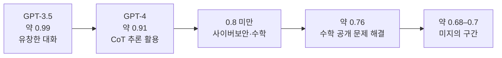

모델이 얼마나 똑똑해졌는지를 말할 때 우리는 보통 벤치마크 점수를 꺼냅니다. 그런데 벤치마크는 몇 년 지나면 포화되고, 새 능력이 나타날 때마다 새 벤치마크를 만들어야 합니다. OpenAI 수석 과학자 Jakub Pachocki가 2026년 11월 22일 공개한 글 "Perplexity and Intelligence"는 정반대의 제안입니다. 7년 넘게 거의 변하지 않은 단 하나의 지표, 즉 **퍼플렉시티(perplexity)** 를 업계 공통 언어이자 안전 상한선의 근거로 삼자는 것입니다. 이 글에서는 원문이 실제로 주장하는 바와 수치, 저자가 스스로 인정한 한계, 그리고 이 제안을 어떻게 읽어야 하는지를 정리합니다.

---

## 퍼플렉시티가 무엇이고 왜 지금 나왔나

퍼플렉시티는 모델이 다음 토큰을 평균적으로 얼마나 잘 맞히는지를 나타냅니다. 값이 낮을수록 예측이 정확합니다. 원문이 보고하는 값은 퍼플렉시티에 로그를 취한 **로그 퍼플렉시티**, 곧 교차 엔트로피 손실(cross-entropy loss)과 같은 양입니다. 원문은 로그의 밑을 명시하지 않으므로, 아래 환산은 자연로그라는 가정 위에서 제가 계산한 값입니다.

Pachocki는 현대 AI를 이렇게 단순화합니다. 먼저 큰 컴퓨터를 만들고, 그 위에서 방대한 비정형 데이터로 **압축기(compressor)** 를 사전학습하고, 이후 프롬프팅·파인튜닝·강화학습으로 잠재 능력을 끌어냅니다. 여기서 압축기는 GZIP 같은 압축 산출물이 아니라 "보지 못한 데이터를 예측해 압축할 수 있는 능력"을 뜻합니다. 원문 각주도 가장 좋은 압축기가 학습 코퍼스의 내용을 그대로 "기억"하는 것은 아니라고 못박습니다.

이 구도에서 지능의 원천은 훨씬 단순하고 해석하기 어려운 과정, 즉 압축기 학습입니다. 그래서 저자는 하위 벤치마크가 아니라 사전학습 진행도를 직접 보는 편이 장기적으로 낫다고 주장합니다. 하위 벤치마크는 GPT-4 즈음에 대부분 포화됐지만, 손실은 연속적이고 계속 유효하기 때문입니다.

## 공개된 수치가 말하는 것

원문은 GPT-3.5 이후 모델들의 로그 퍼플렉시티 추이를 그래프로 공개하고, 구간별로 어떤 능력이 나타났는지 서술합니다. 아래 표의 "환산" 열은 원문 수치에 지수함수를 적용한 제 계산이며, 직관을 돕기 위한 참고값입니다.

| 모델·구간 | 로그 퍼플렉시티 | 환산(e의 거듭제곱) | 원문이 서술한 능력 |
|---|---|---|---|
| GPT-3.5 | 약 0.99 | 약 2.69 | 유창한 대화, 초기 ChatGPT의 기반 |
| GPT-4 | 약 0.91 | 약 2.48 | 사고의 연쇄(chain-of-thought) 추론을 생산적으로 활용 |
| 0.8 미만 | 0.8 아래 | 약 2.23 미만 | 사이버보안·수학 등에서 변혁적 능력 출현 |
| 최근 모델 | 약 0.76 | 약 2.14 | 공개 수학 문제에서 "획기적 결과" |
| 외삽 구간 | 약 0.68–0.7 | 약 1.97–2.01 | 추가 변혁적 능력이 나타날 수 있으나 무엇인지는 모름 |

환산값은 "다음 토큰을 고를 때 모델이 평균적으로 헷갈리는 후보 수"처럼 읽을 수 있습니다. 2.7개에서 2.1개로 줄었을 뿐인데 대화 모델이 수학 난제를 푸는 모델이 됐다는 점이 이 글의 가장 인상적인 대목입니다. 숫자의 변화는 작고, 그 변화가 낳은 능력 차이는 큽니다.

저자는 여기서 중요한 단서를 붙입니다. 이 능력들이 특정 퍼플렉시티 임계값에서 나타나리라는 것은 사전에 전혀 분명하지 않았고, 사후적으로 "이 한 지표의 진전에서 창발한 잠재 능력"으로 해석할 수 있다는 것입니다. 즉 임계값은 예측 도구가 아니라 회고적 관찰입니다.

## AI가 AI 연구에 기여하기 시작한 구간

글의 두 번째 축은 속도입니다. 원문에는 OpenAI 모델의 손실 그래프에서 2026년에 가파른 가속이 보이며, 주된 원인은 장기 연구와 컴퓨팅 투자이고 자동화의 기여는 더 작은 부분이라고 서술돼 있습니다. 다만 각주에서 최신 모델에서는 AI의 설계 기여가 이미 의미 있는 수준이라고 덧붙입니다.

저자는 "완전한 재귀적 자기개선"이라는 흔한 프레이밍이 핵심을 놓친다고 봅니다. 연구 전 과정이 인간 없이 돌아가는 상태는 인간 통제를 위해 피해야 할 상태일 뿐 아니라, 더 일찍 올 수 있는 단일 단계의 변곡점, 곧 **사전학습 알고리즘 연구에 AI가 참여하는 것**을 가립니다. 근거는 수학 쪽 경험입니다. 1년 넘게 모델에 열린 수학 문제를 던져 왔는데, 퍼플렉시티 약 0.76 모델로 올리자 오래 고민하던 문제의 해답이 한 슬랙 스레드에 연달아 올라오는 것을 봤다고 합니다. 딥러닝 연구는 실험 의존도가 높지만 단순한 통찰이 수년간 간과된 사례가 많으므로, 이르면 2027년에 사전학습 기초 진전의 "눈사태"를 볼 수 있다는 추측입니다. 이는 어디까지나 저자의 추측이고, 정렬·모니터링 진전은 그 속도를 따라가기에 충분히 빠르지 않을 것이라는 판단과 함께 제시됩니다.

## 제안: 지표 기반의 공통 상한선

핵심 제안은 세 겹입니다.

- 개발사들이 퍼플렉시티와 기타 측정에 기반한 **상한선(limit)** 에 공동으로 합의하고, 그 선을 넘지 않겠다고 약속한다.
- 상한을 넘기 전에 달성해야 할 이해·모니터링 이정표를 구체적으로 정한다. 예로 CoT 모니터의 후속 기술 개발이 거론됩니다.
- 그 선을 넘는 모델이 처음 쓰이기 전까지 평가 방식과 레드팀 안전 케이스, 투명성 기준을 공유 규범으로 만든다.

저자는 현재 지배적인 정렬 감사(alignment auditing) 방식이 평가·훈련 인지(evaluation and training awareness)가 커질수록 약해질 것으로 예상합니다. 모델이 시험받고 있음을 알아채는 정도가 높아지면 감사 결과의 신뢰도가 떨어진다는 뜻입니다. 그래서 속도를 조절할 근거가 필요하다는 논리입니다. 제안된 상한의 구체적 수치는 원문에 없습니다.

## 저자가 직접 인정한 한계

이 글이 읽을 가치가 있는 이유 중 하나는 약점을 원문이 먼저 적는다는 점입니다.

1. **연구소 간 비교가 어렵습니다.** 평가 데이터셋과 학습 데이터 구성이 개발사마다 다릅니다. 저자는 투명성 목표를 세우면 모델 간 이전 가능한 비교 방법을 찾을 수 있다고 기대할 뿐입니다.
2. **실제 관심 과제와 직접 대응하지 않습니다.** 퍼플렉시티를 보는 이유는 그 진전이 새 능력의 출현으로 이어지리라 기대하기 때문입니다.
3. **사전학습 밖의 진전을 반영하지 못합니다.** 대표적으로 CoT 추론은 퍼플렉시티를 낮추지 않으면서 능력을 크게 올립니다.
4. **하한을 모릅니다.** 손실 0은 불가능하고 데이터의 고유 엔트로피는 알 수 없습니다. 그 값에 가까워질수록 겉보기 진전은 느려지지만, 작은 손실 감소가 더 큰 지능 도약에 대응하게 된다고 저자는 주장합니다.

수치의 출처에도 주의가 필요합니다. 보고된 값은 OpenAI **사내 코드베이스**에서 뽑은 고정 스냅샷의 held-out 데이터 기준이며, 저자는 그래서 GPT-2·GPT-3 같은 옛 모델의 값이 일반 능력의 나쁜 대리 지표가 된다고 각주에서 인정합니다. 외부에서 재현할 수 없는 자체 서술이라는 점은 변하지 않습니다.

## 어떻게 읽을 것인가

저는 이 글을 두 층으로 나눠 읽는 것이 안전하다고 봅니다.

첫째 층은 **수치**입니다. 0.99, 0.91, 0.76은 비교 불가능한 사내 데이터셋 위의 값이고 제안 주체가 이해당사자입니다. 독립 검증이 없으므로 이 숫자를 업계 순위표처럼 쓰면 안 됩니다. 다른 연구소가 같은 방식으로 공개하기 전에는 "OpenAI 내부 시계열"로만 읽어야 합니다.

둘째 층은 **제안의 구조**입니다. 포화되는 하위 벤치마크 대신 연속적이고 오래 유지된 지표를 거버넌스의 공통 언어로 삼자는 발상, 상한과 그 상한을 넘기 위한 이해 이정표를 한 쌍으로 묶자는 설계는 수치와 별개로 논의할 가치가 있습니다. 반론도 분명합니다. CoT나 강화학습처럼 퍼플렉시티를 건드리지 않는 능력 증폭이 사전학습 밖에 있으므로, 퍼플렉시티 상한만으로는 위험한 능력의 출현을 막지 못할 수 있습니다. 저자도 이를 한계로 적었고, 그래서 "퍼플렉시티와 기타 측정"이라는 표현을 씁니다.

같은 맥락에서 [OpenAI 프론티어 학습 격리 글](/post/2026-11-23-openai-frontier-training-containment-offline-world/)과 이어 읽으면 흥미롭습니다. 그쪽이 학습 인프라를 어떻게 가둘 것인가의 문제라면, 이쪽은 학습을 어디까지 진행할 것인가의 문제입니다.

## 마무리

정리하면 이 글의 주장은 세 문장입니다. 지능은 압축기 학습에서 나오고, 그 진행도는 퍼플렉시티로 가장 잘 추적되며, 따라서 퍼플렉시티 기반의 공통 상한선을 업계가 합의하자는 것입니다. 수치는 자체 서술이고 비교 가능성은 아직 증명되지 않았지만, 능력 평가가 계속 포화되는 상황에서 "무엇을 기준으로 속도를 조절할 것인가"라는 질문을 구체적인 지표로 던졌다는 점이 이 글의 실질적 기여입니다.

## 참고 및 출처

- Jakub Pachocki, [Perplexity and Intelligence](https://openai.com/index/perplexity-and-intelligence/), OpenAI, 2026-11-22
- 환산값(지수 변환)은 원문 수치를 이용한 저자 계산이며, 원문에는 포함되어 있지 않습니다.
