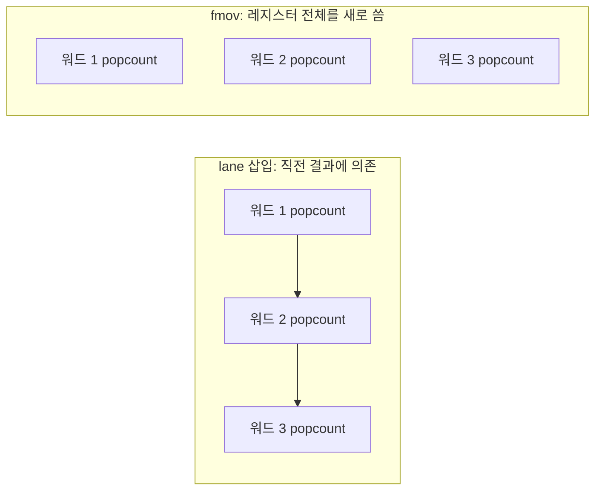

벤치마크는 코드가 **얼마나** 느린지 알려 주지만 **왜** 느린지는 알려 주지 않는다. 답은 대개 JIT 컴파일러가 만든 기계어와 CPU가 그 안에서 시간을 보내는 위치에 있다. Daniel Lemire는 2026년 11월 23일 블로그에서 Richard Startin의 새 라이브러리 **instructive**를 소개했다. 실행 중인 JVM 안에서 뜨거운 JIT 메서드를 찾아 명령어별 샘플 수를 보여 주는 도구다. 이 글은 도구의 동작 방식, 비트맵 교집합 루프에서 드러난 의외의 병목, 그리고 도입 전에 알아야 할 제약을 정리한다. 본문의 수치는 Lemire의 글과 공개 저장소의 결과 파일에서 가져온 것이며, 필자가 직접 재현한 값이 아니다.

## 스택 샘플링이 멈추는 지점

대부분의 JVM 프로파일러는 샘플마다 스택을 거슬러 올라가 "어떤 호출 경로가 비싼가"를 답한다. 유용한 질문이지만 답은 메서드(프레임) 수준에서 멈춘다. 어느 메서드가 뜨겁다는 것을 알아도 그 안의 어느 루프, 어느 로드, 어느 분기가 문제인지, JIT가 기대한 코드를 만들었는지는 알 수 없다.

instructive는 방향이 반대다. 스택을 풀지 않고, 인터럽트된 **프로그램 카운터(PC, 지금 실행 중인 명령어 주소)** 하나만 기록해 그 주소를 담은 컴파일된 메서드에 귀속시킨다. README에 따르면 CPU 시간 10ms마다 `SIGPROF` 신호가 오고(Linux는 스레드별 POSIX 타이머, macOS는 프로세스 단위 `setitimer`), 신호 처리기는 잠금 없는 radix tree 조회 한 번과 원자적 증가 두 번만 한다. 컴파일된 메서드 목록은 JVMTI의 `CompiledMethodLoad`·`CompiledMethodUnload` 이벤트로 추적하고, 기계어는 필요할 때 코드 캐시에서 복사해 Java로 작성된 디스어셈블러가 해석한다. 낮은 오버헤드는 README가 밝힌 설계 목표이며, 다른 에이전트와 비교 측정한 결과는 아직 없다고 명시돼 있다.

## 사용법: 워밍업한 뒤 구간만 샘플링한다

API는 `Sampler.start()`와 `Sampler.stop()`으로 구간을 감싸고, 끝난 뒤 가장 뜨거운 메서드를 출력하는 형태다. 주의할 점은 **워밍업**이다. JVM은 처음에 바이트코드를 인터프리트하다가 호출이 충분히 쌓인 뒤에야 최적화 컴파일러 C2로 컴파일한다. instructive는 인터프리트된 코드의 샘플 수는 세지만 메서드에 귀속시키지 않으므로, 최적화된 코드를 보려면 샘플링 전에 대상 메서드를 충분히 돌려야 한다.

```java
import instructive.agent.InstructionProfileFormatter;
import instructive.agent.Sampler;

public class PopcountProfile {
    static int andCardinality(long[] a, long[] b) {
        int count = 0;
        for (int i = 0; i < a.length; i++) {
            count += Long.bitCount(a[i] & b[i]);
        }
        return count;
    }

    public static void main(String[] args) {
        java.util.Random random = new java.util.Random(1);
        long[] a = random.longs(65_536).toArray();
        long[] b = random.longs(65_536).toArray();
        long sink = 0;
        for (int i = 0; i < 10_000; i++) sink += andCardinality(a, b); // 워밍업

        Sampler.start();
        for (int i = 0; i < 100_000; i++) sink += andCardinality(a, b);
        Sampler.stop();

        InstructionProfileFormatter formatter = new InstructionProfileFormatter();
        Sampler.forEachHottestMethod(1, profile -> formatter.format(profile.snapshot(), System.out));
        System.out.println(sink); // 결과를 써서 루프가 제거되지 않게 한다
    }
}
```

실행할 때는 에이전트 jar를 `-javaagent`로 붙이고, 디스어셈블러가 든 `parse` jar를 클래스패스에 넣는다. README의 예시 명령은 다음과 같다(`javac`에도 같은 클래스패스가 필요하다).

```bash
java --enable-native-access=ALL-UNNAMED -javaagent:agent.jar -cp agent.jar:parse.jar:. PopcountProfile
```

출력은 메서드 이름, 컴파일 단계(tier 4가 C2), 코드 크기와 총 샘플 수에 이어 명령어 주소, 바이트, 디스어셈블 결과, 샘플 수가 표처럼 나온다. 위 코드는 사례를 단순화해 필자가 구성한 것이고, 아래에서 다루는 Lemire의 측정은 RoaringBitmap 라이브러리를 대상으로 한다.

## 사례: 비트맵 교집합 크기 세기

**RoaringBitmap**은 정수 집합을 65,536개 단위 청크로 나눠 저장하는 압축 비트맵이다. 값이 많은 청크는 64비트 워드 1,024개짜리 비트맵 컨테이너가 되고, 두 컨테이너의 교집합 크기는 워드마다 AND를 한 뒤 `Long.bitCount`로 1의 개수를 더하면 된다. Lemire는 0부터 4,194,303까지의 정수를 동전 던지기로 채운 두 집합을 만들어 모든 청크가 비트맵 컨테이너가 되게 했다. 호출 한 번에 65,536워드를 처리한다. 10,000회 워밍업 후 100,000회를 샘플링한 결과는 환경에 따라 크게 갈렸다.

| 환경 | 호출당 시간 | 워드당 시간 | JIT가 만든 코드 |
|---|---|---|---|
| Apple M4 Max, JDK 25 | 115 µs | 1.75 ns | 워드마다 스칼라 popcount |
| Apple M4 Max, JDK 27 | 15.6 µs | 0.24 ns | 루프 벡터화 |
| Intel Xeon Gold 6548N, JDK 25 | 10 µs | 0.15 ns | AVX-512 `vpopcntq` |
| Intel Xeon Gold 6548N, JDK 27 | 10 µs | 0.15 ns | AVX-512 `vpopcntq` |

단순한 루프인데 M4 Max와 JDK 25 조합에서는 워드 하나에 약 8사이클이 걸렸다. 타이밍만 봤다면 "ARM에서 느리네"로 끝났을 결과다.

### 샘플이 몰린 곳은 계산이 아니라 레지스터 복사였다

ARM은 (최근의 CSSC 확장 이전에는) 일반 64비트 레지스터의 비트를 세는 명령이 없다. 그래서 C2는 값을 벡터 레지스터로 복사하고, `cnt`로 바이트별 개수를 세고, `addv`로 합친 뒤 다시 일반 레지스터로 복사하는 네 단계를 만든다. 공개된 프로파일에서는 1,042개 샘플의 약 80%가 두 복사 명령에 몰려 있고, 정작 계산을 하는 `cnt`·`addv`에는 거의 없다. 참고로 이 버전의 디스어셈블러는 ARM 벡터 명령을 해석하지 못해 `.word`로 표시하므로, 명령 의미는 Lemire가 주석으로 달았다.

Lemire의 분석에 따르면 복사 자체가 비싼 것이 아니다. 모든 popcount가 같은 레지스터 `v16`을 쓰는데, 첫 복사(`mov v16.d[0], x`)는 128비트 레지스터의 **하위 절반만** 바꾸고 상위 절반을 유지한다. 따라서 `v16`의 이전 값, 즉 직전 popcount가 끝나기를 기다려야 한다. CPU는 여러 워드를 동시에 처리하지 못하고 한 줄로 늘어선다.



이 가설은 도구 밖에서 검증됐다. 저장소의 `chain.c`는 C2의 명령 순서를 인라인 어셈블리로 옮기고 복사 방식만 바꿔 측정한다. 공개된 M4 Max 결과는 다음과 같다.

| 인라인 어셈블리 변형 | 워드당 시간 |
|---|---|
| 삽입(`mov v16.d[0]`), 레지스터 1개 | 1.79 ns |
| 삽입, 레지스터 2개를 번갈아 사용 | 0.85 ns |
| `fmov`, 레지스터 1개 | 0.29 ns |

`fmov`는 대상 레지스터 전체를 새로 쓰므로 이전 값에 의존하지 않고, 약 6배 빨라진다. 레지스터를 두 개로 나누면 독립된 체인이 두 개가 되어 시간이 절반 가까이 줄어드는 것도 의존성 설명과 맞아떨어진다(이 대목은 표를 본 필자의 해석이다).

여기서 배울 점은 **샘플이 찍힌 명령이 곧 비싼 명령은 아니라는 것**이다. 타이머 샘플은 앞선 결과를 기다리는 지점에 쌓일 수 있다. instructive에는 반복 간 의존성을 명령 흐름에서 찾는 `LongDependencyChainRule`이라는 분석 규칙도 있다. 다만 README가 벡터 SIMD 명령은 분류만 한다고 밝히고 있으므로, 이번 `v16` 체인까지 자동으로 짚어 주는지는 필자가 확인하지 못했다.

### JDK 27은 루프를 벡터화해 문제를 피해 갔다

JDK 27에서는 같은 소스가 약 7배 빨라졌다. 프로파일을 보면 두 워드를 벡터 레지스터에 한 번에 적재(`ldr q`)하고 그 안에서 AND와 비트 세기를 하므로 일반 레지스터를 오가는 복사가 사라진다. 다만 Lemire는 `Long.bitCount` 자체의 코드 생성은 바뀌지 않았고, **벡터화되지 않는 루프는 JDK 25와 똑같이 느리다**고 지적한다. "JDK를 올리면 popcount가 빨라진다"가 아니라 "이 루프 모양이 벡터화된다"가 정확한 표현이다.

이 차이는 저장소의 `BitCount.java` 결과 파일에서도 보인다. 1,024워드 배열 두 개를 대상으로 한 M4 Max의 워드당 시간이며, 블로그 본문에는 없는 값이다.

| 변형 | JDK 25 | JDK 27 |
|---|---|---|
| `Long.bitCount(a[i] & b[i])` 합산 | 1.57 ns | 0.22 ns |
| 같은 루프에 조기 종료 조건 추가 | 1.57 ns | 1.57 ns |
| 조기 종료 + `Integer.bitCount` 두 번 | 0.42 ns | 0.43 ns |
| Vector API(128비트) | 0.20 ns | 0.20 ns |

합이 한계값을 넘으면 중간에 반환하는 루프는 C2가 벡터화하지 않아 JDK 27에서도 1.57 ns에 머문다. 64비트 값을 32비트 두 조각으로 나눠 세면 같은 조건에서 3.7배 안팎 빨라진다.

```java
long x = a[i] & b[i];
count += Integer.bitCount((int) x) + Integer.bitCount((int) (x >>> 32));
```

왜 32비트 버전이 빠른지는 필자가 확인한 자료에 설명이 없다. 생성 코드는 CPU와 JDK에 따라 달라지므로 이 치환을 일반 규칙으로 삼지 말고, 대상 환경에서 프로파일과 벤치마크로 확인한 뒤 적용해야 한다.

### Xeon에서는 처음부터 문제가 없었다

Emerald Rapids Xeon에서는 JDK 25와 27 모두 AVX-512를 사용했다. `vmovdqu32`로 8워드를 512비트 레지스터에 올리고, `vpandd`로 AND한 뒤, [`vpopcntq`](https://www.felixcloutier.com/x86/vpopcnt) 한 명령으로 8워드의 비트를 각각 센다. 이 묶음을 8번 반복해 루프 한 바퀴에 64워드를 처리한다. 같은 Java 소스가 아키텍처와 JDK 버전에 따라 10배 넘게 차이 난 셈이다.

## JMH perfasm과 무엇이 다른가

[JMH](https://github.com/openjdk/jmh)의 `perfasm` 프로파일러도 뜨거운 어셈블리 영역을 보여 준다. 차이는 설치 부담과 쓸 수 있는 장소다.

| 항목 | JMH perfasm | instructive |
|---|---|---|
| 대상 | JMH 벤치마크 | 일반 Java 애플리케이션 |
| 필요한 것 | JMH 프로젝트, hsdis 디스어셈블러, `perf`(Linux) 또는 DTrace(macOS) | 에이전트 jar, 파서 jar |
| 권한 | macOS DTrace는 root 필요 | root 불필요 |
| 결과 | 텍스트 보고서 | Java 객체(정렬·필터·분석 가능) |
| 성숙도 | 오랫동안 쓰인 표준 도구 | 2026년 11월에 만들어진 신규 저장소 |

실행 중인 애플리케이션 안에서 실제 데이터로 켤 수 있다는 점이 가장 큰 차별점이다. 반대로 재현 가능한 성능 비교가 목적이라면 워밍업·포크·통계를 관리해 주는 JMH가 여전히 필요하다. 둘은 대체재라기보다 "측정"과 "원인 분석"을 나눠 맡는 관계다.

## 도입 전에 확인할 제약

2026년 11월 26일에 확인한 README와 저장소 상태 기준이다.

- **JDK와 빌드**: JDK 17 이상과 C++17 컴파일러가 필요하고 `./gradlew build`로 빌드한다. 테스트 대상은 JDK 17·21·25다.
- **플랫폼**: Linux(x86-64·AArch64, glibc·musl)는 CI에서 테스트한다. macOS는 게시되는 jar에 포함되지 않아 직접 빌드해야 하며, JDK 25 미만은 필요한 VMStructs 심볼을 내보내지 않는다. Windows 지원은 언급이 없다.
- **분석 규칙**: 의존성 체인 등 일부 분석 규칙은 현재 AArch64에서만 동작한다. 레지스터는 추적하지만 메모리는 추적하지 않는다.
- **디스어셈블**: AArch64 벡터 SIMD 명령은 분류만 되고 해석되지 않는다.
- **샘플 수**: 10ms당 한 개이므로 CPU 시간 1초에 약 100개다. 짧은 워크로드는 표본이 부족해 명령어 단위 비율이 흔들린다.
- **장시간 수집**: 명령어별 카운터는 16비트라 한 명령에 약 11분 분량이 쌓이면 포화된다. 상시 수집한다면 주기적으로 `Sampler.resetCounts()`를 호출해야 한다.
- **라이선스와 안정성**: 확인 시점에 저장소에서 라이선스 파일과 릴리스 항목을 찾지 못했다. 네이티브 에이전트를 운영 환경에 붙이는 일이므로 사용 조건을 먼저 확인하고 비운영 환경에서 검증해야 한다.

## 판단 기준

instructive가 잘 맞는 상황은 뜨거운 메서드를 이미 특정했는데 그 안에서 왜 느린지 설명이 안 될 때, 같은 코드가 CPU나 JDK 버전에 따라 크게 다른 속도를 보일 때, 벤치마크로 옮기기 어려운 실제 데이터에서 확인해야 할 때다. 반대로 어디가 병목인지 아직 모른다면 스택 샘플링 프로파일러가 먼저이고, 병목이 I/O 대기나 GC라면 CPU 시간 기반의 명령어 샘플은 답을 주지 않는다. 어느 쪽이든 어셈블리를 읽을 수 있어야 결과를 해석할 수 있다.

이번 사례가 남기는 실천 항목은 세 가지다. 성능 수치에는 CPU와 JDK 버전을 함께 기록한다. 핵심 루프에 조건 하나를 추가했을 때 벡터화가 유지되는지 확인한다. 그리고 가설은 `chain.c`처럼 변수 하나만 바꾼 실험으로 검증한다.

마이크로아키텍처 수준의 병목을 더 보고 싶다면 [Store forwarding 실패의 성능 함정](/post/2026-11-08-cpp-store-forwarding-failure-performance-trap/)과 [fast_float 성능 힌트와 분기 예측](/post/2026-11-15-fast-float-performance-hints-branch-misprediction/)이 이어지는 주제다.

## 참고 자료

- Daniel Lemire, [Seeing the machine code of your Java program, with a few lines of Java](https://lemire.me/blog/2026/11/23/seeing-the-machine-code-of-your-java-program/) (2026-11-23)
- Richard Startin, [instructive 저장소와 README](https://github.com/richardstartin/instructive)
- Lemire, [벤치마크 코드와 결과 파일](https://github.com/lemire/Code-used-on-Daniel-Lemire-s-blog/tree/master/2026/11/instructive)
- [Java SE 25 `Long.bitCount` API 문서](https://docs.oracle.com/en/java/javase/25/docs/api/java.base/java/lang/Long.html)
- [Roaring Bitmaps 공식 사이트](https://roaringbitmap.org)
- [OpenJDK JMH 저장소](https://github.com/openjdk/jmh)
