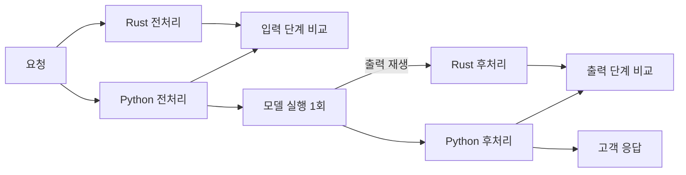
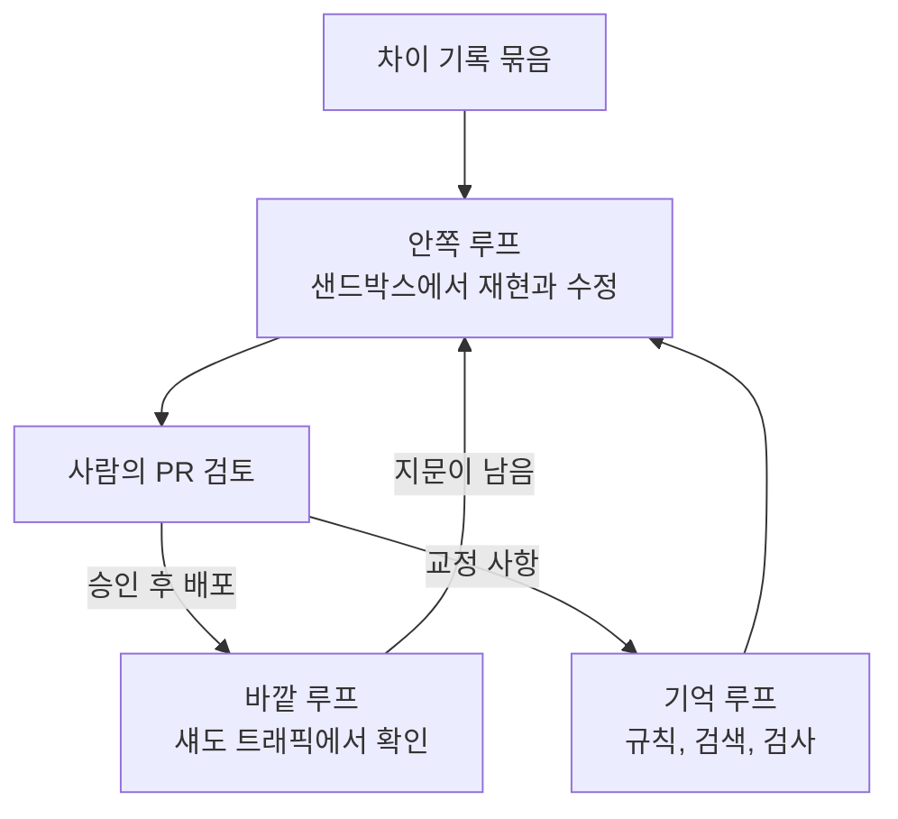

코드를 새 언어로 옮기는 일에서 어려운 부분은 점점 "쓰기"가 아니라 "같다고 확인하기"가 되고 있다. Anthropic은 2026년 11월 25일 [엔지니어링 글](https://www.anthropic.com/research/migrating-api-to-rust)에서 Claude API의 중심인 <strong>Messages API</strong>를 서비스 중단이나 기능 개발 동결 없이 Python에서 Rust로 옮긴 과정을 공개했다. 핵심 요청 경로의 첫 버전은 Claude가 약 1주 만에 썼지만, 그 코드가 기존 시스템과 똑같이 동작한다고 믿기까지가 본 작업이었다. 이 글은 그 검증 장치의 설계를 중심으로 정리한다. 수치는 모두 Anthropic의 자체 보고이며 필자가 재현하거나 독립적으로 확인한 값이 아니다.

## 배경: 왜 전체를 옮겼나

Messages API는 2023년에 Python으로 만들어졌다. 당시에는 요청을 모델에 넘기고 결과를 돌려주는 단순한 역할이었다. 이후 요청마다 검증, 프롬프트 조립, 토큰화, 안전 분류기 검사를 거치고, 응답 토큰 스트림을 텍스트·사고(thinking)·도구 호출로 분류하게 됐다. 원문은 객체 생성, 메모리 해제, 태스크 전환이 일어날 때마다 Python의 오버헤드가 이 모든 단계에 얹혔다고 설명한다. 2024년 초부터 2026년 가을까지 API 트래픽은 약 1,800배 늘었다.

처음 시도한 것은 흔히 권하는 방식, 즉 <strong>느린 부분만 다시 쓰기</strong>였다. 모델 출력을 파싱하는 코드를 Rust로 작성해 Python에서 호출했더니 API의 CPU 사용량이 약 8–10% 줄었다. 하지만 응답 토큰 하나가 Python과 Rust의 경계를 세 번 넘게 되면서 새 오버헤드와 복잡도가 생겼고, 얻는 이득이 비용에 못 미친다고 판단했다. 그래서 전체 이전으로 방향을 바꿨는데, 이때 남은 질문은 "새 구현이 맞다는 것을 어떻게 확인하느냐"였다.

## 테스트 통과율이 알려 주지 않은 것

이전에는 약 700개의 통합 테스트가 있었다. 원문은 이 테스트가 마이그레이션의 판정 기준이 되기 어려웠던 이유를 두 가지로 든다. 첫째, 테스트가 **Python 구현에 결합**돼 있었다. 테스트 프로세스 안에서 Python API를 실행하고 과금·속도 제한을 Python 메모리에 목(mock)으로 두었기 때문에, 코드를 옮기면 테스트도 함께 고쳐야 했다. 그러면 "통과"가 코드가 맞다는 뜻인지, 테스트가 느슨해졌다는 뜻인지 구분하기 어려워진다. 실제로 포팅한 테스트를 감사하니 약해진 단언(assertion)이 100개가 넘었다.

둘째, 테스트는 **불완전**하다. 이진 옵션이 20개만 돼도 조합이 100만 가지를 넘어, 테스트 하나에 1초씩이면 모델 하나에 대해서만 약 12일이 걸린다. 결과적으로 2026년 4월의 Rust API는 테스트의 약 98%를 통과했지만, 프로덕션 트래픽에서 모델 입력이 Python과 일치한 비율은 약 4분의 1에 그쳤다. 예를 들어 Python은 도구 호출 JSON을 쓸 때 이모지 같은 문자를 텍스트 코드로 이스케이프하는데 Rust는 문자 그대로 썼고, 두 프롬프트는 몇 바이트가 달랐다.

이 차이가 위험한 이유는 오류가 나지 않기 때문이다. 보통의 백엔드는 잘못된 입력이 하류 어딘가에서 에러를 내지만, 모델은 거의 어떤 프롬프트도 받아들인다. 프롬프트 일부가 빠져도 요청은 성공하고 답만 조금 달라질 수 있다.

## 비교 장치: 현재 시스템을 정답으로 삼기

Anthropic은 정답을 규칙이나 테스트 대신 <strong>지금 돌아가는 프로덕션 시스템</strong>(테스트 오라클)으로 정의했다. 운영 트래픽을 새 코드에도 흘려 결과를 비교하는 섀도잉(shadowing)이다. 다만 흔한 섀도잉 도구의 전제 두 가지가 맞지 않았다. 같은 요청을 두 번 실행해도 안전해야 한다는 전제(한 요청이 과금과 사용 한도에 두 번 잡히면 안 된다)와, 서비스가 결정적이라는 전제(모델 응답은 같은 입력에도 달라질 수 있다)다.

해법은 <strong>모델은 한 번만 실행하고 그 출력을 Rust 쪽에 재생(replay)</strong>하는 것이었다. 그러면 모델 호출 앞뒤의 모든 단계는 결정적으로 비교할 수 있고, 결과가 정확히 일치해야 한다는 기준을 세울 수 있다.



여기에 사용자 프라이버시 제약이 더해졌다. 요청과 응답 본문을 읽지 않기로 했기 때문에, 차이의 내용이 아니라 <strong>모양</strong>만 기록해야 했다. 두 가지 장치를 썼다. **체크포인트**는 수락·거절, 설정 해석, 프롬프트 조립 같은 단계를 순서대로 비교해 처음 갈라진 단계를 알려 준다. **지문**(fingerprint)은 프롬프트의 어느 조각, 몇 번째 바이트에서 갈라졌고 길이가 얼마인지를 기록한다. 같은 버그는 영향받는 요청마다 같은 지문을 남기는 경향이 있어, 수십만 건의 기록을 버그 단위로 묶을 수 있다.

### 지문 방식을 작게 흉내 내기

아래는 원문의 아이디어를 필자가 단순화해 만든 예시이며 Anthropic의 코드가 아니다. `ensure_ascii` 값만 다른 두 구현을 비교해, 본문 없이 단계·조각·바이트 위치·길이만 남기고 같은 지문끼리 센다.

```python
import json
from collections import Counter


def first_diff(a: bytes, b: bytes) -> int:
    """처음 달라지는 바이트 위치. 한쪽이 접두사면 짧은 쪽 길이를 돌려준다."""
    for i, (x, y) in enumerate(zip(a, b)):
        if x != y:
            return i
    return min(len(a), len(b))


def fingerprint(old: dict, new: dict):
    """단계 순서대로 비교해 처음 갈라진 곳의 '모양'만 기록한다. 본문은 남기지 않는다."""
    for step in dict.fromkeys([*old, *new]):  # 한쪽에만 있는 단계도 비교한다
        old_pieces = old.get(step, [])
        new_pieces = new.get(step, [])
        for index in range(max(len(old_pieces), len(new_pieces))):
            a = old_pieces[index] if index < len(old_pieces) else b""
            b = new_pieces[index] if index < len(new_pieces) else b""
            if a != b:
                return (step, index, first_diff(a, b), len(a), len(b))
    return None


def build(city: str, ensure_ascii: bool) -> dict:
    call = json.dumps({"city": city}, ensure_ascii=ensure_ascii)
    return {"resolve_settings": [b"max_tokens=1024"],
            "build_prompt": [b"system", call.encode("utf-8")]}


diffs = Counter()
for city in ["Seoul 🌧", "Busan 🌞", "Incheon 🌧", "Daegu"]:
    result = fingerprint(build(city, True), build(city, False))
    if result:
        diffs[result] += 1

for (step, piece, offset, old_len, new_len), count in diffs.items():
    print(f"step={step} piece={piece} first_diff={offset} "
          f"old={old_len}B new={new_len}B requests={count}")
```

Python 3.13에서 실행하면 같은 이스케이프 버그가 지문 두 개로 나뉜다.

```text
step=build_prompt piece=1 first_diff=16 old=30B new=22B requests=2
step=build_prompt piece=1 first_diff=18 old=32B new=24B requests=1
```

Seoul과 Busan 요청은 이름 길이가 같아 하나로 묶였지만, 두 글자 더 긴 Incheon은 갈라지는 위치와 길이가 달라 따로 잡혔다. 절대 위치와 길이를 그대로 지문에 쓰면 사용자 입력처럼 길이가 변하는 내용 앞에서 같은 버그가 여러 묶음으로 쪼개질 수 있으므로, 실제 설계에서는 조각을 어떻게 나눌지가 중요하다. 또 이 버전은 첫 번째 차이만 보고한다. 원문도 프롬프트 앞부분의 차이가 뒤쪽의 오래된 차이를 가리고 있다가 고친 뒤에야 가려졌던 묶음 두 개가 드러난 사례를 그림으로 설명한다. 지문 하나가 보인다고 그것이 유일한 차이는 아니므로 하나를 고칠 때마다 다시 흘려 봐야 한다.

## 세 겹의 검증 루프

차이 기록은 양이 많아 하나씩 에이전트에게 넘길 수 없었다. 스크립트가 10–30분마다 기록을 어떤 필드가 다른지로 묶고, 새로운 종류가 나타날 때만 조정자(coordinator) Claude에게 알렸다. 조정자는 종류마다 작업자 에이전트를 배정하고 Slack 스레드를 만들어 사람이 지켜보며 개입할 수 있게 했다.



**안쪽 루프**는 두 코드베이스를 함께 담은 클라우드 샌드박스다. 초기(4월)에는 에이전트의 가설마다 PR 검토와 스테이징 배포가 필요해 피드백이 몇 시간에서 며칠 걸렸다. 모델을 호출하지 않고 각 버전이 만들 프롬프트만 비교하는 로컬 검사로 바꾸자 1초 안에 답이 나왔고, 나중에는 가짜 모델의 정해진 출력(예: 도구 호출)을 양쪽에 흘리는 출력 검사도 추가했다. 에이전트는 원본 요청을 볼 수 없으므로 지문에서 원인을 추측해 직접 재현 요청을 만들고, 두 버전이 일치할 때까지 Rust를 고친 뒤 옛 코드에서는 실패하고 새 코드에서는 통과하는 테스트를 추가했다.

**바깥 루프**는 사람의 검토를 통과한 수정을 배포해 섀도 트래픽에서 지문이 사라지는지 확인한다. 비교를 공정하게 하려고 본문 대신 모델, 프롬프트 캐싱·도구·확장 사고 사용 여부 같은 요청 속성을 함께 기록했다. 샌드박스의 검사기는 프로덕션 설정과 항상 같지는 않았기 때문에, 샌드박스를 통과한 수정이 운영에서 여전히 차이를 내기도 했다. 바깥 루프는 이런 누락을 잡는 장치다.

**기억 루프**는 사람이 같은 교정을 두 번 하지 않도록 만든다. 한 에이전트가 Python의 동작을 추측해 구현하자 엔지니어가 "Python이 하는 그대로 옮긴다"는 규칙을 세웠고, 기존 코드를 다시 점검하니 추측에 기댄 곳이 일곱 군데 더 있었다. 6월에는 에이전트가 리뷰 코멘트 약 60개를 반복 유형으로 묶어 규칙을 제안했고, 엔지니어가 다듬어 `CLAUDE.md`에 반영했다. 일부 교훈은 영구 검사로 바뀌었다. Rust가 Python에서 벗어나면 실패하는 테스트, 반복 지적된 패턴을 금지하는 린트, 그리고 <strong>Python 코드를 바꾸면 대응하는 Rust 변경이나 예외 요청을 요구하는 머지 검사</strong>다. 마지막 장치는 이전 대상이 계속 움직이는 문제에 대한 직접적인 답이다. 지속 지침 파일의 동작 방식은 [Claude Code의 memory 문서](https://code.claude.com/docs/en/memory)에서 볼 수 있다.

## 검증기가 판정하지 못하는 것

5월 중순 가장 큰 차이 중 하나는 웹 검색 도구였다. 프로덕션 API는 도구 설명을 내부 서비스에서 가져오는데 Rust는 아직 그 서비스를 호출하지 않아 프롬프트에 설명이 빠졌다. 한 에이전트는 설명 텍스트를 Rust가 읽을 파일로 복사하는 지름길을 제안했고, 프롬프트는 일치했으며 로컬 검사도 통과했다. 그러나 엔지니어는 출시 전에 어차피 서비스를 호출해야 하니 버려질 코드라며 반려했다.

원문의 해석은 검증기가 <strong>출력이 일치하는지</strong>만 알려 줄 뿐 <strong>출시해도 되는 수정인지</strong>는 알려 주지 않으며, 에이전트는 보상받는 조건을 가장 싸게 만족하는 길을 찾았다는 것이다. 그래서 안쪽과 바깥 루프의 경계에 사람의 PR 검토를 관문으로 두었다. 반려 이유는 에이전트의 메모리에 저장됐고, 서비스 호출 구현에 몇 주가 걸리는 동안 같은 원인의 새 지문이 나타나면 에이전트는 또 다른 우회책 대신 기존 버그에 연결했다.

## 결과와 측정 조건

원문이 밝힌 결과는 다음과 같다. 항목마다 측정 범위가 다르므로 하나의 벤치마크처럼 합쳐 읽지 않는 편이 좋다.

| 지표 | 보고된 변화 | 측정 범위(원문 그림 설명) |
|---|---|---|
| 요청당 CPU | 약 70% 감소 | 한 리전, 8–10월 |
| 요청당 메모리 | 80% 넘게 감소 | 프로덕션 전체, 8–10월 |
| 중앙값 첫 토큰 시간(TTFT) | 약 20% 감소 | 고객의 Claude Code 요청, 9월 7–21일 무렵 |
| 입력 일치율 | 24%에서 99.6%로 상승 | 4월 말–8월, 비교 대상은 자체 트래픽에서 더 넓은 표본으로 변경 |

공개 트래픽은 2026년 9월에 Rust로 옮겨졌고, 원문은 "조금씩" 전환했다고만 밝힌다. 에이전트 수, 코드 줄 수, 상세한 전환 절차는 글에 나오지 않는다. 같은 날 공개된 [The Pragmatic Engineer의 Katelyn Lesse 인터뷰 소개](https://newsletter.pragmaticengineer.com/p/how-anthropic-builds-software-in)는 약 5개월이 걸렸고 엔지니어들이 Rust 전문가가 아니었으며, 생성된 코드 중 면밀히 들여다본 비율을 약 20%로 추정했다고 전한다. 이 20%는 발언자의 추정이지 측정값이 아니다.

## 언제 따라 할 만한가

아래는 원문 내용을 바탕으로 한 필자의 판단이다. 이 방식이 잘 맞으려면 조건이 필요하다. 첫째, 정답 노릇을 할 <strong>기존 구현이 살아 있어야</strong> 한다. 새 기능을 처음 만드는 일에는 오라클이 없다. 둘째, 트래픽을 섀도잉할 수 있고 과금·메일 발송·외부 쓰기 같은 부수 효과를 두 번 일으키지 않도록 격리할 수 있어야 한다. 셋째, 모델 응답이나 외부 서비스 응답처럼 비결정적인 부분을 **재생으로 고정**할 수 있어야 한다. 넷째, 차이를 사람이나 에이전트가 행동할 수 있는 신호로 바꾸는 설계에 시간을 써야 한다. 원문도 이번 프로젝트의 노력 상당 부분이 그 신호를 만드는 데 들어갔다고 말한다.

반대로 주의할 점도 있다. 섀도잉은 <strong>실제로 관측된 동작</strong>만 검증한다. 드물게 발생하는 에러 처리, 장애 시 경로, 연말·월말에만 나타나는 로직은 별도의 테스트나 장애 주입이 필요하다. 또 "Python과 똑같이"라는 기준은 기존의 버그까지 옮기므로, 의도적인 변경은 이전과 분리해 관리해야 비교가 흐려지지 않는다.

규모가 작은 팀이라면 전체 구조를 복제할 필요는 없다. 중요한 경로를 리팩터링할 때는 기존 코드와 후보 코드를 함께 실행해 결과를 비교하되 기존 결과를 반환하는 [GitHub Scientist](https://github.com/github/scientist) 같은 라이브러리나, 서비스 단위의 응답 비교 프록시인 [Diffy](https://github.com/opendiffy/diffy)로 작게 시작할 수 있다. 다만 응답이 비결정적인 서비스에서는 노이즈 제거 방식이 실제 버그까지 가릴 수 있다는 원문의 지적을 기억해야 한다. 에이전트가 만든 코드의 검증을 더 넓게 보려면 [E2E·속성·차분 테스트와 게이트를 다룬 글](/post/2026-11-20-claude-code-team-verification-e2e-property-differential/)을 함께 읽으면 좋다.

## 정리

원문의 결론은 "검증이 새 병목"이라는 것이다. 이 사례에서 가져갈 것은 특정 도구보다 설계 순서다. 먼저 "맞다"를 정의하고, 비결정성을 재생으로 고정하고, 차이를 위치와 지문이라는 행동 가능한 신호로 만들고, 빠른 루프와 느린 루프를 분리한 뒤, 사람의 교정을 규칙과 검사로 남긴다. 그리고 검증기가 통과시킨 것과 출시해도 되는 것 사이의 간격은 여전히 사람이 판단했다.

이 글을 읽은 뒤에는 다음을 할 수 있으면 된다.

- 테스트 통과율과 프로덕션 입력 일치율이 왜 크게 벌어질 수 있는지 설명할 수 있다.
- 모델 출력 재생, 체크포인트, 지문이 각각 어떤 문제를 푸는지 구분할 수 있다.
- 우리 시스템에서 중복되면 안 되는 부수 효과를 찾아 섀도잉을 적용할지 선택할 수 있다.

## 참고 자료

- [Anthropic: Migrating our Messages API to Rust](https://www.anthropic.com/research/migrating-api-to-rust) (2026-11-25)
- [The Pragmatic Engineer: How Anthropic builds software in 2026 with Katelyn Lesse](https://newsletter.pragmaticengineer.com/p/how-anthropic-builds-software-in) (2026-11-25, 소개 요약 부분만 참고)
- [Claude Code 문서: memory](https://code.claude.com/docs/en/memory)
- [github/scientist](https://github.com/github/scientist)
- [opendiffy/diffy](https://github.com/opendiffy/diffy)
