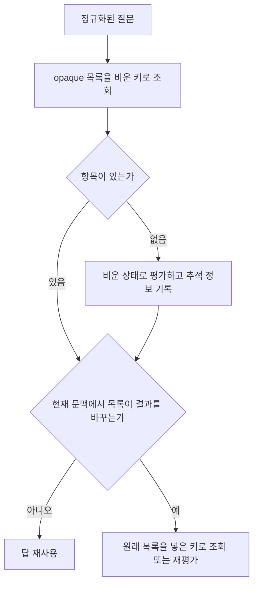

캐시를 붙였는데 적중률이 낮다면, 먼저 볼 곳은 캐시 키다. <strong>대부분의 경우 결과에 영향을 주지 않는 입력</strong>이 키에 들어 있으면 같은 계산이 서로 다른 항목으로 갈라진다. rustc의 차세대 트레이트 해결기(next-generation trait solver)가 바로 이 문제를 겪었고, 해결 방식은 컴파일러 밖의 메모이제이션 설계에도 옮겨 볼 만하다.

이 글은 이 해결기의 성능 작업을 맡은 jdonszelmann의 [2026년 11월 25일 글](https://donsz.nl/blog/optimizing-rustcs-next-trait-solver/)과 [8월의 상세 기록](https://donsz.nl/blog/new-solver-performance)을 중심으로, 관련 PR과 [rustc 개발 가이드](https://rustc-dev-guide.rust-lang.org/solve/caching.html)를 함께 읽고 정리했다. 성능 수치는 모두 저자와 PR 작성자의 보고이며 필자가 rustc에서 재현한 값이 아니다.

## 트레이트 해결기는 무엇을 묻는가

<strong>트레이트 해결기</strong>(trait solver)는 "타입 T가 트레이트 조건을 만족하는가"라는 질문에 답하는 컴파일러 하위 시스템이다. `a + b`를 검사할 때는 `Add` 구현을 찾고, 지역 변수를 둘 때는 `Sized`인지 확인한다. 답의 근거가 되는 후보는 `impl` 블록, 컴파일러 내장 규칙, 그리고 함수에 적힌 `where` 절이다. 후보 하나를 적용하면 새 하위 질문이 생기므로 탐색은 Prolog처럼 가지를 치며 이어지고, 이 그래프에는 순환도 생긴다.

호출 빈도가 높다는 점이 성능을 결정한다. 저자에 따르면 표준 라이브러리를 컴파일하는 동안 "이 타입이 `Sized`인가"만 약 80만 번 묻는다. 게다가 연관 타입이 있는 `impl`은 입력과 출력을 가진 함수처럼 동작해서, 한 번의 질문이 재귀 한계까지 임의의 계산을 할 수 있다.

해결기를 새로 만든 이유는 속도가 아니라 <strong>건전성</strong>(soundness)이다. 기존 해결기에는 [2015년부터 열려 있는 implied bounds 버그](https://github.com/rust-lang/rust/issues/25860)처럼 설계상 고치기 어려운 문제가 있었다. Rust 팀은 [2026년 8월 21일 글](https://blog.rust-lang.org/2026/08/21/enabling-next-solver-on-nightly/)에서 새 해결기를 nightly 기본값으로 켜며, 이 교체로 이미 200개가 넘는 GitHub 이슈가 해결됐다고 밝혔다. 같은 글은 안정화 시점을 "앞으로 몇 달 안"으로만 적었다. 저자는 11월 글에서 Rust 1.102.0에 들어간다고 썼지만, 이 글을 쓰는 11월 28일 기준으로 필자는 Rust 공식 블로그에서 그 버전을 확정한 발표를 찾지 못했다.

## 캐시의 기본: 정규화

가장 단순한 캐시는 `질문 → 답` 맵이지만 두 가지가 어긋난다. 첫째, `T: Into<U>`와 `U: Into<T>`처럼 <strong>이름만 다른 같은 모양의 질문</strong>이 다른 키가 된다. 둘째, `where T: Into<U>`가 있는 함수에서 성립한 증명을 그 절이 없는 함수에 재사용하면 틀린 코드를 통과시킨다.

그래서 해결기는 질문 속 변수를 등장 순서대로 번호로 바꾸는 <strong>정규화</strong>(canonicalization)를 한다. `T: Into<U>`는 `?0: Into<?1>`이 되고, 답도 번호 형태로 저장했다가 꺼낼 때 호출자의 변수로 되돌린다(instantiation). 한편 스코프 안의 `where` 절 모음인 <strong>ParamEnv</strong>는 키에 넣되, 결과에 영향 없는 절은 최대한 걸러 낸다. 저자가 설명하는 대략의 모양은 `HashMap<(ParamEnv, CanonicalQuestion), CanonicalAnswer>`이다. 정규화와 조회도 공짜가 아니라서, `i32: Sized`처럼 자명한 질문은 아예 캐시하지 않는 편이 빠르다.

저자가 공개한 차트의 캐시 적중률은 Serde 86.6%, Diesel 81.8%, Syn 81.4%였고, 문제의 `wg-grammar` 크레이트는 73%였다.

## 키를 갈라놓던 입력: opaque 타입 목록

`-> impl Trait`처럼 반환 위치에 쓰는 타입을 <strong>opaque 타입</strong>이라고 한다. 함수 본문 안에서는 숨은 실제 타입을 추론할 수 있지만 밖에서는 알 수 없다. 이 정보가 답에 영향을 줄 수 있으므로 "지금 스코프에 어떤 opaque 타입이 있는가"도 키의 일부였다. 그 결과 아래 두 함수는 똑같이 `i32: Clone`을 묻고도 캐시 항목을 공유하지 못한다.

```rust
fn foo() -> impl Sized {
    15.clone()
}

fn bar() -> i32 {
    15.clone()
}
```

저자는 이 문제가 async 코드나 `-> impl Parser`를 많이 반환하는 파서 생성기 코드에서 특히 컸다고 설명한다. 그런데 실제로는 이 목록이 답을 바꾸는 일이 거의 없다.

### 비우고 계산하되, 의존 여부를 값에 남긴다

해법([PR #155443](https://github.com/rust-lang/rust/pull/155443), 2026년 5월 병합)은 키의 목록을 <strong>비운 채로 먼저 시도</strong>하고, 계산 도중 그 정보가 필요했는지를 추적해 두는 것이다. 필요하지 않았다면 그 답은 어느 함수에서든 재사용할 수 있다. 필요했다면 원래 목록을 넣어 다시 계산한다.



저자가 독자 질문에 답한 설명에 따르면, 목록은 키에서 없어지는 것이 아니라 <strong>빈 목록으로 바뀐다</strong>. 그래서 빈 키 항목과 전체 키 항목이 함께 남는다. 다음 질문은 빈 키 항목의 추적 정보를 보고 재시도가 필요한지 바로 알 수 있고, 필요하면 전체 키로 다시 적중할 수 있다.

시도가 헛수고가 되는 경우를 줄이는 장치도 있다. 질의와 그 하위 질의가 opaque 타입에 3회를 넘게 접근하면 영향이 있을 가능성이 높다고 보고 비운 시도를 포기하며, 이 사실을 추적 정보에 남겨 이후 질의는 처음부터 비우지 않는다. 또 코루틴 관련 특정 경로에서는 비운 상태가 질의 순환을 만들 수 있다. 순환은 컴파일러를 죽일 수 있으므로, 결과가 같았을지라도 원래 목록으로 다시 실행한다.

### 효과와 대가

PR 설명은 대부분의 프로그램에서 약 0.5%의 작은 감속이 있는 대신 `wg-grammar` 같은 특정 경우에서 60%가 넘는 속도 향상이 보였다고 적었다. 11월 글은 적중률이 73%에서 79%로 오르면서 컴파일 시간이 28초에서 14초가 됐다고 보고한다. 적중률 6%p 차이가 2배 속도 차이가 된 셈인데, 해결기 호출 하나가 하위 질문 트리 전체를 품을 수 있어 <strong>놓친 적중 하나의 비용이 균일하지 않기</strong> 때문으로 볼 수 있다(필자의 해석). 저자는 이 최적화를 포함한 여러 작업을 합치면 `wg-grammar`가 약 2,000억 CPU 사이클에서 약 70억 사이클로 줄었다고도 적었다. 이 값은 이 변경 하나의 효과가 아니다.

## 아이디어를 40줄로 흉내 내기

아래는 위 구조를 필자가 크게 단순화한 파이썬 예시이며 rustc 코드가 아니다. `?hidden`으로 시작하는 목표만 opaque 목록을 실제로 들여다본다고 가정하고, `impl Trait`를 반환하는 서로 다른 함수 1,000개가 같은 질문을 할 때 실제 평가 횟수를 센다.

```python
class Solver:
    """답이 opaque 타입 목록에 의존하는지 추적하는 장난감 캐시."""

    def __init__(self, erase: bool):
        self.erase = erase
        self.cache = {}
        self.evaluations = 0

    def evaluate(self, goal, opaques):
        self.evaluations += 1
        read_opaques = goal.startswith("?hidden")  # 이 목표만 목록을 들여다본다
        if read_opaques and not opaques:
            return None, True  # 비운 채로는 답할 수 없음: 재시도 표시
        return "yes", False

    def lookup(self, goal, opaques):
        key = (goal, () if self.erase else opaques)
        if key not in self.cache:
            self.cache[key] = self.evaluate(goal, key[1])
        answer, needs_opaques = self.cache[key]
        if not needs_opaques:
            return answer
        full_key = (goal, opaques)
        if full_key not in self.cache:
            self.cache[full_key] = self.evaluate(goal, opaques)
        return self.cache[full_key][0]


def run(goal: str, erase: bool) -> int:
    solver = Solver(erase)
    for i in range(1000):  # 서로 다른 impl Trait 반환 함수 1000개
        assert solver.lookup(goal, (f"opaque{i}",)) == "yes"
    return solver.evaluations


for goal in ("i32: Clone", "?hidden: Clone"):
    print(f"{goal:15} 키에 포함={run(goal, False):5}  비우고 추적={run(goal, True):5}")
```

실행 결과는 다음과 같다.

```text
i32: Clone      키에 포함= 1000  비우고 추적=    1
?hidden: Clone  키에 포함= 1000  비우고 추적= 1001
```

목록에 의존하지 않는 질문은 평가가 1,000번에서 1번이 된다. 의존하는 질문은 비운 시도 한 번이 추가되어 1,001번이다. 실제 해결기에서는 비운 시도 자체가 큰 하위 트리일 수 있으므로 낭비가 이 예시보다 클 수 있고, 앞의 조기 포기 장치가 그 때문에 필요하다.

## 캐시만의 문제가 아니었다: 2차 시간 회귀

성능 문제의 다른 축은 `unic-ucd` 계열 크레이트였다. 유니코드 이름을 담은 수만 개짜리 상수 슬라이스를 가진 코드로, 8월 글은 최소 재현을 다음처럼 보여 준다.

```rust
pub const A: &[&[&str]] = &[
    &["A"],
    &["A"],
    &["A"],
    // ... 수만 개
];
```

각 문자열 슬라이스에는 lifetime 추론 변수가 있다. 새 해결기는 기존과 달리 일부 경로에서 이 변수들을 합치고(unify), 빌림 검사 중의 호출은 그 결과를 되돌린다. 되돌리기는 lifetime 저장소 전체를 순회한다. "lifetime을 하나도 건드리지 않았으면 건너뛴다"는 지름길이 있었지만 새 해결기에서는 이 조건이 깨졌다. 항목 N개마다 N개를 순회하니 O(N²)이다. 저자는 [PR #160982](https://github.com/rust-lang/rust/pull/160982) 이후 기존 해결기 대비 214배 느리던 `unic-ucd-name`이 1.07배가 됐다고 썼다. PR 설명의 작성 시점 측정값은 1.0045배로, 두 값은 측정 시점이나 조건이 다른 것으로 보인다.

여기서 눈여겨볼 점은 원인이 해결기 바깥에 있었다는 것이다. 저자도 새 해결기의 동작 변화가 무관해 보이는 코드로 번져 복잡도를 올리는 일이 자주 있었다고 적었다. 내부 구현을 교체할 때는 "기존 코드의 빠른 경로가 어떤 전제에 기대고 있었는가"가 회귀의 출발점이 될 수 있다.

## 순환이 캐시를 어렵게 만드는 지점

개발 가이드는 이 해결기의 전역 캐시가 일반적인 메모이제이션보다 까다로운 이유를 두 가지로 설명한다. 첫째, 재귀 한계 도달은 컴파일 실패가 아니라 "모호함" 답이 되므로 <strong>남은 재귀 깊이</strong>에 따라 결과가 달라질 수 있다. 한계에 닿지 않은 항목은 도달 깊이를 저장해 두고 여유가 더 있으면 재사용하지만, 한계에 닿은 항목은 깊이가 정확히 같을 때만 쓴다. 둘째, 순환에서는 <strong>순환의 루트만 캐시</strong>한다. 참여자의 중간 결과는 어느 목표가 루트인지에 따라 달라질 수 있고, 증분 컴파일의 의존성 추적과도 어긋나 내부 컴파일러 오류를 낼 수 있기 때문이다. 루트 항목조차 그 순환의 참여자가 지금 스택에 있으면 쓰지 않는다.

즉 "같은 입력이면 같은 출력"이라는 메모이제이션의 전제는 <strong>숨은 입력</strong>(남은 깊이, 호출 스택의 상태)을 전부 찾아낸 뒤에야 성립한다. opaque 목록 비우기는 키를 줄이는 방향이고, 깊이와 순환 처리는 키나 재사용 조건을 늘리는 방향이다. 둘 다 "이 답이 실제로 무엇을 읽었는가"를 정확히 아는 데서 나온다.

## 얼마나 빨라졌나

8월 글에는 crates.io에서 가장 많이 내려받은 2만 개를 두 해결기로 비교한 작업(Rémy Rakic이 시작)이 소개돼 있다. 그래프에 쓴 표본 1,000개 중 900개 넘게가 기존 대비 0.8–1.2배였다. 측정값은 벽시계 시간이 아니라 `perf`로 센 루트 크레이트의 명령어 수다. 다만 Rust 팀은 공식 글의 비교 그래프 표본이 편차가 큰 크레이트 쪽으로 치우쳐 있다고 밝혔고, 시험한 상위 2만 개의 거의 전부는 두 구현의 성능이 사실상 같았다고 적었다. 양끝의 편차는 크다. `typenum-1.20.1`은 약 2.1배 느린 상태가 유지됐고, `nom-8.0.0`은 6.2배에서 1.6배로 줄었으며, `datafusion-0.5.3`은 기존보다 거의 4배 빨랐다. Rust 팀의 8월 공식 글은 `datafusion` 크레이트가 8배 넘게 빠르게 컴파일된다고 적었는데, 크레이트 버전과 측정 조건이 같다고 확인되지 않으므로 두 수치를 직접 비교하지 않는 편이 안전하다.

자기 프로젝트를 확인하려면 nightly에서 빌드해 보면 된다. 새 해결기에서 문제가 생기면 아래처럼 기존 방식으로 돌려 비교할 수 있다(공식 글이 안내한 방법이며, 안정화 이후에는 달라질 수 있다).

```bash
rustup update nightly
cargo +nightly check
RUSTFLAGS="-Znext-solver=coherence" cargo +nightly check
```

## 내 캐시에 적용한다면

아래는 원문을 바탕으로 한 필자의 판단 기준이다. 비우고 추적하는 방식은 다음 조건이 모두 맞을 때 검토할 만하다.

| 점검 항목 | 적용에 유리한 상태 | 피해야 할 상태 |
|---|---|---|
| 해당 입력의 영향 | 대부분의 호출에서 결과를 바꾸지 않음 | 자주 결과를 바꿈 |
| 의존 여부 추적 | 읽기 지점이 한곳으로 모여 빠짐없이 기록 가능 | 전역 상태처럼 어디서든 읽을 수 있음 |
| 재시도 비용 | 계산이 순수하고 중단·재실행이 안전 | 외부 쓰기, 과금 같은 부수 효과가 있음 |
| 낭비 상한 | 조기 포기 조건과 실패 기록을 둘 수 있음 | 실패해도 끝까지 돌아야 알 수 있음 |

가장 위험한 것은 두 번째 줄이다. 추적에 구멍이 하나라도 있으면 캐시는 느려지는 것이 아니라 <strong>틀린 답</strong>을 돌려준다. 컴파일러에서는 이것이 잘못된 프로그램의 통과를 뜻하고, 일반 서비스에서는 다른 사용자의 결과가 섞이는 사고가 될 수 있다. 권한이나 테넌트처럼 보안 경계를 이루는 값은 "대개 영향이 없다"는 이유로 키에서 빼지 않는 편이 낫다. 도입 전에는 키를 갈라놓는 입력이 무엇인지 적중률 로그로 먼저 확인하고, 도입 후에는 비운 경로의 답과 전체 키 계산의 답을 표본으로 대조해야 한다.

## 정리

이 사례의 핵심은 캐시 키를 "계산에 <strong>전달된</strong> 모든 것"이 아니라 "계산이 <strong>실제로 읽은</strong> 것"에 가깝게 만든 것이다. 미리 알 수 없으니 일단 없다고 가정하고, 읽으려는 순간을 기록해 틀렸을 때만 다시 계산한다. 대가는 가끔의 이중 작업과 추적 코드의 복잡도이며, 전체 이득은 워크로드 분포에 달려 있다.

이 글을 읽은 뒤에는 다음을 할 수 있으면 된다.

- 정규화와 ParamEnv가 트레이트 해결기 캐시에서 각각 무엇을 해결하는지 설명할 수 있다.
- opaque 타입 목록을 비우고 의존 여부를 추적하는 방식의 이득과 손해 조건을 말할 수 있다.
- 내 시스템의 캐시 키에서 빼도 되는 입력과 절대 빼면 안 되는 입력을 구분할 수 있다.

다른 방향의 성능 사례로는 데이터에 대한 지식으로 분기 예측 실패를 줄인 [fast_float 성능 힌트 글](/post/2026-11-15-fast-float-performance-hints-branch-misprediction/)을 함께 읽어 볼 만하다.

## 참고 자료

- [jdonszelmann: Optimizing Rustc's next trait solver](https://donsz.nl/blog/optimizing-rustcs-next-trait-solver/) (2026-11-25, EuroRust 2026 발표 정리)
- [jdonszelmann: Optimizing the new trait solver](https://donsz.nl/blog/new-solver-performance) (2026-08-07)
- [Rust Blog: Enabling the next-generation trait solver on nightly](https://blog.rust-lang.org/2026/08/21/enabling-next-solver-on-nightly/) (2026-08-21)
- [rust-lang/rust PR #155443: TypingMode::ErasedNotCoherence](https://github.com/rust-lang/rust/pull/155443)
- [rust-lang/rust PR #160982: unic-ucd 성능 수정](https://github.com/rust-lang/rust/pull/160982)
- [rustc 개발 가이드: Caching in the new trait solver](https://rustc-dev-guide.rust-lang.org/solve/caching.html)
- [rustc 개발 가이드: Canonicalization](https://rustc-dev-guide.rust-lang.org/solve/canonicalization.html)
- [rust-lang/rust 이슈 #25860](https://github.com/rust-lang/rust/issues/25860)
